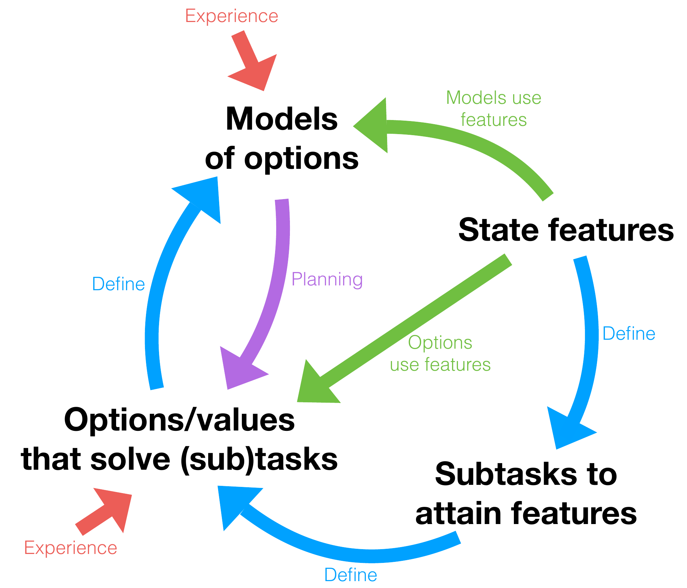

# OaK (Options and Knowledge)

[The Alberta Plan for AI Research](https://arxiv.org/abs/2208.11173) — Richard S. Sutton, Michael Bowling, and Patrick M. Pilarski.

Cycle of discovery from Richard S. Sutton's [Alberta Plan slides, slide 11](http://incompleteideas.net/Talks/AlbertaPlan.pdf#page=11).

Recorded on a binned M4 Max.

## Base

Geometry: 32 percepts, 480 features (96 active per step), 32 options; 200,160 total parameters (6 action dimensions). 633,097 SPS.

| Environment | OaK mean | OaK IQM | PPO mean | PPO IQM | Random mean | Random IQM | OaK vs PPO wins | OaK vs Random wins | PPO vs Random wins |
|---|---:|---:|---:|---:|---:|---:|---:|---:|---:|
| Acrobot-cont-v0 | 0.0059618 | 0.00592066 | 0.00885534 | 0.00909559 | 0.000386531 | 0.000385812 | 3.12% | 100.00% | 98.44% |
| Chain-cont-v0 | 0.0654791 | 0.0655594 | 0.0664122 | 0.0664692 | 0.00417067 | 0.00417069 | 1.56% | 100.00% | 100.00% |
| DeepSea-cont-v0 | 0.140243 | 0.140262 | 0.0938155 | 0.117435 | 0.000500562 | 0.000500166 | 93.75% | 100.00% | 70.31% |
| DelayedChain-cont-v0 | 0.0308337 | 0.030964 | 0.0274261 | 0.0321192 | 0.00101069 | 0.00101266 | 18.75% | 100.00% | 87.50% |
| FourRooms-cont-v0 | 0.0063565 | 0.00665075 | 0.104155 | 0.104583 | 0.0026182 | 0.00262144 | 0.00% | 84.38% | 100.00% |
| HalfCheetah-v4 | 1.5768 | 1.50755 | 3.18892 | 3.28864 | -0.309297 | -0.30943 | 7.81% | 100.00% | 100.00% |
| HighDimMaze-cont-v0 | 0.00747594 | 0.00742872 | 0.0462514 | 0.0562211 | 0.00204973 | 0.00205053 | 20.31% | 100.00% | 79.69% |
| JellyBeanWorld-cont-v0 | 1.31563e-05 | 8.3125e-06 | 0.000107281 | 5.45e-05 | 7.8125e-07 | 9.375e-08 | 21.88% | 60.94% | 82.81% |
| KeyCorridor-cont-v0 | 0.0479658 | 0.0502806 | 0.0914313 | 0.101761 | 0.00369542 | 0.00369712 | 9.38% | 100.00% | 100.00% |
| LargeDeepSea-cont-v0 | 0.00103251 | -0.000207463 | -2.21188e-06 | -1.53514e-06 | -0.000309996 | -0.000310154 | 4.69% | 100.00% | 100.00% |
| MemoryChain-cont-v0 | 0.0208138 | 0.0213984 | 0.0121761 | 0.0144191 | 0.000503094 | 0.0005005 | 96.88% | 100.00% | 87.50% |
| MountainCar-cont-v0 | 0.00486516 | 0.00510931 | 0.00396341 | 0.00466794 | 2.40469e-05 | 2.40625e-05 | 40.62% | 98.44% | 74.22% |
| MultiKeyCorridor-cont-v0 | 0.00434253 | 0.00431931 | 0.0192767 | 0.0215977 | 0.000716188 | 0.000717531 | 40.62% | 100.00% | 60.94% |
| POMaze-cont-v0 | 0.00308941 | 0.00246344 | 0.0333905 | 0.0268092 | 0.00153345 | 0.00153422 | 51.56% | 50.00% | 48.44% |
| Pendulum-cont-v0 | -0.487612 | -0.188046 | -0.0671477 | -0.0109328 | -3.89198 | -3.88951 | 20.31% | 96.88% | 100.00% |
| ProceduralMaze-cont-v0 | 0.000277875 | 0.000178719 | 7.25e-06 | 4.125e-06 | 0.000730344 | 0.000734781 | 100.00% | 9.38% | 0.00% |
| Total | 0.0892461 | 0.0104641 | 0.226815 | 0.0237883 | -0.261478 | 0.000676238 | 33.20% | 87.50% | 80.62% |

## Max

Geometry: 128 percepts, 1920 features (384 active per step), 128 options; 3,196,800 total parameters (6 action dimensions). 70,500 SPS.

| Environment | OaK mean | OaK IQM | PPO mean | PPO IQM | Random mean | Random IQM | OaK vs PPO wins | OaK vs Random wins | PPO vs Random wins |
|---|---:|---:|---:|---:|---:|---:|---:|---:|---:|
| Acrobot-cont-v0 | 0.00623984 | 0.00621806 | 0.00885534 | 0.00909559 | 0.000386531 | 0.000385812 | 3.12% | 100.00% | 98.44% |
| Chain-cont-v0 | 0.0614325 | 0.0611498 | 0.0664122 | 0.0664693 | 0.00417067 | 0.00417069 | 0.00% | 100.00% | 100.00% |
| DeepSea-cont-v0 | 0.139246 | 0.139274 | 0.0938155 | 0.117435 | 0.000500562 | 0.000500166 | 81.25% | 100.00% | 70.31% |
| DelayedChain-cont-v0 | 0.0286496 | 0.0289768 | 0.0274261 | 0.0321192 | 0.00101069 | 0.00101266 | 17.19% | 100.00% | 87.50% |
| FourRooms-cont-v0 | 0.0411696 | 0.039882 | 0.104155 | 0.104583 | 0.0026182 | 0.00262144 | 0.00% | 92.19% | 100.00% |
| HalfCheetah-v4 | 1.89573 | 1.89664 | 3.18892 | 3.28864 | -0.309297 | -0.30943 | 4.69% | 100.00% | 100.00% |
| HighDimMaze-cont-v0 | 0.0112135 | 0.0109925 | 0.0462514 | 0.0562211 | 0.00204973 | 0.00205053 | 20.31% | 98.44% | 79.69% |
| JellyBeanWorld-cont-v0 | 3.40625e-06 | 6.5625e-07 | 0.000107281 | 5.45e-05 | 7.8125e-07 | 9.375e-08 | 21.09% | 53.91% | 82.81% |
| KeyCorridor-cont-v0 | 0.0817751 | 0.0820811 | 0.0914313 | 0.101761 | 0.00369542 | 0.00369712 | 21.88% | 100.00% | 100.00% |
| LargeDeepSea-cont-v0 | 0.00250593 | -0.000237421 | -2.21188e-06 | -1.53514e-06 | -0.000309996 | -0.000310154 | 7.81% | 100.00% | 100.00% |
| MemoryChain-cont-v0 | 0.0141778 | 0.0153223 | 0.0121761 | 0.0144191 | 0.000503094 | 0.0005005 | 64.06% | 100.00% | 87.50% |
| MountainCar-cont-v0 | 0.00471916 | 0.00494094 | 0.00396341 | 0.00466794 | 2.40469e-05 | 2.40625e-05 | 42.19% | 98.44% | 74.22% |
| MultiKeyCorridor-cont-v0 | 0.0130946 | 0.0132551 | 0.0192767 | 0.0215977 | 0.000716188 | 0.000717531 | 42.19% | 100.00% | 60.94% |
| POMaze-cont-v0 | 0.0442407 | 0.0556851 | 0.0333905 | 0.0268092 | 0.00153345 | 0.00153422 | 53.12% | 82.81% | 48.44% |
| Pendulum-cont-v0 | -0.359302 | -0.0813364 | -0.0671477 | -0.0109328 | -3.89198 | -3.88951 | 14.06% | 98.44% | 100.00% |
| ProceduralMaze-cont-v0 | 0.000409828 | 7.91562e-05 | 7.25e-06 | 4.125e-06 | 0.000730344 | 0.000734781 | 99.22% | 15.62% | 0.00% |
| Total | 0.124081 | 0.0199637 | 0.226815 | 0.0237883 | -0.261478 | 0.000676238 | 30.76% | 89.99% | 80.62% |

## Setup and run

Requires macOS 26+, Xcode with Metal tools, Python 3.11, and Bun. Benchmark recordings stay local and are ignored by Git. From the repo root: `./setup.sh --preset base` builds the engine and the page, then `./fleet.py run` records a candidate. Everything is served by one process, `.build/release/OaK`, which `./fleet.py` starts; open http://127.0.0.1:5174. For page development, `cd frontend && bun run dev` and open http://localhost:5173.

Geometry is agent capacity, declared in `Sources/Geometry.metal`; larger presets use more compute and memory. Wide streams increase percept and feature counts above these declared sizes. Total parameters = features × [1 + options × (7 + action dimensions)]; counts below use 6 action dimensions.

| Preset | Percepts | Features | Active per step | Options | Total parameters |
| --- | ---: | ---: | ---: | ---: | ---: |
| base | 32 | 480 | 96 | 32 | 200,160 |
| pro | 64 | 960 | 192 | 64 | 799,680 |
| max | 128 | 1920 | 384 | 128 | 3,196,800 |
| ultra | 160 | 2400 | 480 | 160 | 4,994,400 |
