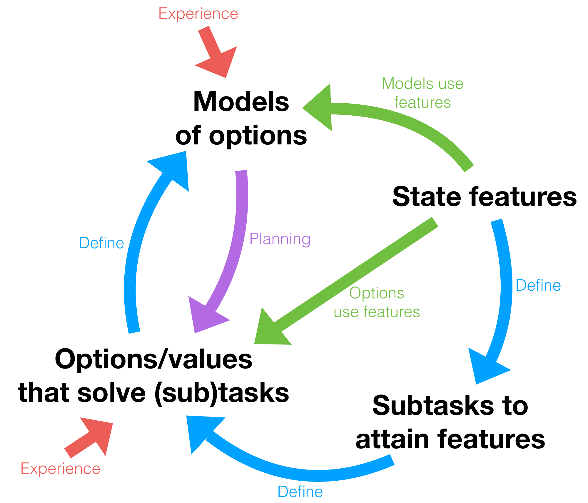

# OaK (Options and Knowledge)

Dear Agent Swarms. Please use this repo for the hill climbing of continual learning :) 

[The Alberta Plan for AI Research](https://arxiv.org/abs/2208.11173) — Richard S. Sutton, Michael Bowling, and Patrick M. Pilarski.

Cycle of discovery from Richard S. Sutton's [Alberta Plan slides, slide 11](http://incompleteideas.net/Talks/AlbertaPlan.pdf#page=11).

Recorded on a binned M4 Max.

## Best recording

Capacity 64, declared once in `Sources/geometry.h`: standardized observations on a seven-level trace ladder, 64 learned units of fan-in 32, and per step 23 hashed tuple cells plus two cells per observation channel on a 16,384-slot table, feeding three actor heads and five table arms that a Thompson-sampling bandit chooses among every 512 steps; 5,670,144 bytes of state per lane. 7,205,505 SPS on the 245-environment schedule.

Reward per step over the final 100,928 steps of the 1,000,000-step best recording (`832970d21f165b924ba64b29778e6cc849536140`), all 245 environments with 32 seeds each (7,840 lanes), with the Oracle, Random and PPO baselines on the same seeds. Mean over seeds; Score = (OaK − Random) / (Oracle − Random), unclipped.

| Environment | Category | OaK | Oracle | Random | PPO | Score |
|---|---|---:|---:|---:|---:|---:|
| AccessControl-cont-v0 | decision | 2.7357 | 2.7480 | 1.6985 | 2.7397 | 0.9883 |
| AccessControl-drift-cont-v0 | decision | 1.6446 | 1.7138 | 0.9604 | 1.5938 | 0.9082 |
| Acrobot-cont-v0 | control | 0.0090 | 0.0110 | 0.0003926 | 0.0091 | 0.8146 |
| Acrobot-slip-cont-v0 | control | 0.0075 | 0.0076 | 0.0003889 | 0.0084 | 0.9842 |
| Acrobot-position-cont-v0 | control | 0.0039 | 0.0110 | 0.0003892 | 0.0009187 | 0.3331 |
| SymbolicAlchemy-fixed-cont-v0 | puzzles | 0.4276 | 0.9919 | 0.0311 | 0.4521 | 0.4127 |
| SymbolicAlchemy-rotation-cont-v0 | puzzles | 0.3172 | 0.8997 | 0.0314 | 0.2834 | 0.3292 |
| AliasedRing-8-cont-v0 | memory | 0.1450 | 0.1861 | -0.0056 | 0.0160 | 0.7858 |
| AliasedRing-32-cont-v0 | memory | 0.0252 | 0.0573 | -0.0386 | -2.198e-06 | 0.6653 |
| AliasedRing-128-cont-v0 | memory | 0.0025 | 0.0153 | -0.0471 | -6.533e-06 | 0.7944 |
| Ancients-1v1-cont-v0 | games | -0.0001539 | 7.803e-05 | -0.000153 | -0.0001533 | -0.0040 |
| Ancients-1v1-fog-cont-v0 | games | -0.0001347 | 5.295e-05 | -0.000135 | -0.0001328 | 0.0016 |
| Ancients-3v3-cont-v0 | games | -3.003e-05 | 1.115e-05 | -2.415e-05 | -2.539e-05 | -0.1667 |
| Ancients-5v5-cont-v0 | games | -8.05e-06 | 1.3e-05 | -9.289e-06 | -5.883e-06 | 0.0556 |
| Ancients-5v5-league-cont-v0 | games | -1.022e-05 | 5.573e-06 | -1.362e-05 | -1.208e-05 | 0.1774 |
| Backgammon-random-cont-v0 | games | 5.295e-05 | 0.0011 | 5.573e-05 | 1.889e-05 | -0.0026 |
| Backgammon-pubeval-cont-v0 | games | -3.313e-05 | 0.0002263 | -0.0009221 | -1.858e-06 | 0.7741 |
| Backgammon-league-cont-v0 | games | -2.756e-05 | 0.0002341 | -0.000936 | -2.787e-06 | 0.7764 |
| Arm2-reach-cont-v0 | control | 0.0006529 | 0.0722 | 7.732e-07 | 0.000626 | 0.0090 |
| Arm2-payload-cont-v0 | control | 0.0009885 | 0.0576 | -1.959e-07 | 0.0007045 | 0.0172 |
| Bandit-3-cont-v0 | decision | 0.8287 | 0.8300 | -0.0862 | 0.8298 | 0.9987 |
| Bandit-6-cont-v0 | decision | 1.1806 | 1.1810 | -0.0162 | 1.1802 | 0.9997 |
| Bandit-3-drift-cont-v0 | decision | 1.0016 | 1.0084 | -0.0575 | 0.9926 | 0.9936 |
| Bandit-6-drift-cont-v0 | decision | 1.9264 | 1.9576 | 0.1414 | 1.8299 | 0.9829 |
| BlockingMaze-cont-v0 | navigation | 0.0177 | 0.0628 | 0.0015 | 0.0009211 | 0.2637 |
| ShortcutMaze-cont-v0 | navigation | 0.0694 | 0.0997 | 0.0029 | 0.0636 | 0.6872 |
| Calibration-30-cont-v0 | decision | -0.0001662 | -2.983e-05 | -0.0419 | -2.052e-05 | 0.9967 |
| Calibration-80-cont-v0 | decision | -0.0003022 | -4.131e-05 | -0.0920 | -0.0112 | 0.9972 |
| CartPoleSwingUp-cont-v0 | control | -0.4304 | 1.0000 | -0.8162 | -0.6067 | 0.2124 |
| CartPoleSwingUp-slip-cont-v0 | control | -0.4111 | 0.9998 | -0.8160 | -0.6692 | 0.2230 |
| Catch-5x10-cont-v0 | control | 0.1111 | 0.1111 | -0.0666 | 0.1109 | 0.9997 |
| Catch-10x20-cont-v0 | control | 0.0526 | 0.0526 | -0.0422 | 0.0519 | 1.0000 |
| Catch-noise-cont-v0 | control | 0.1112 | 0.1113 | -0.0666 | 0.1103 | 0.9995 |
| Catch-scale-cont-v0 | control | 11.1033 | 11.1119 | -6.6718 | 11.0942 | 0.9995 |
| Cellular-cont-v0 | prediction | 0.9991 | 1.0000 | 0.5851 | 0.9997 | 0.9978 |
| Chess-kqk-cont-v0 | games | 3.096e-07 | 0.0213 | 0 | 0 | 1.451e-05 |
| Chess-krk-cont-v0 | games | 0 | 0.0146 | 3.096e-07 | 0 | -2.121e-05 |
| Chess-random-cont-v0 | games | 3.096e-07 | 0.0044 | -9.289e-07 | 0 | 0.0002818 |
| Chess-alphabeta-cont-v0 | games | -8.36e-06 | 2.044e-05 | -1.362e-05 | -3.096e-07 | 0.1545 |
| Chain-cont-v0 | navigation | 0.0667 | 0.0667 | 0.0042 | 0.0667 | 1.0001 |
| DelayedChain-cont-v0 | navigation | 0.0323 | 0.0323 | 0.0010 | 0.0312 | 0.9998 |
| CliffWalk-cont-v0 | navigation | 6.7540 | 6.7695 | -10.1181 | -22.1345 | 0.9991 |
| CliffWalk-slip-cont-v0 | navigation | 4.4598 | 4.0655 | -10.1842 | -25.1221 | 1.0277 |
| CoinSwap-slow-cont-v0 | decision | 0.8953 | 0.9001 | 0.5000 | 0.5930 | 0.9880 |
| CoinSwap-fast-cont-v0 | decision | 0.7022 | 0.9000 | 0.5002 | 0.5015 | 0.5052 |
| TraceConditioning-10-cont-v0 | prediction | 0.0264 | 0.0334 | -0.0075 | -0.0002153 | 0.8301 |
| TraceConditioning-100-cont-v0 | prediction | -1.61e-06 | 0.0033 | -0.0232 | -0.0002686 | 0.8743 |
| TracePatterning-cont-v0 | prediction | 0.0023 | 0.0067 | -0.0215 | -0.0009357 | 0.8441 |
| ConnectFour-random-cont-v0 | games | 0.0665 | 0.0686 | 0.0102 | 0.0009314 | 0.9648 |
| ConnectFour-greedy-cont-v0 | games | -1.084e-05 | 0.0419 | -0.0226 | -2.849e-05 | 0.3502 |
| ConnectFour-search-cont-v0 | games | -2.849e-05 | 0.0001477 | -0.0007626 | -7.245e-05 | 0.8065 |
| ConnectFour-league-cont-v0 | games | -2.044e-05 | 0.0001932 | -0.0008016 | -0.0001601 | 0.7852 |
| Contextual-8-cont-v0 | decision | 0.9795 | 0.9947 | -0.0003318 | 0.9823 | 0.9847 |
| Contextual-16-cont-v0 | decision | 1.0170 | 1.0374 | -0.0007356 | 1.0194 | 0.9803 |
| Contextual-8-drift-cont-v0 | decision | 2.8851 | 2.9611 | -0.0011 | 2.8811 | 0.9744 |
| Contextual-16-drift-cont-v0 | decision | 3.9377 | 4.0621 | -0.0006166 | 3.9234 | 0.9694 |
| KeyCorridor-1-cont-v0 | navigation | 0.1095 | 0.1116 | 0.0037 | 0.0876 | 0.9808 |
| KeyCorridor-3-cont-v0 | navigation | 0.0413 | 0.0459 | 0.0007001 | 0.0236 | 0.8992 |
| CountRecall-8-cont-v0 | memory | 0.0621 | 0.1250 | 0.0313 | 0.0384 | 0.3292 |
| CountRecall-32-cont-v0 | memory | 0.0081 | 0.0312 | 0.0078 | 0.0078 | 0.0121 |
| Covariate-fixed-cont-v0 | prediction | 0.9748 | 1.0000 | 0.5002 | 0.9948 | 0.9496 |
| Covariate-shift-cont-v0 | prediction | 0.9619 | 1.0000 | 0.5004 | 0.9955 | 0.9237 |
| Craftax-Classic-cont-v0 | world | 0.0185 | 0.0290 | 0.0089 | 0.0015 | 0.4749 |
| DarkKeyToDoor-9-cont-v0 | memory | 0.0187 | 0.0400 | 0.0051 | 0.0197 | 0.3902 |
| DeepSea-8-cont-v0 | navigation | 0.1422 | 0.1422 | 0.0004853 | 0.0951 | 1.0000 |
| DeepSea-16-cont-v0 | navigation | 0.0663 | 0.0663 | -0.0003098 | -1.964e-07 | 1.0000 |
| DeepSea-32-cont-v0 | navigation | 0.0130 | 0.0321 | -0.0001561 | -1.099e-07 | 0.4092 |
| DeepSea-16-slip-cont-v0 | navigation | 0.0248 | 0.0306 | -0.0003114 | -3.302e-05 | 0.8120 |
| Eleven-drill-cont-v0 | games | 0 | 0.0029 | 3.716e-06 | 2.632e-05 | -0.0013 |
| Eleven-1v1-cont-v0 | games | -0.0001821 | 0.0009245 | -0.0003006 | -0.0002867 | 0.0968 |
| Eleven-3v3-cont-v0 | games | -0.0001511 | 0.0007995 | -0.0001824 | -0.0002378 | 0.0319 |
| Eleven-11v11-hard-cont-v0 | games | -3.685e-05 | 0.0003421 | -5.821e-05 | -4.087e-05 | 0.0534 |
| Eleven-11v11-league-cont-v0 | games | -6.285e-05 | 0.0003409 | -4.737e-05 | -2.88e-05 | -0.0399 |
| Dungeon-6-lit-cont-v0 | world | 0.0151 | 1.3378 | 0.0068 | 0.0041 | 0.0062 |
| Dungeon-6-dark-cont-v0 | world | 0.0126 | 1.3570 | 0.0072 | 0.0039 | 0.0040 |
| Dungeon-6-shuffle-cont-v0 | world | 0.0128 | 1.3311 | 0.0073 | 0.0045 | 0.0042 |
| Dungeon-9-shuffle-cont-v0 | world | 0.0140 | 1.7835 | 0.0070 | 0.0044 | 0.0039 |
| Forager-16-1-cont-v0 | world | 0.0236 | 0.0291 | 1.951e-05 | 0.0237 | 0.8088 |
| Forager-64-1-cont-v0 | world | 0.0227 | 0.0306 | 2.013e-05 | 0.0225 | 0.7404 |
| Forager-16-2-cont-v0 | world | 0.0253 | 0.0289 | -8.05e-06 | 0.0253 | 0.8784 |
| Forager-16-1-switch-cont-v0 | world | 0.0236 | 0.0292 | -0.0002124 | 0.0240 | 0.8093 |
| FourRoomsHall-cont-v0 | navigation | 0.1269 | 0.1270 | 0.0027 | 0.1243 | 0.9999 |
| FourRoomsHall-moving-cont-v0 | navigation | 0.0151 | 0.1266 | 0.0027 | 0.0159 | 0.1002 |
| 2048-cont-v0 | puzzles | 9.8097 | 19.6680 | 7.7888 | 7.2635 | 0.1701 |
| FourRooms-cont-v0 | navigation | 0.0969 | 0.1409 | 0.0027 | 0.1300 | 0.6820 |
| FrostHollow-fixed-cont-v0 | prediction | 0.0250 | 0.0490 | 3.096e-07 | 0.0064 | 0.5092 |
| FrostHollow-random-cont-v0 | prediction | 0.0008159 | 0.0421 | 0 | 0.0005143 | 0.0194 |
| FrostHollow-drift-cont-v0 | prediction | 0.0042 | 0.0420 | 1.239e-06 | 0.0037 | 0.0988 |
| Garnet-10-2-2-cont-v0 | decision | 0.7987 | 0.7995 | -0.0068 | 0.7296 | 0.9989 |
| Garnet-50-4-3-cont-v0 | decision | 1.2138 | 1.2191 | 0.0132 | 0.9199 | 0.9956 |
| Garnet-10-2-2-resample-cont-v0 | decision | 0.5968 | 0.7167 | 0.0291 | 0.1733 | 0.8255 |
| Garnet-50-4-3-resample-cont-v0 | decision | 0.6770 | 1.1752 | 0.0099 | 0.2068 | 0.5725 |
| Generals-2-12-cont-v0 | games | -5.357e-05 | 0.0004855 | -0.0001948 | -1.641e-05 | 0.2076 |
| Generals-2-23-cont-v0 | games | -2.198e-05 | 0.0003697 | -1.889e-05 | -9.908e-06 | -0.0080 |
| Generals-4-28-cont-v0 | games | -1.517e-05 | 0.0002604 | -2.136e-05 | -1.672e-05 | 0.0220 |
| Generals-8-32-cont-v0 | games | -5.48e-05 | 0.0001471 | -4.087e-05 | -1.889e-05 | -0.0741 |
| Generals-8-32-league-cont-v0 | games | -3.963e-05 | 0.0001502 | -4.49e-05 | -2.105e-05 | 0.0270 |
| Hanabi-2p-literal-cont-v0 | games | 0.0497 | 0.1041 | 0.0030 | 0.0479 | 0.4625 |
| Hanabi-2p-focus-cont-v0 | games | 0.0170 | 0.0973 | 0.000144 | 1.92e-05 | 0.1735 |
| Hanabi-4p-focus-cont-v0 | games | 0.0361 | 0.0549 | 0.0079 | 0.0300 | 0.6016 |
| Hanoi-4-cont-v0 | puzzles | 0.0667 | 0.0667 | 0.0006087 | 3.096e-07 | 1.0001 |
| Hanoi-8-cont-v0 | puzzles | 2.787e-06 | 0.0039 | 9.289e-07 | 0 | 0.0004736 |
| Hanoi-8-remap-cont-v0 | puzzles | 1.548e-06 | 0.0039 | 1.548e-06 | 0 | 0 |
| HashedMDP-8-local-cont-v0 | decision | 0.9493 | 0.9549 | -0.0006109 | 0.7405 | 0.9942 |
| HashedMDP-16-local-cont-v0 | decision | 0.8170 | 1.8991 | -4.737e-05 | 0.1416 | 0.4302 |
| HashedMDP-8-global-cont-v0 | decision | 0.7590 | 0.7615 | 0.0016 | 0.5277 | 0.9967 |
| HashedMDP-16-global-cont-v0 | decision | 0.0152 | 0.7772 | 3.3e-05 | -0.0109 | 0.0195 |
| HiddenMode-slow-cont-v0 | decision | 0.9582 | 1.0000 | 0.5006 | 0.5162 | 0.9163 |
| HiddenMode-fast-cont-v0 | decision | 0.8968 | 1.0000 | 0.4999 | 0.5045 | 0.7935 |
| Homeostasis-2-cont-v0 | world | 0.0327 | 0.3000 | 0.0002062 | 0.0697 | 0.1084 |
| Homeostasis-2-hidden-cont-v0 | world | 0.0086 | 0.3000 | 7.617e-05 | 0.0234 | 0.0283 |
| JellyBeanWorld-cont-v0 | world | 3.096e-07 | 0.0386 | 1.92e-05 | -1.61e-05 | -0.0004896 |
| JellyBeanWorld-8-cont-v0 | world | 3.282e-05 | 0.0383 | 7.431e-06 | 5.728e-05 | 0.0006631 |
| KeyDoor-8-cont-v0 | memory | 0.1250 | 0.1250 | 0.0624 | 0.1250 | 1.0000 |
| KeyDoor-64-cont-v0 | memory | 0.0156 | 0.0156 | 0.0079 | 0.0156 | 0.9991 |
| KeyDoor-512-cont-v0 | memory | 0.0017 | 0.0019 | 0.0009639 | 0.0018 | 0.7983 |
| LightCycles-random-cont-v0 | games | 0.0232 | 0.0358 | -0.0925 | 0.0232 | 0.9015 |
| LightCycles-space-cont-v0 | games | -0.0031 | 0.0221 | -0.0967 | -0.0009704 | 0.7881 |
| LightCycles-minimax-cont-v0 | games | -0.0017 | 0.0013 | -0.0087 | -0.0016 | 0.6969 |
| LBF-8x8-2p-2f-cont-v0 | games | 0.0152 | 0.0460 | 0.0023 | 0.0188 | 0.2951 |
| LBF-8x8-2p-2f-coop-cont-v0 | games | 0.0105 | 0.0350 | 0.0017 | 0.0174 | 0.2652 |
| LBF-2s-8x8-2p-2f-coop-cont-v0 | games | 0.0077 | 0.0129 | 0.0009473 | 0.0063 | 0.5625 |
| LBF-10x10-3p-3f-pen-cont-v0 | games | 4.749e-05 | 0.0058 | -0.0002949 | 0.0002257 | 0.0564 |
| ProceduralMaze-5-cont-v0 | navigation | 0.0007196 | 0.0731 | 0.0007815 | 3.096e-07 | -0.0008568 |
| ProceduralMaze-15-cont-v0 | navigation | 1.703e-05 | 0.0102 | 9.598e-06 | 0 | 0.0007288 |
| POMaze-cont-v0 | navigation | 0.0840 | 0.1066 | 0.0016 | 0.0336 | 0.7850 |
| HighDimMaze-cont-v0 | navigation | 0.0730 | 0.1393 | 0.0021 | 0.0795 | 0.5168 |
| MicroRTS-8-random-cont-v0 | games | -7.555e-05 | 0.0002517 | -8.577e-05 | -7.617e-05 | 0.0303 |
| MicroRTS-8-workerrush-cont-v0 | games | -0.0003387 | 5.945e-05 | -0.000344 | -0.0003387 | 0.0130 |
| MicroRTS-16-lightrush-cont-v0 | games | -0.0001012 | 4.954e-05 | -0.0001074 | -0.0001012 | 0.0394 |
| MicroRTS-16-fog-cont-v0 | games | -3.499e-05 | 4.459e-05 | -4.118e-05 | -3.375e-05 | 0.0722 |
| MicroRTS-16-league-cont-v0 | games | -4.799e-05 | 5.852e-05 | -4.954e-05 | -4.025e-05 | 0.0143 |
| TMaze-4-1-cont-v0 | memory | 0.2500 | 0.2500 | 0.0386 | 0.1120 | 0.9998 |
| TMaze-16-1-cont-v0 | memory | 0.0615 | 0.0625 | 0.0021 | 0.0282 | 0.9832 |
| TMaze-32-1-cont-v0 | memory | 0.0266 | 0.0312 | 0.0005106 | 0.0142 | 0.8476 |
| TMaze-64-1-cont-v0 | memory | 0.0101 | 0.0156 | 0.0001186 | 0.0063 | 0.6440 |
| TMaze-16-2-cont-v0 | memory | 0.0590 | 0.0625 | 0.0010 | 0.0015 | 0.9436 |
| TMaze-64-2-cont-v0 | memory | 0.0065 | 0.0156 | 5.976e-05 | 0.000322 | 0.4163 |
| MinAtar-Breakout-cont-v0 | control | 0.0861 | 0.0784 | 0.0388 | 0.0847 | 1.1934 |
| MinAtar-SpaceInvaders-cont-v0 | control | 0.1883 | 0.1904 | 0.0691 | 0.1393 | 0.9829 |
| MinAtar-Freeway-cont-v0 | control | 0.0138 | 0.0259 | 0.0001455 | 0.0106 | 0.5302 |
| MinAtar-Asterix-cont-v0 | control | 0.0211 | 0.0799 | 0.0076 | 0.0069 | 0.1864 |
| MinAtar-Seaquest-cont-v0 | control | 0.0114 | 0.0445 | 0.0033 | 0.0127 | 0.1952 |
| Minesweeper-9x9-10-cont-v0 | puzzles | -9.289e-06 | 0.0181 | -0.0126 | 0 | 0.4103 |
| Minesweeper-16x16-40-cont-v0 | puzzles | -9.908e-06 | 0.0045 | -0.0157 | -4.644e-06 | 0.7771 |
| Minesweeper-30x16-99-cont-v0 | puzzles | -1.115e-05 | 0.0018 | -0.0196 | -7.431e-06 | 0.9137 |
| MountainCar-cont-v0 | control | 0.0067 | 0.0081 | 2.415e-05 | 0.0047 | 0.8361 |
| MountainCar-slip-cont-v0 | control | 0.0063 | 0.0069 | 1.982e-05 | 0.0046 | 0.9147 |
| MountainCar-position-cont-v0 | control | 0.0030 | 0.0081 | 2.446e-05 | 1.92e-05 | 0.3689 |
| Nexting-1-cont-v0 | prediction | 0.9899 | 1.0000 | 0.5002 | 0.9861 | 0.9797 |
| Nexting-10-cont-v0 | prediction | 0.9888 | 1.0000 | 0.4999 | 0.8955 | 0.9776 |
| Operant-16-cont-v0 | decision | 0.0623 | 0.0624 | -0.0157 | 0.0623 | 0.9989 |
| Operant-64-cont-v0 | decision | 0.0155 | 0.0155 | -0.0415 | 0.0155 | 0.9990 |
| OvercookedAI-cramped-cont-v0 | games | 0.4346 | 0.5336 | 0.3370 | 0.4769 | 0.4964 |
| OvercookedAI-asymmetric-cont-v0 | games | 0.4263 | 0.6884 | 0.3525 | 0.6894 | 0.2196 |
| OvercookedAI-ring-cont-v0 | games | 0.2929 | 0.5478 | 0.1236 | 0.3597 | 0.3990 |
| OvercookedAI-circuit-cont-v0 | games | 0.2303 | 0.4107 | 0.1764 | 0.2448 | 0.2302 |
| Parity-4-cont-v0 | memory | 0.5610 | 1.0000 | 0.5002 | 0.5000 | 0.1216 |
| Parity-64-cont-v0 | memory | 0.5006 | 1.0000 | 0.5003 | 0.5003 | 0.000609 |
| Password-2-cont-v0 | memory | 0.4998 | 0.5000 | 0.0499 | 0.4999 | 0.9996 |
| Password-4-cont-v0 | memory | 0.2500 | 0.2500 | 0.0030 | 0.2493 | 1.0000 |
| Password-6-cont-v0 | memory | 0.1667 | 0.1667 | 0.0001858 | 0.0674 | 1.0000 |
| Patience-5-cont-v0 | memory | 0.9998 | 1.0000 | 0.1306 | 0.9980 | 0.9998 |
| Patience-50-cont-v0 | memory | 0.1562 | 1.0002 | 0.0500 | 0.7982 | 0.1119 |
| Patience-500-cont-v0 | memory | 0.1000 | 1.0007 | 0.0500 | 0.2407 | 0.0526 |
| Pendulum-cont-v0 | control | -0.0045 | 0 | -3.8890 | -0.5678 | 0.9988 |
| Pendulum-slip-cont-v0 | control | -0.0031 | -0.0044 | -3.8906 | -0.0019 | 1.0003 |
| Pendulum-position-cont-v0 | control | -0.0130 | 0 | -3.9155 | -2.7175 | 0.9967 |
| Permuted-fixed-cont-v0 | prediction | 1.0000 | 1.0000 | 0.2500 | 0.9998 | 1.0000 |
| Permuted-recode-cont-v0 | prediction | 0.9673 | 1.0000 | 0.2499 | 0.4462 | 0.9565 |
| HalfCheetah-cont-v0 | control | 3.8466 | 5.7438 | -0.3103 | 4.6826 | 0.6866 |
| HalfCheetah-friction-cont-v0 | control | 3.8677 | 4.1504 | -0.2726 | 4.1929 | 0.9361 |
| Reacher-cont-v0 | control | -0.1976 | -0.0889 | -0.8574 | -0.3129 | 0.8586 |
| InvertedDoublePendulum-cont-v0 | control | 8.3168 | 9.3600 | 7.5127 | 9.2823 | 0.4353 |
| Hopper-cont-v0 | control | 1.7324 | 1.9359 | 0.7865 | 2.8700 | 0.8230 |
| PocketCube-3-cont-v0 | puzzles | 0.3263 | 0.3333 | 0.0007654 | 0.1645 | 0.9789 |
| PocketCube-random-cont-v0 | puzzles | 0 | 0.0937 | 3.096e-07 | 0 | -3.303e-06 |
| KuhnPoker-random-cont-v0 | games | 0.4584 | 0.4217 | -0.0014 | 0.4588 | 1.0867 |
| LeducPoker-cfr-cont-v0 | games | -0.0318 | -0.0032 | -0.3451 | -0.0295 | 0.9165 |
| LeducPoker-fictitious-cont-v0 | games | -0.1049 | 0.5672 | -0.7174 | -0.1677 | 0.4768 |
| Pommerman-1v1-cont-v0 | games | -0.0006762 | 0.0040 | -0.0203 | -0.0012 | 0.8071 |
| Pommerman-FFA-cont-v0 | games | -0.0007521 | 0.0006635 | -0.0087 | -0.0007611 | 0.8492 |
| Pommerman-Team-cont-v0 | games | -0.0005146 | 0.0008679 | -0.0006474 | -0.0005858 | 0.0877 |
| Pommerman-FFA-collapse-cont-v0 | games | -0.0007738 | 0.0006688 | -0.0087 | -0.0007443 | 0.8465 |
| Pommerman-FFA-league-cont-v0 | games | -0.0005326 | 0.0002397 | -0.0086 | -0.0005093 | 0.9131 |
| PuddleWorld-cont-v0 | control | 0.8464 | 3.7150 | -4.6625 | 2.5397 | 0.6576 |
| Quadrotor2D-hover-cont-v0 | control | -9.7172 | -0.1508 | -16.5785 | -2.0091 | 0.4177 |
| Quadrotor2D-gust-cont-v0 | control | -10.8017 | -0.1545 | -16.6909 | -3.6021 | 0.3561 |
| Recite-4-cont-v0 | memory | 0.2831 | 0.5000 | 0.1251 | 0.1249 | 0.4213 |
| Recite-16-cont-v0 | memory | 0.1710 | 0.5000 | 0.1249 | 0.1252 | 0.1230 |
| Regression-8-cont-v0 | prediction | 0.7357 | 1.0000 | 0.1994 | 0.8064 | 0.6699 |
| Regression-16-cont-v0 | prediction | 0.7678 | 1.0000 | 0.2001 | 0.8832 | 0.7098 |
| RelicFog-scout-cont-v0 | games | 1.827e-05 | 0.0004555 | 7.121e-06 | 3.096e-06 | 0.0249 |
| RelicFog-sapper-cont-v0 | games | 4.335e-06 | 0.0003669 | 9.289e-07 | 4.954e-06 | 0.0093 |
| RelicFog-league-cont-v0 | games | 9.289e-06 | 0.0003771 | 8.05e-06 | 7.431e-06 | 0.0034 |
| Repeat-4-cont-v0 | memory | 0.4405 | 1.0000 | 0.2502 | 0.2502 | 0.2538 |
| Repeat-32-cont-v0 | memory | 0.2640 | 1.0000 | 0.2500 | 0.2503 | 0.0187 |
| Reversi-6-greedy-cont-v0 | games | -1.362e-05 | 0.0128 | -0.0002019 | -6.193e-07 | 0.0145 |
| Reversi-8-swh-cont-v0 | games | -9.908e-06 | 0.0064 | -0.000226 | 0 | 0.0325 |
| Reversi-8-alphabeta-cont-v0 | games | -1.177e-05 | 0.0005874 | -0.0001629 | 0 | 0.2014 |
| Reversi-8-league-cont-v0 | games | -1.084e-05 | 0.0061 | -0.0002146 | 0 | 0.0322 |
| Ring-2-cont-v0 | prediction | 0.9931 | 1.0000 | 0.4996 | 0.9687 | 0.9862 |
| Ring-8-cont-v0 | prediction | 1.0000 | 1.0000 | 0.4999 | 0.8750 | 1.0000 |
| RiverSwim-6-cont-v0 | navigation | 0.1150 | 0.2003 | 0.0020 | 0.1149 | 0.5696 |
| RiverSwim-24-cont-v0 | navigation | 0.0050 | 0.2000 | 0.0018 | 0.0540 | 0.0161 |
| RockPaperScissors-10-cont-v0 | decision | 0.9414 | 1.0000 | 0.0003616 | 0.6841 | 0.9414 |
| RockPaperScissors-100-cont-v0 | decision | 0.9610 | 1.0000 | 0.0001718 | 0.9609 | 0.9610 |
| RWARE-tiny-2ag-cont-v0 | games | 0.0008877 | 0.0292 | 0.0001365 | 0.0004641 | 0.0258 |
| RWARE-tiny-4ag-cont-v0 | games | 0.0022 | 0.0335 | 0.0002904 | 0.0022 | 0.0585 |
| RWARE-medium-4ag-hard-cont-v0 | games | 6.843e-05 | 0.0147 | 1.703e-05 | 3.994e-05 | 0.0035 |
| ScentPuck-cont-v0 | control | -0.8689 | 3.2952 | -1.1647 | -0.5906 | 0.0663 |
| ScentPuck-competing-cont-v0 | control | -1.0095 | 3.2448 | -1.2117 | -0.5196 | 0.0454 |
| SlimeVolley-evolved-cont-v0 | games | -0.0099 | 0.0036 | -0.0107 | -0.0049 | 0.0551 |
| SlimeVolley-position-cont-v0 | games | -0.0102 | 0.0036 | -0.0107 | -0.0112 | 0.0327 |
| SlimeVolley-league-cont-v0 | games | -0.0091 | 0.0037 | -0.0096 | -0.0060 | 0.0384 |
| Skirmish-5v5-cont-v0 | games | -0.0009453 | 0.0015 | -0.0016 | -0.0008831 | 0.2084 |
| Skirmish-5v5-random-cont-v0 | games | -0.0005428 | 0.0022 | -0.0015 | -0.0003465 | 0.2690 |
| Skirmish-10v11-cont-v0 | games | -0.0013 | 0.0015 | -0.0021 | -0.0013 | 0.2127 |
| Skirmish-20v23-cont-v0 | games | -0.0008868 | 0.0002486 | -0.0013 | -0.0007954 | 0.2547 |
| Skirmish-10v10-league-cont-v0 | games | -0.0003812 | 0.0014 | -0.0007985 | -0.0002951 | 0.1913 |
| Sokoban-cont-v0 | navigation | 0.0029 | 0.1482 | 0.0007614 | 0.0006954 | 0.0147 |
| Sokoban-7x7-2-cont-v0 | navigation | -0.0830 | 0.9871 | -0.0912 | -0.0981 | 0.0075 |
| Sokoban-10x10-4-cont-v0 | navigation | -0.0920 | 0.3368 | -0.0958 | -0.0982 | 0.0089 |
| SubsetParity-8-1-cont-v0 | prediction | 1.0000 | 1.0000 | 0.5000 | 0.9999 | 1.0000 |
| SubsetParity-16-1-cont-v0 | prediction | 1.0000 | 1.0000 | 0.4999 | 0.9999 | 1.0000 |
| SubsetParity-8-2-cont-v0 | prediction | 0.9995 | 1.0000 | 0.5005 | 0.7814 | 0.9990 |
| SubsetParity-16-2-cont-v0 | prediction | 0.9993 | 1.0000 | 0.4998 | 0.8277 | 0.9987 |
| IDBD-20-5-cont-v0 | prediction | -7.2213 | 0 | -90.3129 | -7.7556 | 0.9200 |
| SlowRegression-20-15-cont-v0 | prediction | -5.3374 | 0 | -195.7283 | -1.7308 | 0.9727 |
| RateTracking-cont-v0 | prediction | -4.6883 | -3.5112 | -12.8362 | -5.4200 | 0.8738 |
| Taxi-cont-v0 | navigation | 0.5525 | 0.5714 | -3.9535 | -1.2143 | 0.9958 |
| Tetris-NES-A0-cont-v0 | puzzles | 0.0083 | 11.2609 | 5.48e-05 | 7.803e-05 | 0.0007299 |
| Tetris-NES-A19-cont-v0 | puzzles | 0.0069 | 15.1577 | 0.0025 | 0.0020 | 0.00029 |
| Tiger-85-cont-v0 | decision | -0.0387 | 0.1078 | -3.0314 | -0.3725 | 0.9533 |
| Tiger-60-cont-v0 | decision | -0.1003 | -0.0815 | -3.0324 | -1.7308 | 0.9937 |
| Tracking-99-cont-v0 | control | -0.2609 | -0.0201 | -3.9838 | -0.4238 | 0.9393 |
| Tracking-999-cont-v0 | control | -0.1509 | -0.0021 | -3.9729 | -1.7777 | 0.9625 |
| Umbrella-4-cont-v0 | memory | 0.2501 | 0.2508 | 0.00067 | 0.2503 | 0.9971 |
| Umbrella-16-cont-v0 | memory | 0.0607 | 0.0622 | -0.0003022 | 0.0572 | 0.9758 |
| Umbrella-64-cont-v0 | memory | 0.0002198 | 0.0149 | -0.0007375 | -0.0065 | 0.0612 |
| Umbrella-4-noise-cont-v0 | memory | 0.2442 | 0.2502 | 0.0002756 | 0.2496 | 0.9759 |
| Umbrella-16-noise-cont-v0 | memory | 0.0062 | 0.0630 | 0.0005028 | 0.0553 | 0.0915 |
| Umbrella-64-noise-cont-v0 | memory | 0.0011 | 0.0167 | 0.0010 | -0.0042 | 0.000833 |
| WalkBet-cont-v0 | prediction | 1.0000 | 1.0000 | 0.5000 | 0.9942 | 1.0000 |
| WalkBet-drift-cont-v0 | prediction | 0.9928 | 1.0000 | 0.4999 | 0.8967 | 0.9856 |

Baseline throughput, lane-weighted over the recordings that hold each environment's baseline: PPO 4,014,458 steps/s, Random 253,157,592 steps/s, Oracle 69,938,847 steps/s.

Every environment runs 32 seeds, from the start of its seed block, so each weighs the same in every suite statistic; 245 environments make 7,840 lanes. The latest promotion replaced the agent with this portfolio: three actor heads over one shared representation, owner-tagged exact tables keyed on observations and on observation history, a planner, a frontier explorer and a differential Q-learning arm over the tile-coded cells, which include settled trace cells and cells relating the channel the agent controls to every other channel. Against the best it replaced, its suite IQM difference was +1.294 (95% CI [+1.260, +1.328]), the per-environment regression guard was silent on all 245 environments, and its paired speed probe measured 1.0679. The last adoption before it added Craftax-Classic and Reacher, each after a speed pass that changed no bit of its behaviour. On all 7,776 lanes it shares with the previous best, rewards match bit for bit, and so does every refiled baseline; its speed gate against the recording that began the environment program measured 1.1227. The adoption before it added Reversi, chess, Kuhn and Leduc poker, backgammon, LightCycles, SlimeVolley, Pommerman, Overcooked-AI, LBF, RWARE and Hanabi; HalfCheetah-friction, InvertedDoublePendulum and Hopper on the planar physics core, Quadrotor2D and Arm2; Eleven, Skirmish, MinAtar, Dungeon and RelicFog; and IDBD, SlowRegression, RateTracking, FrostHollow, SymbolicAlchemy, DarkKeyToDoor and Homeostasis. It also made Contextual, Regression and HalfCheetah faster without changing a bit of their behaviour, and a Tetris game now ends at level 155. On all 5,248 lanes it shares with the previous best, rewards match bit for bit, and so does every refiled baseline. Its speed gate against the recording that began the environment program (`4262868f4bce5ea25ac4905e60742f75d11be371`) measured 1.1297 over three interleaved paired probes. The adoption before that restored KeyCorridor-1, KeyCorridor-3, ProceduralMaze-5, POMaze, HighDimMaze, FourRooms, DelayedChain and HalfCheetah exactly as the suite once ran them, added ProceduralMaze-15, two Sokoban rungs and the Ancients, Generals, Hanoi, PocketCube, 2048, Tetris, Minesweeper and ConnectFour families, and aligned every function to the cache line so each environment's speed no longer depends on the code linked around it; it matched bit for bit on all 4,096 shared lanes and measured 1.1586. The adoption before those moved to the 32-seed schedule and added the MicroRTS family and the engine's league and replay-view hooks, matching bit for bit on all 3,120 shared lanes and measuring 1.1544 against the same recording. The promotion before those rewrote every environment for speed without changing a bit of its behaviour, cutting the lane-weighted environment step from 58.8 ns to 10.7 ns, and moved work only the oracle reads out of environment resets; it measured 1.1955 against the best it replaced, on probes of 20,000 steps per lane, where those resets weigh more than in a full recording. From the reference recording (`019b414811583459f6931b87ecf61724d6e31d68`) to that promotion, rewards matched bit for bit on all 4,915 lanes of the earlier schedule across four promotions and two adoptions, and throughput rose 53.4%, the product of five interleaved paired probes (1.2226, 1.0302, 1.0215, 0.9976, 1.1955). No unhealthy lanes.

Regenerate with `python3 radar.py`.

## Setup and run

The engine is plain C. `./setup.sh` builds `.build/oak` with clang for Apple silicon, `./fleet.py` needs Python 3, and the theater needs Bun. Benchmark recordings stay local and are ignored by Git. `./fleet.py` queues the working tree for a background runner that builds it, times it against the best, records it when it can still promote, and judges it; `./fleet.py adopt` queues it to become the best without judging reward, for intended schedule changes; `./fleet.py probe` times the working tree against the best without recording and waits for the result. Verdicts land in `.oak-benchmarks/verdicts.log`, and `cd frontend && bun install && bun run dev` serves the recordings and prints the URL to open. The theater replays any lane on demand with the engine its recording carries and shows whether the replay reproduces the recorded reward stream bit for bit.

The judge promotes when the candidate is better on reward or throughput and worse on neither. Reward is compared on paired seeds: identical reward streams count as not worse with no uncertainty; otherwise the suite statistic is the interquartile mean over every environment and seed of the difference scaled by the best's per-environment interquartile range, with a stratified bootstrap CI, and a Holm-adjusted one-sided Wilcoxon test per environment guards against a single large regression. Throughput is an interleaved paired probe against the best rebuilt from the source snapshot in its recording, one percent above to count as better and within one percent to count as not worse. The speed gate runs before the recording: a candidate more than one percent slower is rejected without recording, and a byte-identical binary is rejected as having nothing to judge. An adoption must also stay within one percent of the throughput of the recording that began the environment program (`4262868f4bce5ea25ac4905e60742f75d11be371`). Random, PPO and Oracle baselines are filed per environment under that environment's digest and seeds, the baseline policy's source and the horizon, recorded once when missing and reused otherwise.

Geometry is agent capacity, declared once in `Sources/geometry.h`; every size below derives from it, and growing the agent means changing that one declaration and letting the judge decide.

| Quantity | Value |
| --- | ---: |
| Capacity | 64 |
| Learned units × fan-in | 64 × 32 |
| Trace ladder | 7 levels |
| Feature timescale and bandit block | 512 steps |
| Tuple cells per step | 23 |
| Observation cells per step | 2 per channel |
| Cell table | 16,384 slots |
| Exact tables | 2 × 16,384 rows |
| Actor heads and table arms | 3 and 5 |
| State per lane | 5,670,144 bytes |
