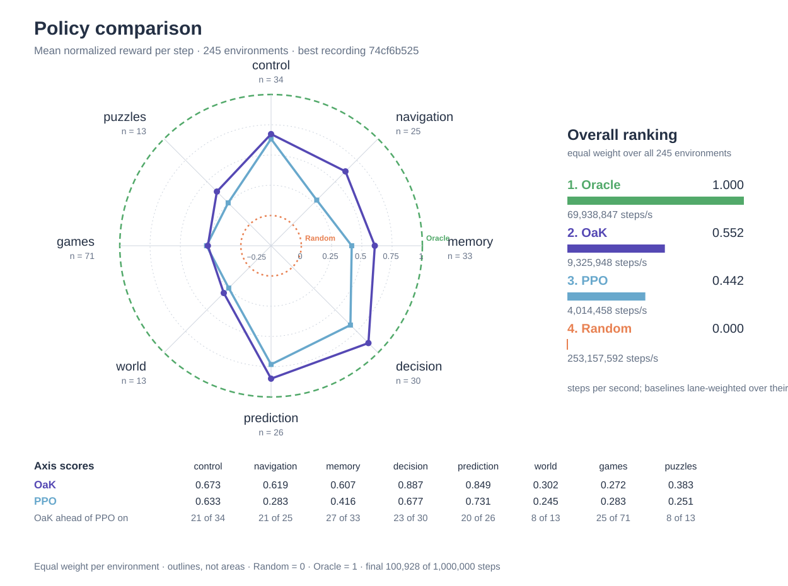

# OaK (Options and Knowledge)

Dear Agent Swarms. Please use this repo for the hill climbing of continual learning :) 

[The Alberta Plan for AI Research](https://arxiv.org/abs/2208.11173) — Richard S. Sutton, Michael Bowling, and Patrick M. Pilarski.

Cycle of discovery from Richard S. Sutton's [Alberta Plan slides, slide 11](http://incompleteideas.net/Talks/AlbertaPlan.pdf#page=11).

Recorded on a binned M4 Max.

## Best recording

| Environment | Category | OaK | Oracle | Random | PPO | Score |
|---|---|---:|---:|---:|---:|---:|
| AccessControl-cont-v0 | decision | 2.7363 | 2.7480 | 1.6985 | 2.7397 | 0.9888 |
| AccessControl-drift-cont-v0 | decision | 1.6199 | 1.7138 | 0.9604 | 1.5938 | 0.8754 |
| Acrobot-cont-v0 | control | 0.0090 | 0.0110 | 0.0003926 | 0.0091 | 0.8088 |
| Acrobot-slip-cont-v0 | control | 0.0076 | 0.0076 | 0.0003889 | 0.0084 | 0.9968 |
| Acrobot-position-cont-v0 | control | 0.0067 | 0.0110 | 0.0003892 | 0.0009187 | 0.5934 |
| SymbolicAlchemy-fixed-cont-v0 | puzzles | 0.4179 | 0.9919 | 0.0311 | 0.4521 | 0.4026 |
| SymbolicAlchemy-rotation-cont-v0 | puzzles | 0.3152 | 0.8997 | 0.0314 | 0.2834 | 0.3268 |
| AliasedRing-8-cont-v0 | memory | 0.1495 | 0.1861 | -0.0056 | 0.0160 | 0.8088 |
| AliasedRing-32-cont-v0 | memory | 0.0249 | 0.0573 | -0.0386 | -2.198e-06 | 0.6621 |
| AliasedRing-128-cont-v0 | memory | 0.0029 | 0.0153 | -0.0471 | -6.533e-06 | 0.8009 |
| Ancients-1v1-cont-v0 | games | -0.0001536 | 7.803e-05 | -0.000153 | -0.0001533 | -0.0027 |
| Ancients-1v1-fog-cont-v0 | games | -0.0001341 | 5.295e-05 | -0.000135 | -0.0001328 | 0.0049 |
| Ancients-3v3-cont-v0 | games | -2.415e-05 | 1.115e-05 | -2.415e-05 | -2.539e-05 | 0 |
| Ancients-5v5-cont-v0 | games | -9.598e-06 | 1.3e-05 | -9.289e-06 | -5.883e-06 | -0.0139 |
| Ancients-5v5-league-cont-v0 | games | -1.455e-05 | 5.573e-06 | -1.362e-05 | -1.208e-05 | -0.0484 |
| Backgammon-random-cont-v0 | games | 2.663e-05 | 0.0011 | 5.573e-05 | 1.889e-05 | -0.0273 |
| Backgammon-pubeval-cont-v0 | games | -2.756e-05 | 0.0002263 | -0.0009221 | -1.858e-06 | 0.7789 |
| Backgammon-league-cont-v0 | games | -3.158e-05 | 0.0002341 | -0.000936 | -2.787e-06 | 0.7730 |
| Arm2-reach-cont-v0 | control | 0.0014 | 0.0722 | 7.732e-07 | 0.000626 | 0.0193 |
| Arm2-payload-cont-v0 | control | 0.0011 | 0.0576 | -1.959e-07 | 0.0007045 | 0.0185 |
| Bandit-3-cont-v0 | decision | 0.8290 | 0.8300 | -0.0862 | 0.8298 | 0.9990 |
| Bandit-6-cont-v0 | decision | 1.1804 | 1.1810 | -0.0162 | 1.1802 | 0.9995 |
| Bandit-3-drift-cont-v0 | decision | 0.9997 | 1.0084 | -0.0575 | 0.9926 | 0.9918 |
| Bandit-6-drift-cont-v0 | decision | 1.9279 | 1.9576 | 0.1414 | 1.8299 | 0.9837 |
| BlockingMaze-cont-v0 | navigation | 0.0193 | 0.0628 | 0.0015 | 0.0009211 | 0.2907 |
| ShortcutMaze-cont-v0 | navigation | 0.0708 | 0.0997 | 0.0029 | 0.0636 | 0.7016 |
| Calibration-30-cont-v0 | decision | -0.0002453 | -2.983e-05 | -0.0419 | -2.052e-05 | 0.9949 |
| Calibration-80-cont-v0 | decision | -0.0002721 | -4.131e-05 | -0.0920 | -0.0112 | 0.9975 |
| CartPoleSwingUp-cont-v0 | control | -0.2207 | 1.0000 | -0.8162 | -0.6067 | 0.3279 |
| CartPoleSwingUp-slip-cont-v0 | control | -0.2911 | 0.9998 | -0.8160 | -0.6692 | 0.2891 |
| Catch-5x10-cont-v0 | control | 0.1111 | 0.1111 | -0.0666 | 0.1109 | 0.9999 |
| Catch-10x20-cont-v0 | control | 0.0526 | 0.0526 | -0.0422 | 0.0519 | 1.0000 |
| Catch-noise-cont-v0 | control | 0.1111 | 0.1113 | -0.0666 | 0.1103 | 0.9993 |
| Catch-scale-cont-v0 | control | 11.1059 | 11.1119 | -6.6718 | 11.0942 | 0.9997 |
| Cellular-cont-v0 | prediction | 0.9999 | 1.0000 | 0.5851 | 0.9997 | 0.9999 |
| Chess-kqk-cont-v0 | games | 0 | 0.0213 | 0 | 0 | 0 |
| Chess-krk-cont-v0 | games | 3.096e-07 | 0.0146 | 3.096e-07 | 0 | 0 |
| Chess-random-cont-v0 | games | -1.858e-06 | 0.0044 | -9.289e-07 | 0 | -0.0002113 |
| Chess-alphabeta-cont-v0 | games | -9.598e-06 | 2.044e-05 | -1.362e-05 | -3.096e-07 | 0.1182 |
| Chain-cont-v0 | navigation | 0.0667 | 0.0667 | 0.0042 | 0.0667 | 1.0001 |
| DelayedChain-cont-v0 | navigation | 0.0323 | 0.0323 | 0.0010 | 0.0312 | 0.9998 |
| CliffWalk-cont-v0 | navigation | 6.7508 | 6.7695 | -10.1181 | -22.1345 | 0.9989 |
| CliffWalk-slip-cont-v0 | navigation | 4.6438 | 4.0655 | -10.1842 | -25.1221 | 1.0406 |
| CoinSwap-slow-cont-v0 | decision | 0.8945 | 0.9001 | 0.5000 | 0.5930 | 0.9861 |
| CoinSwap-fast-cont-v0 | decision | 0.7005 | 0.9000 | 0.5002 | 0.5015 | 0.5010 |
| TraceConditioning-10-cont-v0 | prediction | 0.0263 | 0.0334 | -0.0075 | -0.0002153 | 0.8273 |
| TraceConditioning-100-cont-v0 | prediction | -1.223e-06 | 0.0033 | -0.0232 | -0.0002686 | 0.8743 |
| TracePatterning-cont-v0 | prediction | 0.0025 | 0.0067 | -0.0215 | -0.0009357 | 0.8517 |
| ConnectFour-random-cont-v0 | games | 0.0685 | 0.0686 | 0.0102 | 0.0009314 | 0.9987 |
| ConnectFour-greedy-cont-v0 | games | -8.67e-06 | 0.0419 | -0.0226 | -2.849e-05 | 0.3502 |
| ConnectFour-search-cont-v0 | games | -1.239e-05 | 0.0001477 | -0.0007626 | -7.245e-05 | 0.8241 |
| ConnectFour-league-cont-v0 | games | -2.446e-05 | 0.0001932 | -0.0008016 | -0.0001601 | 0.7812 |
| Contextual-8-cont-v0 | decision | 0.9794 | 0.9947 | -0.0003318 | 0.9823 | 0.9846 |
| Contextual-16-cont-v0 | decision | 1.0169 | 1.0374 | -0.0007356 | 1.0194 | 0.9802 |
| Contextual-8-drift-cont-v0 | decision | 2.8867 | 2.9611 | -0.0011 | 2.8811 | 0.9749 |
| Contextual-16-drift-cont-v0 | decision | 3.9375 | 4.0621 | -0.0006166 | 3.9234 | 0.9693 |
| KeyCorridor-1-cont-v0 | navigation | 0.1096 | 0.1116 | 0.0037 | 0.0876 | 0.9815 |
| KeyCorridor-3-cont-v0 | navigation | 0.0415 | 0.0459 | 0.0007001 | 0.0236 | 0.9024 |
| CountRecall-8-cont-v0 | memory | 0.0623 | 0.1250 | 0.0313 | 0.0384 | 0.3309 |
| CountRecall-32-cont-v0 | memory | 0.0079 | 0.0312 | 0.0078 | 0.0078 | 0.0062 |
| Covariate-fixed-cont-v0 | prediction | 0.9748 | 1.0000 | 0.5002 | 0.9948 | 0.9496 |
| Covariate-shift-cont-v0 | prediction | 0.9622 | 1.0000 | 0.5004 | 0.9955 | 0.9244 |
| Craftax-Classic-cont-v0 | world | 0.0198 | 0.0290 | 0.0089 | 0.0015 | 0.5407 |
| DarkKeyToDoor-9-cont-v0 | memory | 0.0197 | 0.0400 | 0.0051 | 0.0197 | 0.4178 |
| DeepSea-8-cont-v0 | navigation | 0.1422 | 0.1422 | 0.0004853 | 0.0951 | 1.0000 |
| DeepSea-16-cont-v0 | navigation | 0.0663 | 0.0663 | -0.0003098 | -1.964e-07 | 1.0000 |
| DeepSea-32-cont-v0 | navigation | 0.0251 | 0.0321 | -0.0001561 | -1.099e-07 | 0.7824 |
| DeepSea-16-slip-cont-v0 | navigation | 0.0258 | 0.0306 | -0.0003114 | -3.302e-05 | 0.8449 |
| Eleven-drill-cont-v0 | games | 0 | 0.0029 | 3.716e-06 | 2.632e-05 | -0.0013 |
| Eleven-1v1-cont-v0 | games | -0.0002496 | 0.0009245 | -0.0003006 | -0.0002867 | 0.0417 |
| Eleven-3v3-cont-v0 | games | -0.0002177 | 0.0007995 | -0.0001824 | -0.0002378 | -0.0360 |
| Eleven-11v11-hard-cont-v0 | games | -5.047e-05 | 0.0003421 | -5.821e-05 | -4.087e-05 | 0.0193 |
| Eleven-11v11-league-cont-v0 | games | -7.462e-05 | 0.0003409 | -4.737e-05 | -2.88e-05 | -0.0702 |
| Dungeon-6-lit-cont-v0 | world | 0.0172 | 1.3378 | 0.0068 | 0.0041 | 0.0078 |
| Dungeon-6-dark-cont-v0 | world | 0.0150 | 1.3570 | 0.0072 | 0.0039 | 0.0058 |
| Dungeon-6-shuffle-cont-v0 | world | 0.0140 | 1.3311 | 0.0073 | 0.0045 | 0.0051 |
| Dungeon-9-shuffle-cont-v0 | world | 0.0132 | 1.7835 | 0.0070 | 0.0044 | 0.0035 |
| Forager-16-1-cont-v0 | world | 0.0233 | 0.0291 | 1.951e-05 | 0.0237 | 0.8013 |
| Forager-64-1-cont-v0 | world | 0.0230 | 0.0306 | 2.013e-05 | 0.0225 | 0.7519 |
| Forager-16-2-cont-v0 | world | 0.0255 | 0.0289 | -8.05e-06 | 0.0253 | 0.8835 |
| Forager-16-1-switch-cont-v0 | world | 0.0233 | 0.0292 | -0.0002124 | 0.0240 | 0.7991 |
| FourRoomsHall-cont-v0 | navigation | 0.1271 | 0.1270 | 0.0027 | 0.1243 | 1.0008 |
| FourRoomsHall-moving-cont-v0 | navigation | 0.0155 | 0.1266 | 0.0027 | 0.0159 | 0.1036 |
| 2048-cont-v0 | puzzles | 9.6970 | 19.6680 | 7.7888 | 7.2635 | 0.1606 |
| FourRooms-cont-v0 | navigation | 0.1109 | 0.1409 | 0.0027 | 0.1300 | 0.7832 |
| FrostHollow-fixed-cont-v0 | prediction | 0.0298 | 0.0490 | 3.096e-07 | 0.0064 | 0.6077 |
| FrostHollow-random-cont-v0 | prediction | 0.0013 | 0.0421 | 0 | 0.0005143 | 0.0312 |
| FrostHollow-drift-cont-v0 | prediction | 0.0018 | 0.0420 | 1.239e-06 | 0.0037 | 0.0419 |
| Garnet-10-2-2-cont-v0 | decision | 0.7982 | 0.7995 | -0.0068 | 0.7296 | 0.9984 |
| Garnet-50-4-3-cont-v0 | decision | 1.2146 | 1.2191 | 0.0132 | 0.9199 | 0.9962 |
| Garnet-10-2-2-resample-cont-v0 | decision | 0.5697 | 0.7167 | 0.0291 | 0.1733 | 0.7861 |
| Garnet-50-4-3-resample-cont-v0 | decision | 0.7076 | 1.1752 | 0.0099 | 0.2068 | 0.5988 |
| Generals-2-12-cont-v0 | games | -2.322e-05 | 0.0004855 | -0.0001948 | -1.641e-05 | 0.2522 |
| Generals-2-23-cont-v0 | games | -1.796e-05 | 0.0003697 | -1.889e-05 | -9.908e-06 | 0.0024 |
| Generals-4-28-cont-v0 | games | -2.013e-05 | 0.0002604 | -2.136e-05 | -1.672e-05 | 0.0044 |
| Generals-8-32-cont-v0 | games | -4.304e-05 | 0.0001471 | -4.087e-05 | -1.889e-05 | -0.0115 |
| Generals-8-32-league-cont-v0 | games | -2.384e-05 | 0.0001502 | -4.49e-05 | -2.105e-05 | 0.1079 |
| Hanabi-2p-literal-cont-v0 | games | 0.0549 | 0.1041 | 0.0030 | 0.0479 | 0.5135 |
| Hanabi-2p-focus-cont-v0 | games | 0.0181 | 0.0973 | 0.000144 | 1.92e-05 | 0.1850 |
| Hanabi-4p-focus-cont-v0 | games | 0.0357 | 0.0549 | 0.0079 | 0.0300 | 0.5916 |
| Hanoi-4-cont-v0 | puzzles | 0.0667 | 0.0667 | 0.0006087 | 3.096e-07 | 1.0000 |
| Hanoi-8-cont-v0 | puzzles | 3.096e-07 | 0.0039 | 9.289e-07 | 0 | -0.0001579 |
| Hanoi-8-remap-cont-v0 | puzzles | 3.096e-07 | 0.0039 | 1.548e-06 | 0 | -0.0003158 |
| HashedMDP-8-local-cont-v0 | decision | 0.9498 | 0.9549 | -0.0006109 | 0.7405 | 0.9947 |
| HashedMDP-16-local-cont-v0 | decision | 0.8103 | 1.8991 | -4.737e-05 | 0.1416 | 0.4267 |
| HashedMDP-8-global-cont-v0 | decision | 0.7584 | 0.7615 | 0.0016 | 0.5277 | 0.9959 |
| HashedMDP-16-global-cont-v0 | decision | 0.0523 | 0.7772 | 3.3e-05 | -0.0109 | 0.0673 |
| HiddenMode-slow-cont-v0 | decision | 0.9564 | 1.0000 | 0.5006 | 0.5162 | 0.9126 |
| HiddenMode-fast-cont-v0 | decision | 0.8970 | 1.0000 | 0.4999 | 0.5045 | 0.7941 |
| Homeostasis-2-cont-v0 | world | 0.0335 | 0.3000 | 0.0002062 | 0.0697 | 0.1111 |
| Homeostasis-2-hidden-cont-v0 | world | 0.0073 | 0.3000 | 7.617e-05 | 0.0234 | 0.0241 |
| JellyBeanWorld-cont-v0 | world | -1.548e-05 | 0.0386 | 1.92e-05 | -1.61e-05 | -0.000899 |
| JellyBeanWorld-8-cont-v0 | world | -2.725e-05 | 0.0383 | 7.431e-06 | 5.728e-05 | -0.0009057 |
| KeyDoor-8-cont-v0 | memory | 0.1250 | 0.1250 | 0.0624 | 0.1250 | 0.9999 |
| KeyDoor-64-cont-v0 | memory | 0.0156 | 0.0156 | 0.0079 | 0.0156 | 0.9992 |
| KeyDoor-512-cont-v0 | memory | 0.0017 | 0.0019 | 0.0009639 | 0.0018 | 0.8019 |
| LightCycles-random-cont-v0 | games | 0.0230 | 0.0358 | -0.0925 | 0.0232 | 0.9003 |
| LightCycles-space-cont-v0 | games | -0.0020 | 0.0221 | -0.0967 | -0.0009704 | 0.7969 |
| LightCycles-minimax-cont-v0 | games | -0.0017 | 0.0013 | -0.0087 | -0.0016 | 0.7036 |
| LBF-8x8-2p-2f-cont-v0 | games | 0.0166 | 0.0460 | 0.0023 | 0.0188 | 0.3289 |
| LBF-8x8-2p-2f-coop-cont-v0 | games | 0.0127 | 0.0350 | 0.0017 | 0.0174 | 0.3290 |
| LBF-2s-8x8-2p-2f-coop-cont-v0 | games | 0.0079 | 0.0129 | 0.0009473 | 0.0063 | 0.5810 |
| LBF-10x10-3p-3f-pen-cont-v0 | games | 3.963e-05 | 0.0058 | -0.0002949 | 0.0002257 | 0.0551 |
| ProceduralMaze-5-cont-v0 | navigation | 0.0016 | 0.0731 | 0.0007815 | 3.096e-07 | 0.0115 |
| ProceduralMaze-15-cont-v0 | navigation | 2.384e-05 | 0.0102 | 9.598e-06 | 0 | 0.0014 |
| POMaze-cont-v0 | navigation | 0.0879 | 0.1066 | 0.0016 | 0.0336 | 0.8222 |
| HighDimMaze-cont-v0 | navigation | 0.0753 | 0.1393 | 0.0021 | 0.0795 | 0.5339 |
| MicroRTS-8-random-cont-v0 | games | -7.4e-05 | 0.0002517 | -8.577e-05 | -7.617e-05 | 0.0349 |
| MicroRTS-8-workerrush-cont-v0 | games | -0.0003387 | 5.945e-05 | -0.000344 | -0.0003387 | 0.0130 |
| MicroRTS-16-lightrush-cont-v0 | games | -0.0001028 | 4.954e-05 | -0.0001074 | -0.0001012 | 0.0296 |
| MicroRTS-16-fog-cont-v0 | games | -3.839e-05 | 4.459e-05 | -4.118e-05 | -3.375e-05 | 0.0325 |
| MicroRTS-16-league-cont-v0 | games | -4.428e-05 | 5.852e-05 | -4.954e-05 | -4.025e-05 | 0.0487 |
| TMaze-4-1-cont-v0 | memory | 0.2499 | 0.2500 | 0.0386 | 0.1120 | 0.9997 |
| TMaze-16-1-cont-v0 | memory | 0.0615 | 0.0625 | 0.0021 | 0.0282 | 0.9839 |
| TMaze-32-1-cont-v0 | memory | 0.0265 | 0.0312 | 0.0005106 | 0.0142 | 0.8469 |
| TMaze-64-1-cont-v0 | memory | 0.0103 | 0.0156 | 0.0001186 | 0.0063 | 0.6542 |
| TMaze-16-2-cont-v0 | memory | 0.0591 | 0.0625 | 0.0010 | 0.0015 | 0.9454 |
| TMaze-64-2-cont-v0 | memory | 0.0072 | 0.0156 | 5.976e-05 | 0.000322 | 0.4617 |
| MinAtar-Breakout-cont-v0 | control | 0.0890 | 0.0784 | 0.0388 | 0.0847 | 1.2660 |
| MinAtar-SpaceInvaders-cont-v0 | control | 0.1908 | 0.1904 | 0.0691 | 0.1393 | 1.0034 |
| MinAtar-Freeway-cont-v0 | control | 0.0143 | 0.0259 | 0.0001455 | 0.0106 | 0.5514 |
| MinAtar-Asterix-cont-v0 | control | 0.0211 | 0.0799 | 0.0076 | 0.0069 | 0.1868 |
| MinAtar-Seaquest-cont-v0 | control | 0.0133 | 0.0445 | 0.0033 | 0.0127 | 0.2417 |
| Minesweeper-9x9-10-cont-v0 | puzzles | -1.393e-05 | 0.0181 | -0.0126 | 0 | 0.4101 |
| Minesweeper-16x16-40-cont-v0 | puzzles | -9.289e-06 | 0.0045 | -0.0157 | -4.644e-06 | 0.7771 |
| Minesweeper-30x16-99-cont-v0 | puzzles | -1.022e-05 | 0.0018 | -0.0196 | -7.431e-06 | 0.9137 |
| MountainCar-cont-v0 | control | 0.0068 | 0.0081 | 2.415e-05 | 0.0047 | 0.8435 |
| MountainCar-slip-cont-v0 | control | 0.0065 | 0.0069 | 1.982e-05 | 0.0046 | 0.9514 |
| MountainCar-position-cont-v0 | control | 0.0036 | 0.0081 | 2.446e-05 | 1.92e-05 | 0.4476 |
| Nexting-1-cont-v0 | prediction | 0.9899 | 1.0000 | 0.5002 | 0.9861 | 0.9798 |
| Nexting-10-cont-v0 | prediction | 0.9888 | 1.0000 | 0.4999 | 0.8955 | 0.9775 |
| Operant-16-cont-v0 | decision | 0.0623 | 0.0624 | -0.0157 | 0.0623 | 0.9989 |
| Operant-64-cont-v0 | decision | 0.0155 | 0.0155 | -0.0415 | 0.0155 | 0.9990 |
| OvercookedAI-cramped-cont-v0 | games | 0.4446 | 0.5336 | 0.3370 | 0.4769 | 0.5471 |
| OvercookedAI-asymmetric-cont-v0 | games | 0.4416 | 0.6884 | 0.3525 | 0.6894 | 0.2652 |
| OvercookedAI-ring-cont-v0 | games | 0.3318 | 0.5478 | 0.1236 | 0.3597 | 0.4909 |
| OvercookedAI-circuit-cont-v0 | games | 0.2435 | 0.4107 | 0.1764 | 0.2448 | 0.2868 |
| Parity-4-cont-v0 | memory | 0.5615 | 1.0000 | 0.5002 | 0.5000 | 0.1227 |
| Parity-64-cont-v0 | memory | 0.5001 | 1.0000 | 0.5003 | 0.5003 | -0.00036 |
| Password-2-cont-v0 | memory | 0.4999 | 0.5000 | 0.0499 | 0.4999 | 0.9999 |
| Password-4-cont-v0 | memory | 0.2500 | 0.2500 | 0.0030 | 0.2493 | 1.0000 |
| Password-6-cont-v0 | memory | 0.1667 | 0.1667 | 0.0001858 | 0.0674 | 1.0000 |
| Patience-5-cont-v0 | memory | 1.0000 | 1.0000 | 0.1306 | 0.9980 | 0.9999 |
| Patience-50-cont-v0 | memory | 0.9927 | 1.0002 | 0.0500 | 0.7982 | 0.9921 |
| Patience-500-cont-v0 | memory | 0.1000 | 1.0007 | 0.0500 | 0.2407 | 0.0526 |
| Pendulum-cont-v0 | control | -0.0031 | 0 | -3.8890 | -0.5678 | 0.9992 |
| Pendulum-slip-cont-v0 | control | -0.0046 | -0.0044 | -3.8906 | -0.0019 | 0.9999 |
| Pendulum-position-cont-v0 | control | -0.0035 | 0 | -3.9155 | -2.7175 | 0.9991 |
| Permuted-fixed-cont-v0 | prediction | 1.0000 | 1.0000 | 0.2500 | 0.9998 | 1.0000 |
| Permuted-recode-cont-v0 | prediction | 0.9743 | 1.0000 | 0.2499 | 0.4462 | 0.9657 |
| HalfCheetah-cont-v0 | control | 4.5730 | 5.7438 | -0.3103 | 4.6826 | 0.8066 |
| HalfCheetah-friction-cont-v0 | control | 4.8913 | 4.1504 | -0.2726 | 4.1929 | 1.1675 |
| Reacher-cont-v0 | control | -0.1833 | -0.0889 | -0.8574 | -0.3129 | 0.8772 |
| InvertedDoublePendulum-cont-v0 | control | 8.6396 | 9.3600 | 7.5127 | 9.2823 | 0.6100 |
| Hopper-cont-v0 | control | 1.8698 | 1.9359 | 0.7865 | 2.8700 | 0.9426 |
| PocketCube-3-cont-v0 | puzzles | 0.3293 | 0.3333 | 0.0007654 | 0.1645 | 0.9880 |
| PocketCube-random-cont-v0 | puzzles | 0 | 0.0937 | 3.096e-07 | 0 | -3.303e-06 |
| KuhnPoker-random-cont-v0 | games | 0.4586 | 0.4217 | -0.0014 | 0.4588 | 1.0872 |
| LeducPoker-cfr-cont-v0 | games | -0.0256 | -0.0032 | -0.3451 | -0.0295 | 0.9346 |
| LeducPoker-fictitious-cont-v0 | games | -0.1134 | 0.5672 | -0.7174 | -0.1677 | 0.4702 |
| Pommerman-1v1-cont-v0 | games | -0.0007013 | 0.0040 | -0.0203 | -0.0012 | 0.8061 |
| Pommerman-FFA-cont-v0 | games | -0.0007781 | 0.0006635 | -0.0087 | -0.0007611 | 0.8464 |
| Pommerman-Team-cont-v0 | games | -0.0005217 | 0.0008679 | -0.0006474 | -0.0005858 | 0.0830 |
| Pommerman-FFA-collapse-cont-v0 | games | -0.0007902 | 0.0006688 | -0.0087 | -0.0007443 | 0.8447 |
| Pommerman-FFA-league-cont-v0 | games | -0.0005121 | 0.0002397 | -0.0086 | -0.0005093 | 0.9154 |
| PuddleWorld-cont-v0 | control | 1.2919 | 3.7150 | -4.6625 | 2.5397 | 0.7108 |
| Quadrotor2D-hover-cont-v0 | control | -9.1623 | -0.1508 | -16.5785 | -2.0091 | 0.4514 |
| Quadrotor2D-gust-cont-v0 | control | -9.8678 | -0.1545 | -16.6909 | -3.6021 | 0.4126 |
| Recite-4-cont-v0 | memory | 0.2832 | 0.5000 | 0.1251 | 0.1249 | 0.4218 |
| Recite-16-cont-v0 | memory | 0.1701 | 0.5000 | 0.1249 | 0.1252 | 0.1205 |
| Regression-8-cont-v0 | prediction | 0.7244 | 1.0000 | 0.1994 | 0.8064 | 0.6558 |
| Regression-16-cont-v0 | prediction | 0.7731 | 1.0000 | 0.2001 | 0.8832 | 0.7163 |
| RelicFog-scout-cont-v0 | games | 1.61e-05 | 0.0004555 | 7.121e-06 | 3.096e-06 | 0.0200 |
| RelicFog-sapper-cont-v0 | games | 4.644e-06 | 0.0003669 | 9.289e-07 | 4.954e-06 | 0.0102 |
| RelicFog-league-cont-v0 | games | 1.393e-05 | 0.0003771 | 8.05e-06 | 7.431e-06 | 0.0159 |
| Repeat-4-cont-v0 | memory | 0.4430 | 1.0000 | 0.2502 | 0.2502 | 0.2571 |
| Repeat-32-cont-v0 | memory | 0.2624 | 1.0000 | 0.2500 | 0.2503 | 0.0165 |
| Reversi-6-greedy-cont-v0 | games | -2.972e-05 | 0.0128 | -0.0002019 | -6.193e-07 | 0.0132 |
| Reversi-8-swh-cont-v0 | games | -1.146e-05 | 0.0064 | -0.000226 | 0 | 0.0322 |
| Reversi-8-alphabeta-cont-v0 | games | -8.36e-06 | 0.0005874 | -0.0001629 | 0 | 0.2059 |
| Reversi-8-league-cont-v0 | games | -9.908e-06 | 0.0061 | -0.0002146 | 0 | 0.0323 |
| Ring-2-cont-v0 | prediction | 0.9932 | 1.0000 | 0.4996 | 0.9687 | 0.9863 |
| Ring-8-cont-v0 | prediction | 1.0000 | 1.0000 | 0.4999 | 0.8750 | 1.0000 |
| RiverSwim-6-cont-v0 | navigation | 0.1453 | 0.2003 | 0.0020 | 0.1149 | 0.7225 |
| RiverSwim-24-cont-v0 | navigation | 0.0050 | 0.2000 | 0.0018 | 0.0540 | 0.0161 |
| RockPaperScissors-10-cont-v0 | decision | 0.9301 | 1.0000 | 0.0003616 | 0.6841 | 0.9301 |
| RockPaperScissors-100-cont-v0 | decision | 0.9611 | 1.0000 | 0.0001718 | 0.9609 | 0.9611 |
| RWARE-tiny-2ag-cont-v0 | games | 0.0010 | 0.0292 | 0.0001365 | 0.0004641 | 0.0311 |
| RWARE-tiny-4ag-cont-v0 | games | 0.0024 | 0.0335 | 0.0002904 | 0.0022 | 0.0639 |
| RWARE-medium-4ag-hard-cont-v0 | games | 0.0001081 | 0.0147 | 1.703e-05 | 3.994e-05 | 0.0062 |
| ScentPuck-cont-v0 | control | -0.8877 | 3.2952 | -1.1647 | -0.5906 | 0.0621 |
| ScentPuck-competing-cont-v0 | control | -0.8836 | 3.2448 | -1.2117 | -0.5196 | 0.0736 |
| SlimeVolley-evolved-cont-v0 | games | -0.0092 | 0.0036 | -0.0107 | -0.0049 | 0.1044 |
| SlimeVolley-position-cont-v0 | games | -0.0100 | 0.0036 | -0.0107 | -0.0112 | 0.0498 |
| SlimeVolley-league-cont-v0 | games | -0.0084 | 0.0037 | -0.0096 | -0.0060 | 0.0852 |
| Skirmish-5v5-cont-v0 | games | -0.0009307 | 0.0015 | -0.0016 | -0.0008831 | 0.2131 |
| Skirmish-5v5-random-cont-v0 | games | -0.0006524 | 0.0022 | -0.0015 | -0.0003465 | 0.2394 |
| Skirmish-10v11-cont-v0 | games | -0.0014 | 0.0015 | -0.0021 | -0.0013 | 0.1982 |
| Skirmish-20v23-cont-v0 | games | -0.0008635 | 0.0002486 | -0.0013 | -0.0007954 | 0.2699 |
| Skirmish-10v10-league-cont-v0 | games | -0.0002963 | 0.0014 | -0.0007985 | -0.0002951 | 0.2301 |
| Sokoban-cont-v0 | navigation | 0.0094 | 0.1482 | 0.0007614 | 0.0006954 | 0.0586 |
| Sokoban-7x7-2-cont-v0 | navigation | -0.0830 | 0.9871 | -0.0912 | -0.0981 | 0.0076 |
| Sokoban-10x10-4-cont-v0 | navigation | -0.0923 | 0.3368 | -0.0958 | -0.0982 | 0.0082 |
| SubsetParity-8-1-cont-v0 | prediction | 1.0000 | 1.0000 | 0.5000 | 0.9999 | 1.0000 |
| SubsetParity-16-1-cont-v0 | prediction | 1.0000 | 1.0000 | 0.4999 | 0.9999 | 1.0000 |
| SubsetParity-8-2-cont-v0 | prediction | 0.9996 | 1.0000 | 0.5005 | 0.7814 | 0.9992 |
| SubsetParity-16-2-cont-v0 | prediction | 0.9993 | 1.0000 | 0.4998 | 0.8277 | 0.9986 |
| IDBD-20-5-cont-v0 | prediction | -7.0128 | 0 | -90.3129 | -7.7556 | 0.9223 |
| SlowRegression-20-15-cont-v0 | prediction | -5.0933 | 0 | -195.7283 | -1.7308 | 0.9740 |
| RateTracking-cont-v0 | prediction | -4.6442 | -3.5112 | -12.8362 | -5.4200 | 0.8785 |
| Taxi-cont-v0 | navigation | 0.5605 | 0.5714 | -3.9535 | -1.2143 | 0.9976 |
| Tetris-NES-A0-cont-v0 | puzzles | 0.0106 | 11.2609 | 5.48e-05 | 7.803e-05 | 0.0009369 |
| Tetris-NES-A19-cont-v0 | puzzles | 0.0073 | 15.1577 | 0.0025 | 0.0020 | 0.0003201 |
| Tiger-85-cont-v0 | decision | -0.0441 | 0.1078 | -3.0314 | -0.3725 | 0.9516 |
| Tiger-60-cont-v0 | decision | -0.1005 | -0.0815 | -3.0324 | -1.7308 | 0.9936 |
| Tracking-99-cont-v0 | control | -0.2793 | -0.0201 | -3.9838 | -0.4238 | 0.9346 |
| Tracking-999-cont-v0 | control | -0.1525 | -0.0021 | -3.9729 | -1.7777 | 0.9621 |
| Umbrella-4-cont-v0 | memory | 0.2503 | 0.2508 | 0.00067 | 0.2503 | 0.9979 |
| Umbrella-16-cont-v0 | memory | 0.0603 | 0.0622 | -0.0003022 | 0.0572 | 0.9705 |
| Umbrella-64-cont-v0 | memory | 3.839e-05 | 0.0149 | -0.0007375 | -0.0065 | 0.0496 |
| Umbrella-4-noise-cont-v0 | memory | 0.2399 | 0.2502 | 0.0002756 | 0.2496 | 0.9588 |
| Umbrella-16-noise-cont-v0 | memory | 0.0125 | 0.0630 | 0.0005028 | 0.0553 | 0.1925 |
| Umbrella-64-noise-cont-v0 | memory | 0.0026 | 0.0167 | 0.0010 | -0.0042 | 0.0999 |
| WalkBet-cont-v0 | prediction | 1.0000 | 1.0000 | 0.5000 | 0.9942 | 1.0000 |
| WalkBet-drift-cont-v0 | prediction | 0.9933 | 1.0000 | 0.4999 | 0.8967 | 0.9865 |
