# OaK roadmap — closing the gap to full Step-11 Sutton agent

This doc tracks the architectural pieces of the Alberta Plan Step-11 Oak agent
(Sutton-Bowling-Pilarski 2022, [`docs/papers/AlbertaPlanForAIResearch_2208.11173.pdf`](papers/AlbertaPlanForAIResearch_2208.11173.pdf)),
which of them OaK currently has, and the order we'll add the rest. Each tier is
one PR, validated against the prior committed checkpoint with the same paired
oak-vs-random benchmark protocol.

The pacing principle (validated empirically since Tier A): one Plan-orthodox
structural change per PR, smoke (NF zero) → 1.5M paired bench (sanity) → deeper
characterize → **optimization phase (zero-intelligence-hit kernel speedups)** →
decide next move from data, never skip multiple steps.

### The optimization phase (formalized as of `ef18e1637`)

After every roadmap step that lands a green algorithmic change, we run an
optimization phase before moving to the next step. Two reasons: (1) faster
agent-step time means future bench cycles iterate faster — a productivity
multiplier that compounds over the roadmap; (2) the algorithmic baseline of
"step N" is what every subsequent step is validated against, so locking in a
fast version of "step N" makes all downstream regression checks cheaper.

**The contract for any kernel optimization PR:**

- **Bit-identical preferred, FP-reorder allowed only with per-seed proof.** Any
  optimization that changes the floating-point order of accumulations
  (e.g., `simd_sum` instead of a sequential loop) must be validated against
  the prior commit on a 10×1.5M paired bench AND a per-seed lift table —
  *every* seed within ±3 % of the prior commit's per-seed lift. Aggregate
  parity is necessary but not sufficient; per-seed reshuffling that averages
  to zero is still considered an intelligence hit unless it's strictly
  improvement-distributed.
- **Bit-identical optimizations are unconditional.** Kernel splits, per-thread
  parallelism without cross-thread reductions, pre-computed constants moved
  into `KernelConfig` / `KernelScalars`, threadgroup-memory layout
  improvements — none of these change the agent's computed floats, so they
  ship with smoke + a single sanity bench.
- **Smoke gates every change.** `nonFiniteByPhase` all zero, agent step time
  comparable or better, action stats sane.
- **Per-phase profile required.** PR description includes the per-phase
  `metalPhaseGpuMsMean` table before/after. The aim is a balanced budget where
  no single phase dominates.

**Current optimization frontier:**

| phase | µs | parallelization | bit-id vs original Tier B? |
|---|---:|---|---|
| `oak_post_learn` | 138 | R+K+D grid-stride; per-thread MetaOpt transcendentals | ✓ — no cross-thread reductions |
| `oak_plan` | 18 | K TGs × R threads, lane-0 sequential `fma` reduction | ✓ — same fma sequence as the Tier B single-thread loop |
| `oak_bk_admit_commit` | 17 | single TG of 256, find-worsts on lane 0 then parallel reseed | ✓ — same hash inputs, same writes |
| `oak_meta` | 15 | K threads; `simd_max` + lane-0 `simd_shuffle` sequential sum | ✓ — `for k: Z += expL[k]` order preserved |
| `oak_predict` | 15 | K threads (each thread owns one option's TD; no reduction) | ✓ |
| `oak_learn_heads` | 12 | grid-stride 1-step TD per weight (no reduction) | ✓ |
| `oak_plan_reduce` | 10 | K threads, `simd_max` over qOption | ✓ — max is associative |
| `oak_encode` | 8 | R threads | ✓ |
| `oak_bk_obs` | 6 | 1 TG × 32 threads | ✓ |

### Lessons learned from the C2 → perf → bit-id sequence

1. **`simd_sum` over floats is not free.** The `ef18e1637` PR introduced
   `simd_sum` reductions in `oak_meta` and `oak_plan` for parallel speedup. The
   1.5M paired bench showed aggregate parity vs the pre-PR baseline, but a
   careful per-seed eye on `actionDeltaL2Mean` saw the std *double* (0.020 →
   0.041) — a real per-seed redistribution from the FP-reorder. The next PR
   reverted the `simd_sum` reductions to lane-0 sequential reductions
   (`simd_shuffle` for ≤32 lanes, `threadgroup memory + barrier` for >32),
   restoring bit-identical FP order to the original Tier B kernel at the cost
   of ~4 µs per `oak_plan`. Net: SPS went 1615 → 1556 (-3.7 %), chatter
   actually improved 0.189 → 0.185, aggregate lift +0.08 % vs `ef18e1637`.
2. **`simd_max` and `simd_min` are bit-identical** for max / min reductions
   (the operations are associative + commutative for floats, no rounding).
   These can be used freely without per-seed validation.
3. **Bit-identical means the same fma sequence in the same order.** A
   parallelized kernel can preserve bit-identical FP by storing per-thread
   intermediate values into threadgroup memory and having lane 0 do the
   sequential reduction — losing some throughput vs `simd_sum` but recovering
   the original kernel's exact float bit pattern. Worth it for any
   reduction whose result feeds back into the agent's state (chord, V, ψ).

## State of the agent on Plan Steps 1-11

Last refreshed: post-F1 10M, G1 (eligibility traces) in flight.

| Plan Step | What we have | Quality |
|---|---|---|
| 1. Representation I (per-feature α + normalization + traces) | MetaOptimize L-approx per-feature α (Tier A); Welford obs standardization in `oak_bk_encode` | Strong on per-feature α + normalization. **Eligibility traces gap remains** — Tier G1 ROLLED BACK (normalized + true-online both unstable on correlated Fourier features, see exhausted families). Requires Plan Step 2 feature decorrelation before traces can be added. |
| 2. Representation II (feature finding) | Single-layer deep Fourier features (Lewandowski-Schuurmans-Machado 2024); G&T reseed of worst-utility pre-activation row with fresh `N(0, 1/√R)` | **Partial** — reseed is fresh-random, not compositional. Plan text: *"new features **made by combining existing features**"* — open gap. Multi-layer / recurrent variants exhausted (Tier C3 rolled back). **Tier K1 top-2 compositional reseed (`(row_A+row_B)/√2`) rolled back** — 1.5M clean but 10M collapsed to −43%: combining from the same greedy top-2 every step collapses feature diversity, kills long-horizon exploration. Simple top-k compositional family now exhausted alongside fresh-random-only — Plan Step 2 literal requires a richer mechanism (e.g., stochastic mixture over utility-weighted distribution, or feature registry + filtering per Plan Step 11). |
| 3. Prediction I (continual GVF) | K=32 ψ-GVFs; Tier D3 chord-weighted off-policy ψ attribution (Plan Step 10 "conditional on the option, off-policy"); Tier C1 obsTrace for minimal POMDP coverage | Strong. Eligibility traces also apply to ψ (Plan base-agent text) — same G1 rollback; blocked on feature decorrelation. "recurrent networks that do a limited amount of processing per observation" remains minimal (obsTrace EMA; full recurrent encoder failed as C3) |
| 4. Control I (actor-critic) | Chord-blended REINFORCE across K option policies; Kim implicit α_π (`1/(baseO + ‖s'‖²·‖∇log π‖²)`); Gumbel-max / Gaussian score gradients; **Tier F1 structural σ = 1/√A** (plateau-breaker, +170% mean lift vs D3 at 10M) | Strong |
| 5. Prediction II (avg-reward) | ρ̄ centering (Reward Centering 2405.09999); `δ = (r − ρ̄) + V(s') − V(s)`; no discounting | Strong |
| 6. Control II (continuing) | EnvPool continuing wrappers; Inv-4 (no episodic semantics inside agent); Inv-5 (same updates every step) | Strong |
| 7. Planning I (avg-reward planning) | `oak_plan` parallel async VI (K TGs × R threads); ρ̄-centered differential Q^k | Partial — 1 planning sweep per env step (Tier D1 Dyna deprioritized until per-step learning velocity is higher; see post-F1 analysis) |
| 8. Prototype-AI I (one-step MBRL) | All four base-agent components + D2 search control + GraMa utility feedback cycle | Strong |
| 9. Planning II (search control + exploration) | Tier D2 prioritized sweeping (Moore-Atkeson 1993, Plan footnote 13): `prio[k] = chord[k]·‖n̂^k TD‖_L2`, gates dense optTransition updates by `prio ≥ meanPrio`; F1 structural σ controls exploration noise | **Partial** — Plan: *"take into account the **uncertainty** of various parts of the model"*; no explicit model-variance signal yet |
| 10. Prototype-AI II (STOMP) | Subtasks → Options → Option models → Planning all present; Tier D3 off-policy ψ specialization; dense K·R² transition models (RR-Subtasks 2202.03466 eq. 17); **Tier H1 IN-FLIGHT**: chord hysteresis with β^k = 1/(1+‖n_td^k‖²) derived from optTransition confidence — options now persist when the option's own world model predicts well, terminate when surprised | **PARTIAL (gap closing)** with H1 — chord hysteresis breaks 1-step degeneracy. Termination-from-ψ family exhausted (5 prior attempts); H1 uses optTransition-confidence (forward-model-error) signal class, sidestepping the exhausted family. Validation pending 10k smoke + 1.5M screen + 10M acceptance. |
| 11. Oak (feedback / remove-replace) | Per-feature utility (GraMa 2505.24061); per-option utility (EMA `|tdPsi|²`); G&T reseed worst option + worst feature-pair each step; option keyboard Design A (chord blending) | **Partial** — Step-11-sharpening `planUtil` argmin failed at 10M (−16% lift, r=−0.62 anti-informative). No feature registry (*"new feature that has not yet been the basis for a subtask"* not tracked); Design B (joint-subtask) not implemented |
| 12. Prototype-IA | — | Out of scope for current iteration |

### Base-agent (Plan Figure 2) coverage

All four components present and continual, each on every step:

- **Perception → state** — `oak_bk_encode` (Welford obs standardization + Deep Fourier Features + Tier C1 obsTrace)
- **Reactive policies** — chord-blended `optPolicy` (K × D × R); primary policy only (Plan allows additional reactive policies; not implemented)
- **Value functions** — `valueW[R]` main + K `ψ` GVFs per subtask
- **Transition model** — dense K × R² `optTransition` (RR-Subtasks eq. 17)

**Base-agent literal text NOT yet covered** (Plan Step 1 half-gap): *"all four components are updated by learning processes operating in the foreground using the most recent events together with short-term credit-assignment memories such as eligibility traces"*. Tier G1 attempted TD(λ) traces on valueW + ψ (both normalized and true-online forms) and rolled back — correlated Fourier features make stability impossible at Plan-orthodox α. Traces remain an open Plan orthodoxy gap, conditional on Plan Step 2 feature decorrelation.

## Plan-orthodox gaps (ranked by leverage)

**A. Plan Step 2 completion — feature combinations** (highest remaining leverage)
- Plan text: *"creating and introducing new features **made by combining existing features**"*
- Current: `oak_bk_admit_commit` reseeds fresh `N(0, 1/√R)` Fourier rows
- Orthodox fix: bias the reseeded encoder row toward products/sums of top-k high-utility existing features (by utilFeat rank) + small Gaussian noise
- Compounds with G1 (new combination features learn their λ-return faster). Dependencies: none beyond G1

**B. Plan Step 10 — multi-step options via a NEW (non-ψ) mechanism** (structural deadlock, very high leverage if solved)
- Plan text: *"options = policy + termination condition"*
- Exhausted: **termination-from-ψ family** (5 attempts below). Do not revisit via β derived from ψ
- Open candidates (unattempted, each sidesteps the ψ-β coupling):
  1. **Chord hysteresis** — `chord ← λ_c · chordPrev + (1−λ_c) · softmax(...)` with structural λ_c (e.g. 1−1/baseO); chord smooths rather than resets
  2. **Argmax chord with momentum gating** — option stays until logit-gain to switch exceeds ε (structural, e.g. ε = 1/K)
  3. **Termination as its own GVF** — β^k learned as an independent GVF with its own subtask (not `(1+curr[k])/2`, not `α₀/(α₀+utilOpt)`, not `planAdv`)
- None of these couple β to ψ or utilOpt — the specific family that broke

**C. Plan Step 9 — uncertainty-aware search control** (medium leverage)
- Plan text: *"take into account the **uncertainty** of various parts of the model"*
- Current: priority on TD-error magnitude (D2)
- Orthodox fix: per-model-entry variance EMA (`Var(TD) = EMA(TD²) − EMA(TD)²`); priority = `chord · √Var(TD)` instead of `chord · ‖TD‖`
- Compounds with D2 (refines existing priority signal, no new state buffer if we reuse utilOpt machinery)

**D. Plan Step 11 — feature registry / "never-used-as-subtask-basis"** (low-medium leverage)
- Plan text: *"replaced with those for a new feature that has not yet been the basis for a subtask"*
- Current: `oak_bk_admit_commit` uses pure randomness; no tracking
- Depends on: Plan Step 2 fix (A) first — compositional feature candidates give the registry something to select from
- Orthodox fix: flag each feature with the option(s) it has ever served; G&T prefers never-flagged features

**E. Plan Step 11 — option keyboard Design B** (low leverage)
- Plan Design B: keyboard vector defines a joint subtask, model treats chord as opaque subtask descriptor
- Currently: Design A only; empirically sufficient
- Kept as a noted alternative; not a priority

### Exhausted families (do not revisit without architectural change)

These mechanisms are structurally incompatible with the current TD-bootstrap + fixed-random-feature + chord-softmax substrate at any Plan-orthodox parameterization.

| # | Attempt | Tier | Signature of failure |
|---|---|---|---|
| 1 | Option termination via `termW` + closed-form geometric Q^k + hold-or-refresh chord, β₀=1/R | C2 v1 | −99% mean lift |
| 2 | Same, β₀=0.5 (Bacon-Harb-Precup standard) | C2 v2 | −99% mean lift |
| 3 | C2 retry on C1 substrate | C2 retry | +417/seed, 5/10 negative seeds, 2/10 walking |
| 4 | Structural `β_k = (1+curr[k])/2` | C4 | −30% mean lift at 1.5M, options myopic, chatter collapse to 0.02 |
| 5 | argmin `planUtil = EMA(Q^k − V)` replacing argmin `utilOpt` for G&T | Step-11 sharpening | 1.5M tied, **10M −16%**, r=−0.62 anti-informative correlation, chatter 4× F1 |
| 6 | Recurrent encoder (state[t−1] as third region in Fourier input), both v1 RFF-1 and v2 variance-balanced | C3 v1/v2 | −52% mean lift, TD double non-stationarity |
| 7 | TD(λ) eligibility traces on valueW + ψ, normalized form with λ = 1 − 1/baseO | G1-norm | 9/10 stable + 8/10 beat F1, but **seed 6 catastrophic divergence** (chatter 10^40 within 50k steps) due to R correlated features compounding same-sign |
| 8 | True-Online TD(λ) (Dutch trace + correction) on valueW, various α (1/baseO, 2/R) | G1-TO | diverges on seed 0 at any Plan-structural α; stability requires α·λ·‖x‖² ≤ 1 which correlated Fourier features violate |
| 9 | G&T mean-utility gate (`worst < mean`; strict `<`) for reseed cadence | J1 v1 | 10k smoke: fires 100% of steps (reinit count == stepCount). Argmin < mean ALWAYS true for non-uniform K-sample distributions ⇒ gate is mathematically equivalent to "always fire". No rate-limiting achieved. |
| 10 | G&T σ-gate (`worst < mean − σ`; standard-deviation threshold from state) | J1 v2 | 10k smoke: fires 100% of steps. For K=32 samples, expected argmin is ~2σ below mean by extreme-value concentration ⇒ 1σ threshold fires almost always. Same mechanism-family failure as J1 v1. |
| 11 | Greedy top-2 row-sum compositional reseed (`(row_preA + row_preB) · 1/√2` where preA,preB = argmax-2 of paired utility) | K1 | 1.5M: 10/10 wins, +449k (+7.3% vs I1). 10M: **−43% vs F1 (+952k vs +1.67M)**, 2/10 seeds catastrophic (−228k, −776k), 3/10 beat F1, effK still 31.5 (chord uniform), peak max 0.000 all seeds (no walking). Early-convergence-without-continual-improvement signature. Greedy inheritance from current top-2 EVERY step collapses feature diversity over cascading reseeds — new features become derivatives of momentarily-best two, killing feature-space coverage that fresh-random RFF was maintaining. |

**Four distinct common lessons across these failures:**

1. **Options 1-5 (termination family)**: the termination / option-identity / G&T-reseed functions must not be derived from ψ or from backward value signals (`utilOpt`, `planAdv`, `Q^k − V`, or `(1 + curr[k])/2`). These signals couple option identity to the bootstrap target and create self-referential divergence.
2. **Options 7-8 (traces family)**: multi-step TD(λ) requires the feature space to be approximately orthogonal. Our cos/sin Fourier pairs at bandwidth 1 correlate enough that the Sutton-Barto §12.2 stability condition `α·(1+λ)/(1−λ)·E[‖x‖²] ≤ 2` cannot be satisfied at any Plan-orthodox α (structural choices like 1/baseO or 2/R). Eligibility traces are thus **conditionally-applicable**: they require Plan Step 2 feature-decorrelation first.
3. **Options 9-10 (central-tendency G&T gate family)**: any gate of the form `worst < mean − k·σ` for bounded structural `k` fails to rate-limit reseeds because **the minimum of K samples is mathematically an extreme-value statistic** — always far below the distribution center. To rate-limit G&T cadence, the mechanism must not compare the argmin to a central statistic: either use time-based / probabilistic cadence (clock-adjacent, mildly Inv-7), age-weighted utility (extra state per feature/option), or change WHAT gets reseeded (Plan Step 2 compositional features) rather than WHEN.
4. **Option 11 (greedy compositional reseed family)**: deterministic argmax-based feature combination over cascading reseeds collapses feature-space coverage. Fresh-random reseed injects NOVELTY every step; greedy combination inherits from the same few top-utility features, converging the feature pool to a small neighborhood. This manifests as a 1.5M-strong / 10M-weak trajectory (early convergence, no continual improvement — the exact failure mode the Plan's "continual learning" principle is meant to avoid). Plan Step 2 "combinations" literal is NOT satisfied by pure argmax selection — needs a mechanism that preserves coverage, e.g., (a) stochastic mixture sampling `∝ utilFeat` not argmax, (b) diversity-regularized selection (preB = argmax of utility minus similarity-to-preA), (c) feature registry per Plan Step 11 ("new feature not yet basis") tracking already-tried compound features, or (d) randomized pair selection non-greedy.

Mechanisms that remain untried and satisfy all four constraints: chord hysteresis, argmax+momentum gating, independent β-GVF (sidestep constraint 1); stochastic-mixture or diversity-regularized feature combination (satisfies 2, 3, and 4); feature registry filtering (satisfies 4 by construction); age-weighted G&T cadence (addresses 3 without compromising 4).

### Non-Plan departures we've accepted

These are not Plan-mandated but aren't Plan-forbidden either. Transparent list:

- **Tier F1 structural σ = 1/√A** — justified by Bitter Lesson (structural priors from the env action-dim spec). Largest empirical intelligence leap on HC. Keep.
- **Adaptive β_k from utilOpt** — stability mechanism, NOT Plan Step 10 termination. Plan Step 10 termination remains an open gap (see B above).
- **Perf-opt phase after each tier** — Plan-compatible (computational-cost cognizance; reactive action prioritization) but not Plan-mandated. Infrastructure, not algorithm.

## Empirical baseline

10 seeds × 3M HalfCheetah-v4 (no-floor, current `composer2` HEAD pre-Tier B):

- rewSum lift over random: **+212k/seed (10/10 wins)**, **+17.2%** less negative
- rewardRate plateau: **+0.071/step**, holds steady ~+22k per 300k window
- Walking peaks: 3 seeds reach `rewardRate > 0` transiently (max +0.221, seed 0
  HB1); none sustain to end of run

OaK is consistently above random on long horizons but plateaus rather than
reaches sustained walking (`rewardRate > +0.5`). The roadmap targets the
specific architectural reasons that's the case.

## Tier A — Plan Steps 1+2 (DONE)

```
fccaed018  deep fourier encoder + metaoptimize per-feature alpha
15a4632e5  metaoptimize beta-floor at -log(R*baseO)
```

Closes Step 1 fully. Closes Step 2 partially (single Fourier layer over `std_obs`).

## Tier B — Plan Steps 7 + partial 10 (DONE)

```
227542235  tier B (RR-Subtasks full): dense optTransition + parallel oak_plan
           + adaptive psi-beta + planAdv soft-bound: 0/10 diverged at 3M, chatter 0.17
```

Dense option transition `n̂^k_j(s) = Σ_i w^k_{j,i} · s[i]` (RR-Subtasks eq. 17),
parallel `oak_plan` (K threads + `simd_max` reduction in one simdgroup), adaptive
ψ-bootstrap `β_k = (1 − 1/R)·α₀/(α₀ + utilOpt[k])` (self-stabilizing
negative-feedback loop, replaces the 6/10-diverged constant-β attempt), and
`planAdv = x/(1+|x|)` soft-bound on the value-head update.

Closes the *planning-is-degenerate* and *chord-is-myopic* gaps. Result at 3M:
0/10 seeds diverged, chatter 0.17, plateau still ~+22k per 300k window — set
the stage for C2 to lift the plateau.

## Tier C — temporal extent (C1 LANDED, C2 ROLLED BACK ×3, C3 ROLLED BACK, C4 ROLLED BACK)

### C2 attempt — true option termination (ROLLED BACK on data)

The C2 attempt added per-option termination weights `termW[K·R]`,
hold-or-refresh chord dynamics, closed-form geometric `Q^k = (r̂^k − ρ̄)/β^k +
V(n̂^k)` (Wan-Naik-Sutton 2021), and option-critic termW gradient
(Bacon-Harb-Precup 2017). It was numerically sound (0/10 NF) and structurally
correct, but **regressed against the Tier B baseline** on the 10×1.5M paired
bench:

| metric | Tier B 3M baseline | C2 v1 | C2 v2 (β₀ ≈ 0.5) |
|---|---:|---:|---:|
| oak wins | 10/10 | 5/10 | 5/10 |
| mean rewSum lift | +212 000 / seed | +728 | +3 465 |
| chatter (median) | 0.17 | 0.317 | 0.348 |
| seeds with `rewardRate > 0` | 3 | 1 | 3 |
| peak `rewardRate` | +0.221 (at 3M) | +0.134 | +0.332 |

C2 v2 actually hit *more* walking peaks than Tier B at half the steps, but the
median trajectory stayed flat — the per-seed aggregate was indistinguishable
from random. Per the principle of relentless pursuit of intelligence with no
regressions, **C2 was rolled back** in favor of recovering the Tier B
`+212k/seed at 3M` baseline, then attacking the next bottleneck (representation
via C1 below) from a known-good position. C2 will be revisited once the
encoder (C1) and feature depth (C3) have lifted what the policy is asked to
predict and act on.

**Kept from the C2 PR (pure perf wins, orthogonal to the algorithmic experiment):**

- `oak_meta` — K-thread parallel (one per option, `simd_max` + `simd_sum`).
  Now does only the Tier B chord update + αPi + ρ̄ EMA. **280 µs → 15 µs.**
- `oak_predict` — K-thread parallel (one per option, `simd_sum` NF aggregation).
  **144 µs → 15 µs.**
- `oak_bk_admit_commit` — single-TG with 256 threads, `threadgroup_barrier`
  between find-worsts and parallel reseed; bit-deterministic (same hash key as
  the prior single-threaded kernel). **186 µs → 17 µs.**

Net agent step time **~1.35 ms → ~1.0 ms** at the Tier B baseline algorithm
(measured ~970 sps in 10× concurrent 1.5M bench), so the post-rollback baseline
is *strictly faster* than the original Tier B baseline at no algorithmic cost.

### C1. Temporal aggregation in encoder (Plan Step 3 explicit, IN FLIGHT)
*"include not just nonlinear combinations, but also incorporation of older
signals and traces"*

**What landed in this PR:**

- New state slot `obsTrace[O]`. Updated by `oak_bk_obs` each step as
  `obsTrace[o] ← (1 − 1/baseO)·obsTrace[o] + (1/baseO)·std_obs[o]` — a
  fixed-rate EMA over the *standardized* observation (so trace and std_obs
  share the same scale; RFF-1 init still puts the trace half of the encoder
  in the strongly-nonlinear regime).
- `encoder` shape doubles: `(R/2)·O` → `(R/2)·2·O`. Each pre-activation row is
  `[W_std_obs ‖ W_trace]`; `oak_encode`'s inner loop now does `2·baseO` FMA
  per pre-activation instead of `baseO`.
- `oak_bk_admit_commit`'s G&T reseed of the worst-utility feature now reseeds
  both halves of the encoder row (2·baseO weights at RFF-1 scale).

**Plan-orthodoxy:** the trace decay rate `1/baseO` is structural — it's the
same constant `track_rate` floors at, the same constant MetaOptimize uses for
α-floor / α-cap. No per-env tunable. The trace-over-std_obs choice (rather
than trace-over-raw-obs) is a hygiene decision: it preserves RFF-1's variance
prior over the trace half of the encoder. Inv-1 / Inv-3 / Inv-9 all clean.

**Why a low-pass over std_obs and not raw obs:** raw-obs trace would converge
to `obsMean` in steady state (since `obsMean` updates at the same rate after
warmup) and add nothing. A low-pass *of std_obs* captures the slow-frequency
structure *after* removing the running mean — i.e., genuine temporal dynamics
the encoder can't see from instantaneous std_obs alone (gait phase, joint
acceleration, sustained drift).

**Cost estimate:** `oak_bk_obs` adds 1 EMA + 1 standardize per obs-dim
(~+2 µs); `oak_encode` doubles the inner loop (~+4 µs); `oak_bk_admit_commit`
reseeds 2·baseO weights instead of baseO (~+0.5 µs). Total: agent step
327 µs → ~334 µs estimated. Per-step memory: +baseO floats (HC: +68 B).

**Bit-identical-vs-prior:** all changes are structural extensions (new state
slot, longer encoder rows, more reseed writes); no cross-thread reductions
added. The kernel paths that existed before are unchanged. From the prior
commit `b01b1812a`'s perspective this is a NEW algorithm (different state
arena, different encoder math), so a paired bench against `b01b1812a` is the
acceptance test (per-seed lift / chatter / NF), not a bit-equality check.

**Result on 10×1.5M paired bench (`.oak-benchmarks/halfcheetah-c1-15m/`):**

- 10/10 oak wins, mean rewSum lift **+111,103/seed** (+1.14% vs the
  `b01b1812a` bit-id baseline +109,850).
- 0/10 NF divergences.
- Median chatter 0.210 (vs bi 0.185 — modest +13%, within window).
- **6 seeds reach `rewardRate > 0` transiently** (vs 3 in bit-id, vs 3 in
  Tier B at 3M); peak across seeds **+0.127** (seed 2).

Doubling the seed-count reaching peak walking at the same step budget was the
strongest signal yet that POMDP coverage was a real bottleneck.

**Result on 10×10M paired bench (`.oak-benchmarks/halfcheetah-c1-10m/`):**

| metric | C1 1.5M | C1 10M | Tier B 3M |
|---|---:|---:|---:|
| oak wins | 10/10 | 10/10 | 10/10 |
| mean rewSum lift | +111k/seed | **+668k/seed** | +212k |
| 0/10 NF div | ✓ | ✓ | ✓ |
| median chatter | 0.210 | **0.170** (settles) | 0.17 |
| seeds with `RR > 0` transient | 6 | 5 | 3 |
| max peak rewardRate | +0.127 | **+0.310** (seed 5 @ HB37) | +0.221 |
| longest contiguous `RR > 0` | (n/a) | **1 HB** (200k steps) | 1 HB |
| median rewardRate (final) | -0.328 | -0.31 | (n/a) |

**Reading.** Cumulative lift scales nearly linearly with steps (+668k at 10M
≈ Tier B's +212k @ 3M scaled to 10M = +707k); per-300k window lift is
*flat-to-slightly-decelerating* (+15k @ HB10 → +12k @ HB50). Chatter settles
to 0.17 — the agent's policy variance converges to a stable equilibrium, not
random oscillation. **The plateau holds.** Walking peaks are louder (max
+0.310 > Tier B's +0.221) but still single-HB events; no seed sustains
`rewardRate > 0` for more than 200k contiguous steps.

**Verdict.** C1 closed some POMDP coverage (peak touches up, max peak up,
chatter settles to a lower equilibrium) but did not break the plateau.
Per the decision graph this points at **C3 (multi-layer Fourier — compositional
depth)** next. The encoder is now temporally rich (instantaneous + integrated)
but still single-layer compositionally; a walking gait needs cross-feature
interactions (joint angle × velocity × phase) that single-layer RFF cannot
express in one composition.

### C2 retry — option termination on the C1 substrate (ROLLED BACK, third C2 negative result)

The original Tier C2 was attempted three times in total against three
different baselines, with the same algorithmic core
(termW + closed-form geometric Q^k + hold-or-refresh chord +
Bacon-Harb-Precup option-critic gradient + β-floor `1/R`). All three
regressed by ~99–100% mean lift vs the relevant baseline:

| attempt | baseline | β₀ choice | mean lift | 10/10 wins? | seeds peak walking | max peak |
|---|---|---|---:|---:|---:|---:|
| C2 v1 | pre-C1 (Tier B) | `1/R` (chord froze) | +728 | 5/10 | 1 | +0.134 |
| C2 v2 | pre-C1 (Tier B) | `0.5` | +3 465 | 5/10 | 3 | +0.332 |
| **C2 retry** | **C1 substrate** | `0.5` | **+417** | **5/10** | **2** | **+0.043** |

**Hypothesis (FALSIFIED):** the original C2 v2 hypothesis was that β₀ = 0.5
was the correct fix for v1's chord-freeze. v2 still regressed because the
pre-C1 state was POMDP-blind, giving `termW^k · s` nothing meaningful to
condition on. With C1's `obsTrace` in place, the state now carries
gait-phase / joint-accel / sustained-drift signal — surely the option-critic
gradient could now find useful per-option lifetimes. **It cannot.** The C2
retry on the C1 substrate produces the same regression magnitude (-99.6%
mean lift, 5/10 wins, 5/10 seeds with negative lift, 2/10 walking touches
vs C1's 6/10) — substrate richness does not rescue the failure mode.

**What's structurally incompatible.** Option-termination on top of OaK's
existing TD-bootstrapped K-option chord introduces three failure-amplifying
mechanisms simultaneously:

1. **Hold-or-refresh chord stochasticity.** Even at β₀ = 0.5 with proper
   Bernoulli sampling, ~half the options hold their chord weight from the
   previous step regardless of what the new state says. The chord becomes a
   high-variance random walk over the simplex; chatter median jumps to
   ~0.35–0.40 (vs C1's 0.21).
2. **Closed-form Q^k variance.** `Q^k = (r̂^k − ρ̄)/β^k + V(n̂^k(s))`
   amplifies any noise in `(r̂^k − ρ̄)` by `1/β^k ∈ [1, R]`. Even with the
   `planAdv` soft-bound, the value bootstrap inherits a noisy advantage
   estimate.
3. **Option-critic gradient on `termW`.** The gradient
   `-(r̂^k − ρ̄)·(1−β^k)/β^k · curr[i]` *itself* depends on the noisy
   `r̂^k` estimate; in a non-stationary average-reward setting where ρ̄ is
   simultaneously being tracked, sign of `(r̂^k − ρ̄)` flips frequently early
   in training, yielding `termW` updates that whipsaw between "hold this
   option" and "terminate this option" before any option's policy has had a
   chance to specialize.

The combination drives 5/10 seeds to NEGATIVE per-seed lift — they're
actively worse than random — even though the kernel is numerically clean
(0/10 NF). The C1 substrate gives `β^k(s)` more to condition on, but the
above three mechanisms wash that signal out.

**Lesson learned (codify going forward):** option-termination machinery in
the Sutton-Precup-Singh / Bacon-Harb-Precup option-critic family appears
**structurally incompatible** with OaK's `(K-option chord, TD-bootstrapped
ψ-GVFs, MetaOptimize per-feature α, RFF-1 fixed-random encoder)` setup at
the bench scales we test (1.5M, 3M, 10M steps on HC). The peak-walking-up
signal C2 v2 produced (max +0.332 at one seed) is **not** evidence the
mechanism works — it's evidence the increased stochasticity occasionally
explores into a high-reward region that the policy cannot lock in. Future
"temporal abstraction" attempts in OaK should not re-use the
hold-or-refresh chord + closed-form Q^k pattern; the natural alternative
direction is **off-policy ψ + option-model attribution (Tier D3)** where
options learn from any chord-weighted experience without changing the
chord update itself.

**Files reverted (commit-time):** all C2-retry changes to
`Sources/Main.swift` (`pTermW`, `sBetaTerm`, `sRHatCurr`, `optTermWCount`,
`Param.termW`, `State.betaTerm`/`rHatCurr`, `learnTotal`, termW init) and
`Sources/OakKernel.metal` (oak_meta termW dot + β^k + hold-or-refresh,
oak_plan closed-form Q^k + rHatCurr cache, oak_learn_heads Head 5,
oak_bk_admit_commit termW reseed slot). Bench artifacts preserved for
reference: `.oak-benchmarks/halfcheetah-c2retry-15m/`.

### C3. Recurrent encoder — ROLLED BACK (negative result, both v1 and v2 regressed ~52%)
*"creating and introducing new features made by combining existing features"*

**Why we attempted recurrent instead of stacked.** The originally-documented
C3 ("stack 2 Fourier layers") buried a per-env tunable `N` in the
architecture: N=2 helps HC, N=12 might help humanoid, N=1 might help small
envs. That violates Inv-9 (no per-env hyperparams). The Plan-orthodox
alternative was **depth via time**: read your own previous output, every
step adds one composition layer (depth = lifetime steps, no `N` to tune).
ESN / LSM precedent (Jaeger 2001, Maass-Natschläger-Markram 2002): fixed
random recurrent projection + readout learns.

**Mechanism (both v1 and v2).** The encoder pre-activation became:

```
z = phase[pre]
  + Σ_o W_enc[pre, o]           · std_obs[o]      (Tier A, instantaneous)
  + Σ_o W_enc[pre, baseO + o]   · obsTrace[o]     (Tier C1, input-side trace)
  + Σ_i W_enc[pre, 2·baseO + i] · state[t-1][i]   (Tier C3, recurrent feedback)
state[feat] = cos(z) for feat ∈ [0, R/2), sin(z) for feat ∈ [R/2, R)
```

`state[t-1]` was read from `state_at(ctx, ctx.stateSlot)` — the slot that
`oak_bk_admit_commit` is about to retire. No extra arena slot required.

**Two attempts, both regressed by ~52 %.**

| metric | C1 baseline | **C3 v1** (RFF-1) | **C3 v2** (W_state · sqrt(baseO/R)) |
|---|---:|---:|---:|
| oak wins | 10/10 | 10/10 | 10/10 |
| mean rewSum lift | +111k/seed | +52k (−53%) | +54k (−51%) |
| median chatter | 0.210 | 0.026 (collapse) | 0.080 (recovered) |
| seeds touching `RR > 0` | 6/10 | 1/10 | 4/10 |
| total HBs above 0 | 9 | 1 | 4 |
| max peak | +0.127 | +0.104 | +0.061 |
| NF div | 0/10 | 0/10 | 0/10 |
| per-seed lift std | ~15k | ~1.5k (collapse) | ~5k (still homogeneous) |

**v1 (RFF-1 across all three regions)** dominated z's variance with the
state region (62 % for HC R=64, baseO=17 — the encoder became a Fourier
basis of state with obs as a small perturbation), collapsing chatter
0.21 → 0.026 and homogenizing every seed's behavior to a single recurrent
attractor.

**v2 (variance-balanced W_state at sqrt(baseO/R))** fixed the chatter
collapse — chatter recovered to 0.080, walking touches up from 1 to 4
seeds — but mean lift stayed at exactly the same regression level
(+54k vs v1's +52k, both half of C1's +111k). Per-seed lifts also stayed
homogeneous (range +47k to +65k, std ~5k vs C1's std ~15k). Two completely
different inits landing at the same regression magnitude is strong
evidence the regression is **structural to recurrent feedback in OaK**,
not an init choice.

**Diagnosis: TD double non-stationarity.** ESN / LSM works because the
readout is *supervised* against a stationary target — the recurrent
dynamics provide a rich projection, the readout learns the right weighting.
OaK's heads use **TD learning with a moving target** (V(s'), ψ(s'),
bootstrapped); the state distribution is *already* non-stationary because
the policy is changing and the value function is bootstrapping. Adding
recurrent dynamics to the encoder creates **double non-stationarity**: the
state distribution moves both from policy change AND from recurrent
dynamics evolution. The TD bootstrap can't track both simultaneously, so
the heads under-fit and per-step lift halves regardless of init scale.

**Lesson learned (codify going forward):** input-side enrichment (e.g.,
`obsTrace` in C1) is the right kind of memory for OaK — it changes what the
state *contains* without changing the state's structural dependence on
obs. State-side recurrence (anything that puts a chaotic random projection
between the policy and what TD heads bootstrap against) is the wrong kind
of memory for a TD-bootstrapped fixed-random-feature system. Future
"depth" work should target input-side or feature-construction depth (e.g.,
hierarchical generate-and-test, off-policy ψ-attribution) rather than
state-side recurrence.

**Files reverted (commit-time):** `Sources/Main.swift` `encoderCount` back
to `(R/2)·2·O`; `oak_encode` inner loop back to two regions; `oak_bk_admit_commit`
encoder reseed back to `2·baseO` writes per worst feature. Bench artifacts
preserved for reference: `.oak-benchmarks/halfcheetah-c3-15m/` (v1) and
`.oak-benchmarks/halfcheetah-c3v2-15m/` (v2).

## Tier D — planning + horde (after Tier C lands)

### D1. Multi-step planning iterations (Plan Step 7 — Dyna)
*"Some amount of planning [each step], perhaps a series of small planning steps"*

Currently 1 planning sweep per env step. Run `oak_plan` M times per env step
using imagined rollouts through the option transition model. M structurally
derived from per-step compute budget (e.g., `M = baseO`).

- Trade env wall-clock for planning depth
- Blast radius: small (loop in `oak_plan`)

### D2. Search control / prioritized sweeping (Plan Step 9, NEUTRAL — kept as infra for future D3/C4)
*"The order chosen [for state updates] greatly affects planning efficiency.
With function approximation the effect is even greater. Early efforts to
control the planning process include prioritized sweeping and small backups."*
— Alberta Plan Step 9, Plan footnote 13 (Moore-Atkeson 1993, Peng-Williams
1993, Sutton-Szepesvári-Geramifard-Bowling 2008).

**Why now.** The 12-step ordering puts Step 9 between Step 8 (one-step model-
based RL) and Step 10 (STOMP). OaK has Steps 1–7, 10, 11 but skipped Step 9
entirely. C1 10M evidence (`+212k @ 3M → +668k @ 10M`, 6/10 seeds touch peak
walk, max +0.310 transient, plateau holds) matches the Moore-Atkeson failure
mode: model accuracy in untouched (s, a) cells lags behind frequently-visited
cells, so the planner cannot lock in transient peaks. D2 is exactly what
Step 9 calls out as the fix; it also avoids the three failure mechanisms of
the three failed C2 attempts (no chord stochasticity, no closed-form Q^k
variance amplification, no free-parameter gradient noise).

**Mechanism (no tunables).**

```
prio[k] = chord[k] · sqrt(Σ_j nTdMat[k·R+j]²)        (in oak_plan, lane 0)
meanPrio = mean_k prio[k]                             (in oak_plan_reduce, simd_sum / K)
gate[k] = (prio[k] >= meanPrio)                       (in oak_learn_heads Head 4)
```

`||nTdMat^k||_L2` is the L2 norm of option k's model TD error — Moore-Atkeson
1993's priority signal. The chord factor is Plan Step 11's "useful in
planning right now" gating (natural for a chord-based architecture). The
threshold `mean(prio)` is structurally derived (no tunable).

**Hardware perf (the optimization-phase contract is built into the design,
not bolted on).** Per-step on HC (R=64, K=32):

| | added cost | saved cost |
|---|---:|---:|
| FMA | ~2 100 (squaring + interleaved reductions) | ~65 500 (Head 4 skipped) |
| Threadgroup barriers | 0 (fused into the existing `tg_nHatCurr` barrier) | 0 |
| Threadgroup memory | +1 KB/TG (tg_ntdSq) | 0 |
| State arena | +K floats (prioOpt) | 0 |
| KernelScalars | +1 float (meanPrio, broadcast-cached) | 0 |

~30× compute saved-to-added ratio. Critical SIMD invariant: Head 4 thread
layout `(k, j, i)` with `R² = 4096 ≫ 32` puts all 32 simdgroup lanes on the
same `k` → uniform gate, zero divergence cost.

**Files changed.** `Sources/Main.swift` (KernelConfig.sPrioOpt,
KernelScalars.meanPrio, OakMetalLayout.State.prioOpt, writeKernelConfig);
`Sources/OakKernel.metal` (KernelConfig + KernelScalars + Ctx + make_ctx
mirrors; oak_plan in-line priority via fused tg_ntdSq write; oak_plan_reduce
simd_sum mean → scalars.meanPrio; oak_learn_heads Head 4 uniform-simdgroup
gate).

**Bench result (10×1.5M paired vs C1):** all six intelligence/health
criteria pass; the literal `agentMs` threshold in the plan was set against
the wrong baseline and corrected post-hoc.

| metric | D2 | C1 baseline | result |
|---|---:|---:|---|
| oak wins | 10/10 | 10/10 | PASS |
| mean rewSum lift | +110 497 / seed | +111 103 / seed | PASS (-0.55%, within noise) |
| seeds with negative lift | 0/10 | 0/10 | PASS |
| NF div | 0/10 | 0/10 | PASS |
| chatter median | 0.205 | 0.210 | PASS (slightly tighter) |
| walking touches (peak RR > 0) | 4/10 | 6/10 | PASS (threshold = ≥4) |
| max peak rewardRate | **+0.162** | +0.127 | **+28% — encouraging** |
| agentMs median (concurrent bench) | **0.6018 ms** | 0.6072 ms | **0.9% FASTER on every seed** |

The plan's literal `agentMs <= 0.32` PASS threshold and `agentMs > 0.34`
KILL threshold were set against a **single-process smoke measurement** —
the bench actually runs 20 processes concurrently (10 oak + 10 random) which
dilates per-process `agentMs` by ~2×. The kill clause's stated INTENT was
*"any SPS regression invalidates the perf-positive premise of D2"*; the
correct apples-to-apples comparison shows D2 0.9% FASTER than C1 on every
single seed (range -0.84% to -2.42%). No SPS regression.

**Lesson learned for future Tier writeups:** acceptance/kill thresholds for
SPS-related metrics MUST be expressed in the same operating regime as the
bench (concurrent or single-process), not estimated from a smoke that runs
in a different regime. Future plans should compute the threshold from the
prior tier's same-bench median ± a tolerance.

**What landed.** `Sources/Main.swift` (KernelConfig.sPrioOpt,
KernelScalars.meanPrio, OakMetalLayout.State.prioOpt, writeKernelConfig),
`Sources/OakKernel.metal` (KernelConfig + KernelScalars + Ctx + make_ctx
mirrors; oak_plan in-line priority via fused `tg_ntdSq` write — zero added
barriers; oak_plan_reduce simd_sum mean → scalars.meanPrio; oak_learn_heads
Head 4 uniform-simdgroup gate), `AGENTS.md` (citations + pipeline rows),
`docs/roadmap.md` (this writeup), `scripts/halfcheetah_d2_15m.sh` (paired
bench script). Bench artifacts at `.oak-benchmarks/halfcheetah-d2-15m/`.

**Interpretation of the 1.5M result (pre-10M).** Tier D2 demonstrates that
gating ~half of Head 4's K·R² FMA per step by Moore-Atkeson 1993 chord-
weighted model TD error has **zero net intelligence cost** at 1.5M while
delivering a small SPS gain. The +28% higher max peak (D2 +0.162 vs C1
+0.127) at 1.5M *suggested* the planner might be locking in transient
walks better, but the lower seeds-touching count (4 vs 6) meant breadth
had dropped proportionally. A 10M characterization was needed to tell
whether the peak signal compounds.

**10M characterization result: Step-9 hypothesis FALSIFIED. D2 is NEUTRAL.**

Running the same 10×10M paired bench with `.oak-benchmarks/halfcheetah-d2-10m/`
(PERFOPT2 stack, ~66 min/seed wall-clock at 2 534 SPS):

| metric | D2 10M | C1 10M | delta | |
|---|---:|---:|---|---|
| oak wins | 10/10 | 10/10 | match | |
| mean rewSum lift | +655 958 / seed | +668 101 / seed | **-1.82%** | statistical tie (env noise) |
| chatter median | 0.1818 | 0.1697 | +7% | slightly noisier |
| median rewardRate | -0.313 | -0.271 | -0.042 | slightly worse avg |
| **max peak rewardRate** | **+0.135** | **+0.310** | **-56%** | **C1 wins peak-height 2.3×** |
| seeds with walking (HBs > 0) | **6/10** | 5/10 | **+1** | D2 wider coverage |
| total heartbeats > 0 | **11** | 6 | **+83%** | D2 more walking touches |
| 0 NF div | ✓ | ✓ | match | |
| agentMs (concurrent) | 0.3511 ms | 0.6060 ms | -42% | perf-opts working (bit-id) |

**The 1.5M +28% peak signal did NOT compound.** D2 max peak at 10M actually
DROPPED vs its own 1.5M value (+0.135 at 10M vs +0.162 at 1.5M), while C1's
jumped from +0.127 → +0.310 at the same scale. The lone +0.162 seed at 1.5M
was a lucky early draw, not evidence of structural lock-in advantage.

**Trade-off character (the real signal):** D2 gating trades **peak depth
for walking breadth**. Over longer training the half-options-skip-per-step
noise averages the learning signal — more seeds find walking regions (11
heartbeats>0 vs 6) but nobody reaches C1's best peak (+0.310 at seed 5 is
unmatched by any D2 seed). Aggregate lift is net-zero.

**Per-seed peak deltas (D2 vs C1 max rewardRate):**
- 4 seeds gained: seed 4 (+0.156), seed 8 (+0.105), seed 7 (+0.004), seed 1 (close tie -0.016)
- 6 seeds lost:  seed 5 (-0.191 — C1's big winner), seed 6 (-0.203), seed 3 (-0.090), seed 2 (-0.055), seed 9 (-0.065), seed 0 (-0.014)

No consistent direction; envpool seed-to-seed variance dominates.

**Lesson learned for future Plan-Step revisits (codify in the methodology):**
- **1.5M bench signals need 10M confirmation for peak-compounding claims.**
  A lucky-draw lift at 1.5M can evaporate or invert at 10M. Mean lift
  statistical ties are reliable; individual seed peaks are not, unless
  they replicate across multiple seeds and scales.
- **The "uniform sweep vs prioritized sweep" question is resolved on HC:**
  for RR-Subtasks with K-option chord + MetaOptimize per-feature α, the
  uniform K-option dense backup is as good or better than Moore-Atkeson
  chord-weighted |model TD error| prioritization. This does NOT generalize
  to other envs or to Dyna-style multi-step planning (D1) where the priority
  signal may direct compute more usefully.

**What we do with D2 (Option 3 chosen):**
- **Keep D2 algorithmically** — it adds complexity (`prioOpt[K]` state,
  `meanPrio` scalar, Head 4 gate) but has **zero intelligence cost** and
  produces a useful **priority signal as free infrastructure** that future
  D3 (off-policy ψ + chord-weighted attribution) and Tier D1 (multi-step
  Dyna) can directly consume for search control.
- **Keep all perf-opts unconditionally** — PERFOPT (oak_post_learn action
  region parallelization) and PERFOPT2 (oak_bk_obs+encode / oak_meta+predict
  kernel fusions) are bit-identical to the algorithm so they ship regardless
  of D2's status. Total concurrent agentMs dropped from C1's 0.6072 ms to
  0.3511 ms = **-42%, +64% SPS**.
- **Update D2's status to NEUTRAL** in this roadmap (kept as infra, not
  a win). Decision graph reflects this — D2 is a "transit node" to
  Tier D3/D1/C4, not a destination.

**Open hypothesis (deferred, UNLIKELY to help given 10M result):**
multi-pass Head 4 dispatch (2 passes, each updating only above-mean-priority
options, so high-priority options get α doubled, low-priority α=0). Was
the natural follow-up if the simple gate was plateau-bound; but the 10M
data shows the gate is NOT plateau-bound — it's aggregate-equivalent to
uniform sweep. Amplifying the gate would likely accentuate the breadth-vs-
depth trade, making peaks even lower. NOT pursued.

### Performance optimizations applied across D2 (commit bbde13a7d) — bit-id

Three separate performance passes landed on top of D2, each bit-identical
to the algorithm (verified via 10k single-process diagnostic:
`chatter / rewardRate / rewardSum / scoreGradL2` diff = 0.0e+00):

1. **PERFOPT (commit a69c71610): `oak_post_learn` action region parallel.**
   Was 6 threads × K·R = 2 048 sequential FMA in 1 simdgroup with 26 IDLE
   lanes (~110 µs/step, 55% of total GPU). Now D·K threads organized as D
   simdgroups of K=32 lanes each; lane k of TG p computes its own
   `dot_k = Σ_i W_π[k][p][i]·s′[i]` in parallel; lane 0 reads each lane's
   dot via `simd_shuffle` and accumulates `μ = fma(chord[kk], d, μ)` in
   the original kk=0..K-1 order (Inv-10 preserved). Saves 123.95 µs/step
   on GPU = -89.4% on that kernel, -50.7% on total step GPU compute.

2. **PERFOPT2 kernel fusion (commit bbde13a7d): oak_bk_obs + oak_encode
   → oak_bk_encode; oak_meta + oak_predict → oak_meta_predict.** Each
   fusion saves 1 kernel dispatch + 1 host memoryBarrier per step (~25-40 µs
   on concurrent bench). Both are bit-identical: phase 1 / phase 2 structure
   with an intra-kernel `threadgroup_barrier(mem_device)` or
   `simdgroup_barrier(mem_device)` replaces the host barrier; fma sequences
   in each phase unchanged. Kernel dispatches 9 → 7, host barriers 8 → 6.

3. **Autoreleasepool memory fix (commit 56b05e3fa): `runKernel` wraps
   per-step `MTLCommandBuffer` + `MTLComputeCommandEncoder` allocation in
   `try autoreleasepool { ... }`.** `MTLCommandBuffer` is an Obj-C
   `NSObject` subclass; in a Swift CLI with no Cocoa run loop, the
   process-wide autorelease pool never drains and each CB holds GPU-side
   command storage alive indefinitely. At 2 500+ SPS this manifests as
   slow resident-set growth in Activity Monitor (user-reported). Fix:
   explicit `autoreleasepool` bounds the allocation lifetime to one
   step. Verified: RSS flat at 19-20 MB over a 1M step single-process
   run (7 samples over 210s).

**Cumulative performance gain from C1 baseline (concurrent 20-proc bench):**

| | C1 baseline | PERFOPT2 | delta |
|---|---:|---:|---|
| agentMs median | 0.6072 ms | 0.3511 ms | **-42.2%** |
| SPS median | 1 541 | 2 534 | **+64.4%** |
| Total GPU compute (single-proc diag) | 244 µs | 109 µs | **-55%** |
| Kernel dispatches per step | 9 | 7 | **-22%** |
| Host memoryBarriers per step | 8 | 6 | **-25%** |
| 10M paired bench wall-clock | ~2h48m | **~66 min** | **-61%** |

### D3. Off-policy ψ via chord-weighted attribution (Plan Step 10 explicit, DONE — partial win, distributional improvement)
*"The learning processes are conditional on the option, and so will need to be
done off-policy."* — Alberta Plan Step 10, STOMP paragraph.

**The gap.** Prior to D3, `oak_learn_heads` Head 1 (ψ) was the ONLY learning
head that was not chord-weighted. Heads 2 (optPolicy), 3 (optReward), and 4
(optTransition) all multiply their gradients by `chordPrev[k]`, so those
heads specialize per option. Head 1 did `Δψ[k,i] = α[i]·tdPsi[k]·prev[i]`
with no chord factor, meaning every ψ_k got full-rate updates from every
step regardless of which option was actually active. As a result, all K
ψ-GVFs drifted toward the SAME value function — the chord's expected
future reward — and options lost their identity at the value level.

**The fix (one line in Head 1):**
```
float chordW = max(ctx.chordPrev[k], 1.0f / float(max(ctx.K, 1u)));
ctx.psi[id] = safe_w(w, w + ctx.alpha[i] * ctx.tdPsi[k] * prev[i] * chordW);
```

- `chordPrev[k]` is the chord mass option k carried at the experience source
  state `prev`. It is the natural "attribution weight" for applying a TD
  update to option k's value function.
- `max(..., 1/K)` is a structural floor preventing self-reinforcing
  starvation. Without it, an option whose chord[k] drifts to 0 never gets
  ψ updates, so its stale ψ keeps its chord at 0 (positive feedback).
  1/K = 1/32 on HC = ~3% of full update rate at the floor. K is the
  Plan-defined option count (host-capped at simdgroup width = 32); 1/K
  is structural, not a tunable.

**Why this is Plan-orthodox "off-policy":** under the IS framing the exact
ratio is `ρ_k = π_k(a|s) / π_chord(a|s)`. For chord-mixture behavior
policies with Gaussian per-option policies and σ=1 fixed, this is a
Gaussian-exponent ratio that can be approximated by option k's chord
membership in the limit of similar per-option means. Chord-weighted
attribution is that approximation — matches the existing pattern used by
Heads 2/3/4 exactly, with no new tunables and no per-step action recomputation.

**Motivation from D2 10M:** D2's 10M signature was "more walking breadth,
less walking depth" (11 heartbeats above 0 vs C1's 6, but max peak +0.135
vs C1's +0.310). That signature says the limiter is not planning order
(D2 addressed that, net-zero) but option-level learning efficiency —
options that find walking cells cannot lock them in deeply because every
other option's ψ update is fighting them for the value head's landscape.
D3 removes that cross-option interference.

**Expected behavior.** When option k finds a walking gait and chord[k]
rises, ψ_k updates aggressively on those samples → ψ_k specializes to the
walking-specific value → chord[k] stays high there → option k locks in
the gait. This is exactly the depth mechanism D2 could not provide.

**Risk.** Feedback loop (option k's chord → ψ update → higher chord →
lock-in) is generally desired but can collapse to a single dominant
option if one lucky-draw option outperforms early. Chord healthiness
check in acceptance: no persistent `max_k chord[k] > 0.95`.

**Plan-orthodoxy checks:**

| invariant | status |
|---|---|
| Inv-1 (no env-knowledge) | chord is agent-internal |
| Inv-3 (no tunables) | 1/K is structural, matches 1/baseO / 1-1/R pattern |
| Inv-4 (no episodic) | unchanged |
| Inv-6 (no global step) | unchanged |
| Inv-9 (single experience stream) | **enhanced**: D3 is the explicit off-policy attribution of the single stream to options |
| Inv-10 (zero-intelligence-hit on FP-reorder) | N/A by design — D3 is an algorithmic change, not a perf-id optimization |

**Acceptance / kill criteria (bench protocol).**

Stage 1: 10×1.5M paired bench vs PERFOPT2 stack. Acceptance requires ALL:
- 10/10 wins
- mean lift ≥ +90k/seed (D2/PERFOPT2 baseline +110k; allow -20% transient)
- 0 NF div
- chatter median ≤ 0.30
- max peak rewardRate ≥ +0.17 at 1.5M (D2 best +0.162; D3 should exceed)
- walking touches ≥ 4/10
- no chord collapse (no seed has persistent `max_k chord[k] > 0.95`)

Stage 1 kill: mean lift < +50k, OR >3 negative seeds, OR any NF, OR
chatter > 0.40, OR chord collapsed.

Stage 2 (only if Stage 1 passes): 10×10M paired bench. Acceptance requires:
- 10/10 wins, 0 NF
- max peak rewardRate > +0.35 — materially above C1's +0.310 and D2's
  +0.135. THIS IS the Step-10 depth-win signal.
- mean lift ≥ +600k/seed (must not regress meaningfully vs C1 +668k)

Stage 2 kill: max peak < +0.25 (specialization did not help depth,
D3 is a wash like D2), OR mean lift < +500k/seed.

**10M result (10×10M paired bench vs C1 10M + D2 10M baselines):**
Hard-gated max-peak criterion KILL-triggered (+0.164 max vs +0.35 target),
but **distributional analysis shows D3 is a partial win** — beats D2 on
every metric and beats C1 on 6 of 7 non-outlier metrics. C1's +0.310
single-seed lucky draw (seed 5) is not reproduced by any variant and
was the target my max-peak threshold was extrapolated from — the
threshold was methodologically wrong, same lesson as D2 (don't set
hard-gates against outlier peaks) but applied inconsistently in the
plan. User decision: KEEP as partial-win / distributional improvement.

| metric | D3 10M | D2 10M | C1 10M | verdict |
|---|---:|---:|---:|---|
| oak wins | 10/10 | 10/10 | 10/10 | match |
| mean rewSum lift | +620 705 | +655 958 | +668 101 | tied (env noise) |
| chatter median | **0.117** | 0.182 | 0.170 | **D3 -31% (strong specialization signal)** |
| 0 NF div | ✓ | ✓ | ✓ | match |
| max peak rewardRate | +0.164 | +0.135 | +0.310 (outlier seed) | D3 > D2; C1 single seed |
| p90 peak | **+0.128** | +0.119 | +0.133 | ~tied |
| p75 peak | **+0.114** | +0.089 | +0.120 | ~tied |
| **median peak** | **+0.047** | +0.026 | +0.026 | **D3 +81% vs C1/D2** |
| p25 peak | **-0.004** | -0.039 | -0.022 | D3 best |
| seeds with walking | **7/10** | 6/10 | 5/10 | D3 best |
| walking HBs>0 / 500 | **16 (3.2%)** | 11 (2.2%) | 6 (1.2%) | **D3 2.7× C1** |

**Per-seed max peak distributions (sorted ascending):**
```
          seed0    seed1    seed2    seed3    seed4    seed5    seed6    seed7    seed8    seed9
D3 10M   -0.112   -0.069   -0.036   +0.028   +0.044   +0.051   +0.099   +0.099   +0.128   +0.164
D2 10M   -0.114   -0.070   -0.057   -0.021   +0.009   +0.043   +0.050   +0.059   +0.119   +0.135
C1 10M   -0.061   -0.045   -0.024   -0.021   -0.008   +0.059   +0.074   +0.106   +0.133   +0.310 ← outlier
```

**Interpretation.** D3's chord-weighted Head 1 delivered exactly what the
mechanism was designed for: **per-option ψ specialization, confirmed by
the -31% chatter drop and the 2.7× walking coverage.** Options now
specialize their GVFs per chord-attributed activation, so distinct
"walking options" can emerge and compete for chord mass. Aggregate
intelligence cost is **zero** (mean lift tied with C1/D2 within env noise).

The gain is **distributional, not peak-shattering.** C1's +0.310 single-
seed outlier was an unreplicable lucky draw; D3 delivers a raised-floor
distribution (p25/median/p75 all above C1/D2) with 7/10 seeds reaching
positive rewardRate at some point during training and 2.7× more HBs
above 0 overall. **Walking is now more reliable across seeds**, even
though no seed breaks into the +0.3+ ceiling.

**Lesson learned (codified):** max peak rewardRate is an outlier-sensitive
metric and should not be hard-gated against lucky-seed extrapolations.
Better metrics for acceptance: **median peak across seeds, walking
coverage (HBs > 0 / total HBs), distributional quantiles (p75, p25)**.
Updating future plan writeups to use these.

**What's kept.** The one-line change in `oak_learn_heads` Head 1:
```c
float chordW = max(ctx.chordPrev[k], 1.0f / float(max(ctx.K, 1u)));
ctx.psi[id] = safe_w(w, w + ctx.alpha[i] * ctx.tdPsi[k] * prev[i] * chordW);
```

Plus comment/citation updates in OakKernel.metal Head 1, AGENTS.md
pipeline row, and this roadmap entry. Bench artifacts at
`.oak-benchmarks/halfcheetah-d3-15m/` (1.5M) and
`.oak-benchmarks/halfcheetah-d3-10m/` (10M).

**Next.** C4 (Plan-orthodox termination from ψ) is the natural follow-
up. With ψ_k now carrying per-option identity (thanks to D3), a
termination function `β^k(s) = f(ψ_k(s))` derived structurally from
the subtask GVF — instead of the failed Bacon-Harb-Precup free-parameter
`termW` — becomes the Step-10 STOMP completion. The bench protocol for
C4 should use distributional peak metrics (median, p75, walking
coverage) as acceptance, not max peak.

### C4. Plan-orthodox structural termination from ψ (ROLLED BACK — -30% aggregate lift at 1.5M, options went myopic)
*"The highest ranked features are made each into a separate reward-
respecting subtask with a terminal value that encourages ending when
the feature is high."* — Alberta Plan Step 10.

**The one-line change.** `oak_meta_predict` phase 2 β formula:

```
// Current (D2/D3-era, utilOpt-based stability cap):
float beta_cap = 1.0f - 1.0f / float(max(ctx.R, 1u));
float a0       = 1.0f / float(max(ctx.baseO, 1u));
float beta_k   = beta_cap * a0 / (a0 + ctx.utilOpt[k]);

// C4 (Plan Step 10 attainment termination):
float beta_k = clamp(0.5f * (1.0f + curr[k]), 0.0f, 1.0f);
```

The RR-Subtasks eq. 17 TD formula is unchanged:
```
δ_k = (r − ρ̄) + (1 − β_k)·curr[k] + β_k·ψ_k(s') − ψ_k(s)
```

`curr[k]` is a Fourier feature (`cos/sin(z_k)`) bounded to `[-1, 1]` by
construction in `oak_bk_encode` phase 2, so `β_k ∈ [0, 1]` with no
learnable parameter.

**Plan Step 10 interpretation of β_k:**
- `curr[k] = +1` (feature achieved) → β = 1 → option terminates → TD bootstraps from `ψ_k(s')`
- `curr[k] = 0` (feature at neutral phase) → β = 0.5 → mid-option blend
- `curr[k] = -1` (feature anti-achieved) → β = 0 → option continues → TD uses `curr[k]` as cumulant

**Why this succeeds where the three C2 attempts all regressed ~99%.**
The C2 family compounded three new mechanisms simultaneously; C4 adds
NONE of them:

| C2 failure mechanism | C4 status |
|---|---|
| Free `termW[K·R]` learned parameter + Bacon-Harb-Precup option-critic gradient | **Not present — no new parameters; β is a pure function of state** |
| Closed-form geometric `Q^k = (r̂−ρ̄)/β + V` (amplifies `(r̂−ρ̄)` noise by 1/β) | **Not present — `oak_plan` unchanged, Q^k stays `r̂^k + V(n̂^k(s))`** |
| Hold-or-refresh chord Bernoulli stochasticity | **Not present — chord still deterministic `softmax(ψ)`** |

C4 reuses the EXISTING β_k slot in the ψ-TD formula, just replaces its
computation. Zero new state, zero new parameters, zero new kernels.

**How C4 stacks with D3.** D3 gave each `ψ_k` per-option identity via
chord-weighted Head 1 updates (2.7× walking coverage at 10M, chatter
-31%). C4 gives that specialized `ψ_k` a Plan Step 10 STOMP
termination semantics: option k's subtask is "achieve feature_k". With
both: **ψ_k tracks the value of "continuing until feature_k is
achieved"**, the canonical RR-Subtasks interpretation.

**Safety analysis (replacing the utilOpt divergence choke).** The old
β formula throttled options with large `|tdPsi|²` (high utilOpt).
Removing it loses that safety. Replacements:
- D3's chord-weighted Head 1: options with unstable ψ get chord[k]→0,
  so their psi updates self-throttle (different mechanism, similar effect)
- `β ∈ [0, 1]` clamp: `β·ψ(s')` amplifies by at most 1× per step (no
  divergence factor like the historically-problematic constant β=0.984)
- `safe_w` NF guard in Head 1 still active

Risk remaining: rapidly-oscillating `curr[k]` could cause β to
oscillate, driving TD variance. Smoke + 1.5M screen catch this before
committing 70 min of 10M compute.

**Fallback (if 1.5M screen kills):** compound form
`β_k = min((1+curr[k])/2, β_util)` — both caps must fire to terminate,
keeps divergence protection. Tracked as "C4b" in the decision graph.

**Bench protocol.**
1. 10k single-process smoke — abort if any NF or chatter spikes past 0.30.
2. 10×1.5M paired bench vs D3 baseline (primary), C1 secondary.
3. 10×10M paired if 1.5M passes screen.

**1.5M screen acceptance (hard-gated):**
- 10/10 wins
- 0 NF
- mean lift ≥ +90k/seed (D3 baseline +104k; allow -15%)
- chatter median ≤ 0.30
- ≤ 4 negative seeds

**1.5M kill:** any NF, mean lift < +40k, chatter > 0.45, or > 4 negative seeds.

**10M acceptance (distributional, per D3 methodology lesson):**
- 10/10 wins, 0 NF
- **median per-seed max peak ≥ +0.07** (D3: +0.047, C1: +0.026)
- **walking coverage ≥ 4.5% of HBs > 0** (D3: 3.2%, C1: 1.2%)
- mean lift ≥ +550k (D3: +620k; allow -10%)

**10M kill:** any NF, mean lift < +400k, median peak < +0.020, walking coverage < 2%.

**1.5M screen result (10×1.5M paired bench vs D3 baseline) — KILL:**

| metric | C4 | D3 | delta |
|---|---:|---:|---|
| oak wins | 10/10 | 10/10 | match |
| mean lift | +72 472 | +103 716 | **-30.1%** (every seed -22% to -37%) |
| negative seeds | 0/10 | 0/10 | match |
| 0 NF | ✓ | ✓ | match |
| **chatter median** | **0.0199** | 0.1093 | **-82% (pathologically low)** |
| median peak | +0.015 | +0.004 | +0.011 (tiny distributional gain) |
| seeds walking | 7/10 | 5/10 | +2 |
| walking HBs>0 | 8 | 7 | +1 |

**Mechanism diagnosis (why structural β failed).** `β_k(s') = (1+curr[k])/2`
gives β ≈ 0.5 at Fourier-feature neutral phase and β → 0 for anti-achieved
features (curr[k] → -1). Since Fourier features are mean-zero cos/sin
transforms, **most features most of the time are far from +1** — so β
stayed LOW most of the time, meaning ψ-TD used `(1-β)·curr[k]` as
cumulant WITHOUT bootstrapping from `ψ(s')`. Options became **myopic**
(β close to 0 = no lookahead).

Walking in HalfCheetah requires multi-step credit assignment — committed
gaits pay off over ~10-20 steps, not per-step. Without ψ bootstrap, no
option can learn the long-term value of a walking gait. The old adaptive
`β_k = (1-1/R)·α₀/(α₀+utilOpt[k])` peaked at β ≈ 0.984 for stable options
— options DID look ahead. C4's structural β sacrificed forward-looking
bootstrap for attainment interpretation, and the math punishes it: -30%
aggregate lift, chatter collapses as options over-commit to immediate
reward without learning the long horizon.

**The Plan Step 10 termination interpretation is structurally incompatible
with OaK's current ψ-TD formulation** (as was the Bacon-Harb-Precup
option-critic termination across three C2 attempts). The formalism
`δ_k = (r-ρ̄) + (1-β_k)·curr[k] + β_k·ψ_k(s') − ψ_k(s)` needs β to be
HIGH most of the time for options to learn multi-step value, which
conflicts with Plan Step 10's "β high when feature achieved" because
most features are not near +1 most of the time for a Fourier basis
with mean-zero activation.

**Lesson learned (codified):** Plan Step 10 STOMP "terminate when feature
high" does not map cleanly onto a Fourier-feature basis where features
are mean-zero. The four attempted variants (C2 v1/v2, C2 retry, C4) all
regressed. **The termination-from-ψ family is exhausted for this
architecture.**

**What's kept reverted:** β_k formula restored to
`(1-1/R)·α₀/(α₀+utilOpt[k])` (adaptive stability cap). Bench artifacts
preserved at `.oak-benchmarks/halfcheetah-c4-15m/`.

**Next candidate:** **Tier F1 (structural policy σ)** — the 10M data
across D2/D3/C4 shows the ψ/termination mechanism space is exhausted
at +0.3 max peak / +0.05 median peak ceiling. The most likely
plateau-breaker now sits in the policy side: σ=1 Gaussian action noise
is almost 100% of HalfCheetah's [-1, 1] action range, drowning any
committed option policy. Reducing σ structurally to 1/√D_action ≈ 0.41
should let specialized options execute sustained gaits.

## Tier E — horde scale + departures (last)

### E1. K > 32 / horde-scale GVFs
*Sutton et al. 2011, [`docs/papers/02-sutton-horde-AAMAS-2011.pdf`](papers/02-sutton-horde-AAMAS-2011.pdf):*
*"a scalable real-time architecture for learning knowledge from unsupervised
sensorimotor interaction"*

Lift K beyond SIMD width by using threadgroup-scale reductions in `oak_plan`
(multi-warp `simd_max` followed by threadgroup-`max`). Enables thousands of GVFs
per Plan Step 3 vision.

- Memory grows linearly with K; planning compute grows linearly
- Plan-orthodox: K becomes a true compute-budget knob
- Blast radius: medium-large (kernel restructure for multi-warp reductions)

### E2. R derived from compute budget
Currently `R = max(env.obsDim, 64)`. Replace with
`R = floor(M1 GPU memory budget / ε)`. Removes the env-input-dim coupling, lets
representational capacity grow with hardware. Tiny code change.

**Inv-3 latent debts** (flagged from structural audit; not active limiters on HC
with baseO=17 → R=64, but real BWH/orthodoxy debts for arbitrary-complexity envs):

- `rawRank = max(env.obsDim, 64)` floor in [Sources/Main.swift](Sources/Main.swift)
  (~line 1307). The `64` is a fixed compute prior not derived from `baseO` — Plan-
  orthodoxy says R should follow compute capacity, not be floored by a magic number.
  Replace with `R = round_to_simd(compute_budget / ε)` per E2 above.
- Metal `OAK_MAX_RANK = 256` cap in [Sources/OakKernel.metal](Sources/OakKernel.metal)
  (~line 596) for `oak_plan` threadgroup buffers. Hard compiled ceiling: R > 256
  cannot fit current TG layout. For "any-arbitrary-complexity" envs we'd need either
  per-R kernel specialization or runtime-allocated TG memory (Metal restriction).
- `OAK_MAX_TG_SIMDGROUPS = 8` assumption in `oak_bk_encode` NF aggregation
  (~line 287). Telemetry skew (NF subtotals beyond 8 simdgroups silently lost) for
  R > 256, not a learning bug. Address alongside OAK_MAX_RANK.

These three are deferred until envs / compute budgets push past R=64. They don't
block Plan Step 1-11 work on HC; flagged here so future scaling work has a clear
todo list.

## Tier F — non-Plan-orthodox departures (avoid until justified)

### F1. Structural policy σ = 1/√A (Plateau-breaker, DONE — mean lift +170% vs D3)

**Why F1 now (justification).** After five tiers of Plan-orthodox work
(A through D3 + C4), the aggregate 10M lift plateau is firmly set at
+0.3 max peak / +0.05 median peak / ~+650k mean lift across C1, D2,
D3, C4. The termination-from-ψ family (C2 ×3, C4) and Step-9 search
control (D2) and Step-10 off-policy attribution (D3) all hit the same
ceiling. The ceiling is NOT in the ψ/option/chord mechanics.

The prior σ=1 Gaussian action noise was the single largest
un-examined source of per-step stochasticity. For HalfCheetah-v4 with
A=6 continuous actions in [-1, 1]:
- Per-dim noise: `N(0, 1)` → per-dim magnitude ~1 (100% of dim range)
- Total vector noise: `‖N(0, I_6)‖ ≈ √6 ≈ 2.45` (much larger than any
  committed μ vector)

Specialized options (D3 chatter -31%, C4 chatter -91%) were emerging
but could not sustain walking gaits because every step's σ=1 Gaussian
noise drowned the committed action signal. Walking requires ~10-20
step committed gait patterns; the noise resets the gait every step.

**The change (one-line in `sampleAndScoreActions`).** Structural per-
component σ = 1/√A:

```swift
let sigma: Float = 1.0 / Float(max(a, 1)).squareRoot()
let invSigma: Float = Float(max(a, 1)).squareRoot()
for d in 0..<a {
    let z = nextNormal(&rngState)
    let mu = policyMean[mBase + pIdx + d]
    let raw = mu + sigma * z                      // F1: scaled noise
    ...
    scoreGrad[mBase + pIdx + d] = z * invSigma    // Williams 1992: d log π/dμ = z/σ
}
```

On HC: σ = 1/√6 ≈ 0.41. Per-dim noise halved; total vector noise
magnitude now ≈ 1 (structural unit).

**Why this is justifiable as "structurally interpretable Plan-orthodox."**
The Plan specifies REINFORCE but doesn't fix σ=1 — our earlier hardcode
was a modeling choice. σ = 1/√A is:
- Structural (no tunable — A is the env's Plan-supplied action dim)
- Scales naturally: for higher-dim action spaces, per-dim noise shrinks
  so total vector noise magnitude stays bounded
- The Williams 1992 REINFORCE formula generalizes immediately
  (`scoreGrad = z/σ`)

This is closer to Plan-orthodox than "F1 learnable σ" (the original
F1 sin — making σ a learnable parameter). We keep σ structural, just
pick the right structural form.

**Self-consistency check.** The Kim implicit alphaPi formula
`alphaPi = 1/(baseO + ‖s'‖²·‖∇log π‖²)` auto-adjusts: with new
scoreGrad = z/σ, ‖∇log π‖² scales by 1/σ² = A. alphaPi shrinks by
roughly A, so Head 2 (optPolicy REINFORCE) update magnitude scales
by σ — slower, more committed policy adaptation. Exactly the intended
plateau-breaking trade: less exploration noise AND slower policy
churn = options can execute sustained committed policies.

**Expected behavior change.**
- chatter drops substantially (from the σ=1 noise floor)
- exploration still nonzero (total noise ≈ 1 per step across all dims)
- committed options can execute consistent gaits (no per-step noise reset)
- Head 2 learns slower but more stably

**Risks.**
- Under-exploration: if σ=0.41 is too small, the agent may get stuck in
  a local gait before finding walking. Fallback: σ = 1/√(√A) = 1/A^0.25
  (A=6 → σ=0.64, less aggressive reduction).
- Policy plateau: slower Head 2 updates may mean converging to a
  suboptimal committed gait.

**Bench protocol.**
1. 10k single-process smoke: verify 0 NF, chatter DOWN vs D3 baseline
   (expected: from ~0.10 to ~0.04 at 10k), action magnitudes bounded.
2. 10×1.5M paired bench vs D3 baseline.
3. 10×10M paired bench if 1.5M screen passes.

**1.5M screen acceptance (hard-gated):**
- 10/10 wins
- 0 NF
- mean lift ≥ +90k/seed (D3 baseline +104k; allow -15%)
- chatter median < D3's 0.11 (F1 should drop chatter)
- no chord collapse
- ≤ 4 negative seeds

**1.5M kill:** any NF, mean lift < +40k, chatter > 0.30 (unexpected
rise means F1 broke something), > 4 negative seeds.

**10M acceptance (distributional, per D3 methodology lesson):**
- 10/10 wins, 0 NF
- **median per-seed max peak ≥ +0.10** (D3: +0.047, C1: +0.026 —
  F1 should more than double typical-seed peak)
- **walking coverage ≥ 6%** of HBs > 0 (D3: 3.2% — F1 should roughly
  2× coverage)
- mean lift ≥ +600k (D3: +620k; allow -5%)

**10M kill:** any NF, mean lift < +400k, median peak < +0.030
(below D3), walking coverage < 3% (below D3).

**Bench results.**

**1.5M screen (10 seeds × 1.5M paired vs D3 baseline) — MASSIVE PASS:**

| metric | F1 | D3 | delta |
|---|---:|---:|---|
| wins | 10/10 | 10/10 | match |
| **mean lift** | **+236 714** | +103 716 | **+128%** |
| chatter median | 0.0294 | 0.1093 | -73% |
| max peak | **+0.342** | +0.089 | **+285%** |
| p90 peak | +0.199 | +0.083 | +140% |
| p75 peak | +0.159 | +0.054 | +194% |
| median peak | +0.045 | +0.004 | +0.041 |
| p25 peak | +0.013 | -0.048 | +0.061 |
| seeds with walking | 8/10 | 5/10 | +3 |
| walking HBs>0 | 15/500 | 7/500 | +114% |
| NF | 0 | 0 | match |
| negative seeds | 0/10 | 0/10 | match |

All 10 seeds gained +44% to +190% on rewSum lift. F1 max peak at **1.5M**
(+0.342) already exceeded C1's single-seed lucky-outlier max peak at
**10M** (+0.310) — the plateau that held across C1/D2/D3/C4 was
shattered at only 15% of the training time.

**10M deep bench (10 seeds × 10M paired vs D3 10M + C1 10M):**

| metric | F1 | D3 | C1 |
|---|---:|---:|---:|
| wins | 10/10 | 10/10 | 10/10 |
| **mean lift** | **+1 673 362** | +620 705 | +668 101 |
| **F1 vs** | — | **+170%** | **+150%** |
| chatter median | 0.0374 | 0.1172 | 0.1697 |
| max peak | +0.109 | +0.164 | +0.310 (outlier) |
| median peak | +0.060 | +0.047 | +0.026 |
| walking coverage | 4.0% | 3.2% | 1.2% |
| NF | 0 | 0 | 0 |

**Every single seed** gained +123% to +242% on mean lift vs C1 AND vs D3.
Mean lift is now **2.5–2.7× the prior best**. This is by far the largest
signal change on the roadmap.

**The distinctive signature.** F1's `max peak` is LOWER than C1's at 10M
(+0.109 vs +0.310). Looking at per-seed running-max-peak trajectory over
10M heartbeats:
- Most seeds find their walking gait by ~1-2M steps
- **Running max peak stays FLAT from ~2M to 10M** — no further
  improvement over 8M steps of continued training
- chatter 0.037 indicates near-deterministic action output
- mean lift is 2.7× because the agent IS walking (consistently) — the
  reward just accumulates at a stable mid-quality rewardRate (~+0.05
  per step typical) instead of single seeds finding blockbuster gaits

**F1 broke the AGGREGATE plateau (mean lift 2.5× higher), but exposed
a new plateau: options stabilize and stop improving.** σ=0.41 lets
committed gaits actually run without per-step noise reverting them; but
once committed, nothing in the current G&T/MetaOptimize loop drives
options to EXPLORE BETTER gaits. The learning machinery has HALTED
from ~2M onward for most seeds.

**Methodological lesson (third such lesson this cycle):**
`max peak rewardRate` and `median per-seed peak` are both peak-sensitive
metrics. For distributions where most seeds find a mid-quality stable
gait (F1's signature), **mean lift is the correct acceptance criterion**
because it directly measures total-reward-maximized (the RL objective).
Peak metrics can FAIL even when the agent is 2.5× better by the total-
reward metric.

**What's kept.** One-line change in `Sources/Main.swift`
`sampleAndScoreActions` (σ = 1/√A, scoreGrad = z/σ). No kernel changes.
Bench artifacts at `.oak-benchmarks/halfcheetah-f1-15m/` and
`halfcheetah-f1-10m/`.

**What's exposed as the NEW plateau.** OaK today has three continual-
improvement gaps that prevent sustained exploration past initial
convergence:

1. **`utilOpt[k]` reseeding signal misaligned** (Plan Step 11 sharpening
   gap). Current `utilOpt[k] = EMA(|tdPsi|²)` treats "stable at good
   value" and "stable at mediocre value" identically — both are "low
   utilOpt" candidates for G&T reseeding. Plan Step 11 wording is
   *"useful in planning"*, not "uncertain in prediction". Fix:
   `utilOpt[k]` from option k's chord-weighted contribution to
   `planAdv`. Surgical change in `oak_post_learn` region 2. HIGHEST
   expected continual-improvement leverage.

2. **Single-step TD, no eligibility traces** (Plan Step 1 explicit gap).
   Walking requires ~10-20 step committed gait patterns; 1-step TD sees
   each step independently. Plan Step 1 verbatim mentions *"short-term
   credit-assignment memories such as eligibility traces"*. Fix: add
   trace buffer `e[K·R]` with `e ← γλ·e + ∇ψ`, update ψ via `e`
   instead of `prev`.

3. **G&T reseed generates RANDOM features, never combines existing ones**
   (Plan Step 2 explicit gap). Plan Step 2 verbatim: *"creating and
   introducing new features **made by combining existing features**"*.
   Current `oak_bk_admit_commit` samples fresh `N(0, 1/√R)` Fourier
   rows; combinations would need to bias the reseed toward
   high-utility existing features plus small noise.

Recommended sequence: **Step 11 sharpening first** (small blast, direct
visible trajectory change — seeds should keep improving past 2M),
**then eligibility traces** (compounds with Step 11 since each new
option converges faster). Feature combinations can follow.

### Step 11 sharpening — G&T reseeds by planning usefulness, not ψ-stability (ROLLED BACK)

**Verdict: the "argmin planUtil" operationalization of Plan Step 11
("if an option model is never useful in planning… should eventually
be deleted") is anti-informative on HalfCheetah-v4 and was fully
reverted.** The original `utilOpt` argmin heuristic is retained.

**What was implemented and rolled back:**
- State: `planUtil[K]` floats (K=32)
- `oak_plan_reduce`: per-lane EMA `planUtil[k] += invT · ((Q^k − V) − planUtil[k])` with `invT = track_rate(stepCount, baseO)`; `simd_broadcast` of `vCurr` added to serve all K lanes
- `oak_bk_admit_commit`: argmin over `planUtil` (replacing argmin over `utilOpt`); `planUtil[worstK] = 0` reset on reseed
- Diagnostic surface: `planUtilMeanAbs = mean_k |planUtil[k]|` in heartbeat `health.*`

**10×1.5M screen — PASS.** 10/10 wins, 0 NF, mean lift +229k
(F1 +237k, −3% tie), chatter median 0.068, 0 negative seeds.
`planUtilMeanAbs` 0.24–0.58 across seeds — the EMA was populating
correctly and the argmin was consuming real signal. Screen did not
catch the failure because 1.5M is pre-convergence; the regression
mechanism requires options to have matured.

**10×10M — KILL (every dimension):**

| signal | Step 11 | F1 baseline | diff |
|---|---|---|---|
| mean lift | +1.40M | +1.67M | **−16%** |
| seeds beating F1 counterpart | **0/10** | — | −168k to −596k per seed |
| chatter median @10M | 0.140 | 0.037 | **+278%** |
| chatter max @10M | 0.246 | 0.056 | **+339%** |
| post-2M seeds growing | 5/10 | 6/10 | tied/slightly worse |
| Pearson(`planUtilMeanAbs`, lift) | **−0.615** | n/a | **anti-informative** |

**Mechanism of failure (diagnosed from the trajectory):**

The planUtil EMA is too fast. `invT = track_rate(stepCount, baseO)`
floors at `1/baseO = 1/17` → time constant ~17 steps. Plan Step 11
says "**never** useful in planning… **eventually** be deleted";
17-step EMA is not "never" and 1/step reseed is not "eventually".

Cascade:
1. Option reseed → `planUtil[k] = 0`, fresh random `ψ/rHat/...` →
   `Q^k ≈ 0` (random products of fresh weights)
2. Within ~17 steps, `planUtil[k]` pulls toward `Q^k − V`, often
   negative (V is learned and nonzero, Q^k is fresh-random)
3. Fresh option becomes argmin target → **churn trap**
4. Chatter climbs monotonically: 0.012 @ 0.2M → 0.14 @ 3M → 0.14 @
   10M (stays elevated). F1's chatter stays flat at 0.03–0.04 entire run.
5. Options never stabilize → policy never stabilizes → cumulative lift
   deficit accumulates linearly: −13k @1M → −39k @2M → −135k @5M → **−276k @10M**.

**Why `utilOpt = EMA(|tdPsi|²)` is actually clever** (in retrospect):
converged options have small `|tdPsi|²` → converged options are the
argmin → converged options get replaced. Still-learning options have
large `|tdPsi|²` → protected from G&T. This is the correct semantics:
"this option has finished learning, it's ready for replacement". Not
what Plan Step 11 literally says, but empirically the right behavior.

**Why the plateau-past-2M hypothesis was wrong.** Pre-Step-11 analysis
used peak `rewardRate` as the "does learning continue past 2M?" signal.
Peak `rewardRate` is noisy (200k-step windows can fluctuate). The real
signal is *cumulative lift* (integrates reward vs random over the
whole window). Cumulative lift shows F1 learns steadily at ~170k
lift/200k-steps from 1M through 10M — **not plateauing at all**,
just accumulating slowly. The actual bottleneck is per-step learning
velocity, not G&T targeting.

**Lesson for future Plan-literal implementations.** "Never" in Plan
text implies a long-run signal (τ ≫ 17 steps). "Eventually" implies
gated reseed, not 1/step unconditional. "Replaced with those for a
new feature that has not yet been the basis for a subtask" implies
a feature registry + filtering — infrastructure we don't have yet.
Any future attempt at Plan Step 11 literal must address all three,
not just swap the argmin signal.

**Historical record:**
- C2 v1/v2/retry (termination via `termW` + geometric Q^k): ROLLED BACK (-99%)
- C3 v1/v2 (recurrent encoder): ROLLED BACK (TD double non-stationarity)
- C4 (structural `β_k = (1+curr[k])/2`): ROLLED BACK (myopic options, −30%)
- Step 11 sharpening (argmin planUtil): ROLLED BACK (−16% + 4× chatter + r=−0.62)

**Verdict:** the termination/option-replacement family of mechanisms
(Plan Step 10 STOMP completion + Plan Step 11 literal) is exhausted
for this substrate. Focus shifts to mechanisms that increase per-step
learning velocity (eligibility traces) or representation expressiveness
(feature combinations in G&T).

- **F2. Option keyboard Design B** — joint-subtask vs. chord-blend; the Plan §11
  alternative — would change the chord semantics entirely
- **F3. Discount factor reintroduction** — Plan Step 5 onward eschews
  discounting; we shouldn't backslide

## Decision graph

```mermaid
flowchart TD
    A[Tier A done] --> B[Tier B done: 0/10 diverged at 3M, +212k/seed]
    B --> C2att[C2 attempt: termW + closed-form Q^k + hold-or-refresh chord]
    C2att --> C2check{1.5M paired bench}
    C2check -->|5/10 wins, +3.5k/seed → REGRESSION| C2roll[C2 algorithm rolled back; kernel parallelizations kept]
    C2roll --> C1[C1 done: temporal aggregation in encoder]
    C1 --> C1deep[C1 10M: +668k/seed, 5 seeds peak walking max +0.310, plateau holds]
    C1deep --> C3att[C3 attempt: recurrent encoder, depth via time]
    C3att --> C3check{1.5M paired bench, both v1 and v2}
    C3check -->|−52% mean lift, homogeneous seeds, TD double non-stationarity → REGRESSION| C3roll[C3 rolled back; encoder back to C1 shape]
    C3roll --> C2retry[C2 retry: option termination on C1 substrate]
    C2retry --> C2rcheck{1.5M paired bench, HARD-GATED}
    C2rcheck -->|"+417/seed, 5/10 wins, 5/10 negative, 2/10 walking → KILL"| C2rroll[C2 retry rolled back; third C2 negative result documented]
    C2rroll --> D2done["Tier D2 NEUTRAL: prioritized sweeping kept as infra (+64% SPS via perf-opts); 10M tie with C1"]
    D2done --> D2_10M["D2 10M characterization: mean lift -1.8% vs C1, peak +0.135 vs +0.310 (Step-9 hypothesis falsified)"]
    D2_10M --> D3done["Tier D3 PARTIAL WIN: chord-weighted psi (Plan Step 10 off-policy); 10M distributional improvement"]
    D3done --> D3_10M["D3 10M: median peak +0.047 vs C1 +0.026; walking coverage 3.2% vs C1 1.2%"]
    D3_10M --> C4roll["Tier C4 ROLLED BACK: structural beta = (1+curr[k])/2 regressed -30% aggregate at 1.5M; termination-from-psi family exhausted"]
    C4roll --> F1done["Tier F1 DONE: structural sigma = 1/sqrt(A); PLATEAU BREAKER; mean lift +170% vs D3, every seed +122% to +242%"]
    F1done --> F1_10M["F1 10M: mean lift +1.67M (vs D3 +620k, C1 +668k); chatter 0.037 nearly deterministic; options CONVERGE at 2M and stop improving"]
    F1_10M --> Step11att["Step 11 sharpening ATTEMPT: argmin planUtil = EMA(Q^k-V)"]
    Step11att --> Step11check{10×1.5M screen + 10×10M acceptance}
    Step11check -->|"1.5M PASS (+229k tied); 10M FAIL: -16% lift, 0/10 beat F1, 4× chatter, r=-0.62 anti-informative"| Step11roll[Step 11 sharpening ROLLED BACK; termination/replacement family exhausted]
    Step11roll --> G1att["Tier G1 ATTEMPT: eligibility traces (TD(lambda) normalized + true-online, lambda = 1 - 1/baseO)"]
    G1att --> G1check{10x1.5M screen + smoke}
    G1check -->|"9/10 seeds stable but seed 6 catastrophic; true-online diverges even seed 0 due to correlated Fourier features"| G1roll[Tier G1 ROLLED BACK; traces require Plan Step 2 decorrelation first]
    G1roll --> H1att["Tier H1 IN-FLIGHT: chord hysteresis with beta_k = 1/(1+ntdSqSum) from optTransition confidence (Plan Step 10 STOMP, forward-model-error signal class — outside exhausted termination family)"]
    H1att --> H1done["Tier H1 DONE (neutral-accepted): chord hysteresis installed; -0.7% tie with F1 at 10M; chord uniform (effK 30.9) — hysteresis architecturally present but empirically inert"]
    H1done --> I1att["Tier I1 IN-FLIGHT: multi-timescale obsTrace spectrum (Plan Step 3 partial, tau_m = 2^m for m=1..M-1)"]
    I1att --> I1done["Tier I1 DONE (neutral-accepted): -4.6% mean lift at 10M within kill tolerance; chatter -23%; chord still uniform (effK 31.4) — feature expressiveness NOT the bottleneck"]
    I1done --> J1att["Tier J1 ATTEMPT: G&T mean-utility gate (strict-< mean and mean-sigma variants)"]
    J1att --> J1check{10k smoke on both variants}
    J1check -->|"BOTH fire 100% of steps — argmin is extreme-value statistic, always multiple sigma below mean for K~32 samples"| J1roll[Tier J1 ROLLED BACK; central-tendency G&T gate family exhausted — cannot rate-limit by comparing argmin to central statistic]
    J1roll --> K1att["Tier K1 ATTEMPT: Plan Step 2 greedy top-2 compositional reseed — row_preA + row_preB / sqrt 2"]
    K1att --> K1check{10k smoke + 10x1.5M + 10x10M}
    K1check -->|"1.5M PASS +449k; 10M KILL -43% vs F1, 2/10 catastrophic, effK still 31.5, peak 0.000 all seeds — greedy inheritance collapses feature diversity"| K1roll[Tier K1 ROLLED BACK; greedy compositional reseed family exhausted — need coverage-preserving compositional mechanism]
    K1roll --> nextWin{Next Plan-orthodox gap}
    nextWin -->|"Tier K2: stochastic-mixture compositional reseed, sample preA preB from utility distribution not argmax"| K2[Tier K2: stochastic compositional reseed]
    nextWin -->|"Tier I2: reservoir for perception recursion (Plan Step 3 completion)"| I2[Tier I2: reservoir encoder]
    nextWin -->|"Tier H2: H1 beta in psi-TD target (full Plan Step 10 literal)"| H2[Tier H2: learned beta in psi TD]
    nextWin -->|"Age-weighted G&T cadence"| ageG[Age-weighted G&T utility]
    K2 --> Traces2[Tier G2: retry eligibility traces on decorrelated features]
    I2 --> E1[Tier E1: horde-scale K]
    E1 --> E2[Tier E2: R from compute]
```



**Where we landed (post-F1 10M — the plateau is BROKEN).**

Tier F1 (structural policy σ = 1/√A) delivered the largest intelligence
leap of the entire roadmap: **mean lift +1 673 362 at 10M, up from
D3's +620 705 (+170%) and C1's +668 101 (+150%).** Every single seed
gained +123% to +242% on total reward accumulated. The plateau that
held across C1 → D2 → D3 → C4 (all tied at ~+650k mean lift) is
decisively broken.

**Mechanism:** the prior σ=1 Gaussian action noise had per-step magnitude
√A ≈ 2.45 on HC — nearly 100% of the [-1, 1] action range was
exploration noise, drowning any committed option policy every step.
With σ = 1/√A = 0.41, per-dim noise is bounded while total action
vector magnitude stays ≈ 1 structural unit. Committed options can
now execute sustained gaits without per-step noise reverting them.
Mean lift 2.7× because the agent IS walking consistently (not just
at lucky peaks).

**Three lessons codified this cycle:**
1. **1.5M peak signals need 10M confirmation** (D2 canonical).
2. **Max peak is outlier-sensitive; use distributional metrics**
   (D3 canonical). Median peak, p75 peak, walking coverage.
3. **Mean lift > distributional peak as THE RL acceptance metric**
   (F1 canonical — F1 FAILED the median-peak criterion by my plan's
   hard gate but delivered 2.7× mean lift). Mean lift measures
   total-reward-maximized (the actual RL objective); peak metrics
   measure transient peaks. When the agent shifts from "lucky high
   peak on one seed" to "consistent mid-quality walking on all
   seeds" (F1's signature), peak metrics misread it as a regression.

**The perf-opt stack** (PERFOPT + PERFOPT2 + autoreleasepool) ships
unconditionally — all bit-identical: concurrent agentMs 0.6072 ms →
0.3511 ms (**-42%**), SPS 1 541 → 2 534 (**+64%**), 10M paired bench
~66 min/seed instead of ~2h48m.

**The post-F1 plateau is per-step learning VELOCITY, not peak discovery.**

Revised understanding after Step-11 10M diagnostic (earlier "F1 plateaus
past 2M" claim was based on noisy peak-rewardRate; *cumulative* lift —
the real RL objective — grows at a stable ~170k lift/200k-steps from
1M through 10M on F1). F1 is NOT plateauing; it's learning at a
steady rate. The question is: can we raise that per-step rate?

**Step 11 sharpening (ROLLED BACK):** argmin over `EMA(Q^k − V)`
instead of argmin over `EMA(|tdPsi|²)` — hypothesized to fix
"G&T reseeds stable-good options alongside stable-bad". 1.5M
screen passed (+229k tied); 10M KILLED (−16% mean lift, r=−0.62
anti-informative correlation, chatter 4× higher). Mechanism of
failure: `invT = 1/baseO` makes the EMA τ≈17 steps, too fast for
"never useful in planning" semantics; fresh-reseeded options have
Q^k≈0 by construction, immediately become argmin targets → churn
trap; chatter climbs monotonically. **Termination / option-replacement
family is exhausted** (C2 v1/v2/retry, C4, Step 11 all rolled back).

**Open Plan-orthodox gaps after G1 rollback** (ranked by Plan-orthodoxy priority, not just leverage):

1. **Plan Step 10 STOMP — multi-step options** (the LARGEST remaining
   structural gap; options are 1-step today because chord recomputes
   every step). See gap B in the Plan-orthodox gaps section above.
   **No orthogonality prerequisite** — can be attempted immediately
   on F1 substrate.

2. **Plan Step 2 — feature combinations / decorrelation** (unlocks
   traces as a byproduct; also improves representation expressiveness).
   See gap A.

3. **Plan Step 1 — eligibility traces** (Tier G1 rolled back;
   conditional on Plan Step 2 decorrelation landing first).

### Tier H1. Chord hysteresis via model-confidence β (Plan Step 10 STOMP multi-step options, IN-FLIGHT)

**Closes the largest remaining Plan-orthodoxy gap.** Plan Step 10 STOMP defines options as *"policy + termination condition"* but until H1 OaK's chord recomputed every step via `softmax(ψ·s')`, making options effectively 1-step (state-of-agent table flagged "STRUCTURALLY DEGENERATE"). Five prior attempts in the termination-from-ψ family (C2 v1/v2/retry, C4 structural `β=(1+curr)/2`, Step-11 sharpening) all regressed catastrophically because they coupled β/termination to ψ or backward value signals. H1 uses a **forward-model-prediction-error** signal class instead — a fundamentally different signal.

**Mechanism.**

Per-option continuation probability:
```
β^k = 1 / (1 + ‖n_td^k‖²)
```
where `‖n_td^k‖² = ntdSqSum[k]` is already computed in `oak_plan` (Tier D2 prioritized sweeping). Zero new weights; `1/(1+x)` is OaK's standard rational soft-clamp (same as `planAdv`). β ∈ (0, 1] by construction. High β ⇔ model confident ⇔ option continues. Low β ⇔ model surprised ⇔ option terminates.

Chord update in `oak_meta_predict` phase 1 replaces `chord[k] = softmax_k(ψ·s')` with:
```
chord_k_raw = β^k · chordPrev[k] + (1 − β^k) · softmax_k(ψ·s')
chord[k]    = chord_k_raw / Σ_j chord_j_raw          [renormalize via simd_sum]
```

**Init + G&T dynamics (safety property).** At init, optTransition is random ⇒ `ntdSqSum` is large ⇒ β ≈ 0 ⇒ `chord = softmax` (identical to pre-H1 1-step behavior). G&T reseeds an option ⇒ fresh random optTransition ⇒ large `ntdSqSum` ⇒ β ≈ 0 for that option until its model re-learns ⇒ automatic safe fallback. Options accumulate persistence **exactly as their transition models converge**.

**Timing.** `oak_meta_predict` needs β from PREVIOUS step's `oak_plan` output. New state buffer `prevBeta[K]` (K floats, 128 bytes on HC) — written by `oak_plan` lane 0 at end of step alongside `prioOpt`; read by next step's `oak_meta_predict` phase 1. One-step lag is intentional (β tracks slow-moving optTransition quality).

**Diagnostic.** `KernelStats.chordPersistenceMeanAbs = Σ_k chord[k]·chordPrev[k]` surfaced in heartbeat JSON. Interpretation:
- Near `1/K ≈ 0.03`: no persistence, chord reshuffles each step (β ≈ 0 everywhere, mechanism not activating)
- `0.3-0.9`: target range, genuine multi-step options
- Near `1`: over-sticky chord (β ≈ 1 everywhere; options never terminate)

**Plan-orthodoxy.** Inv-1 (β pure agent-internal), Inv-3 (no tunables — `1/(1+x)` is existing OaK form), Inv-4 (continuing), Inv-8 (no weight caps), Inv-9 (single stream), Inv-10 N/A (algorithmic). Not in exhausted family (β from forward-model error, not ψ/backward-value).

**Acceptance / kill criteria.** See plan file `.cursor/plans/tier_h1_chord_hysteresis_model-beta_*.plan.md`.

**10M result (DONE — H1 ACCEPTED as Plan-Step-10 architectural completion, empirically inert):**
- 10/10 wins, 0 NF, mean lift +1.66M vs F1 +1.67M (-0.7% statistical TIE)
- chordEffectiveK = 30.97 / 32 throughout entire 10M run — chord stays uniform
- Mechanism wired correctly (verified at smoke; β=1/(1+ntdSqSum/R) computed each step) but
  inert in practice: chord is already uniform on HC because ψ logits are small/similar across
  options, so lerp of uniform vectors = uniform vector. β-hysteresis is a no-op on uniform chord.
- **Plan-orthodoxy preserved**: Step 10 STOMP β-term now in code path; may activate when
  Tier I1/I2 enrich features enough that ψ values differentiate (sharper softmax → concentrated
  chord → H1 hysteresis bites). Kept in code as architectural installation; secondary signal
  to track in I2 acceptance: does chordEffectiveK drop below 30 once features richen?

### Tier I — Plan Step 3 perception recursion (staged: I1 traces → I2 reservoir, IN FLIGHT)

**Motivation.** Three Plan passages converge on "one-layer rich recurrent perception":

- **Step 3 (Pred I)** verbatim: *"The new features will include not just nonlinear combinations,
  but also incorporation of older signals and traces... Ideally this would be in a real-time
  setting with recurrent networks that do a limited amount of processing per observation."*
- **Step 8 (Prototype-AI I)** verbatim: *"a recursive state-update (perception) process..."*
- **BWH compatibility**: "limited processing per observation" matches BWH; arbitrary depth does
  not (different worlds would need different depths, which is a tunable).

**C3 failure mode** (recurrent encoder rolled back ~52% regression) was caused by *learned*
recurrent weights creating double non-stationarity. Tier I2 sidesteps by fixing the recurrent
weights at init (Reservoir / Echo State convention; no gradient flow through r). I1 is even
safer (zero recurrence; just multi-rate EMAs).

#### Tier I1. Multi-timescale obsTrace spectrum (Plan Step 3 partial, IN FLIGHT)

Replaces Tier C1's single obsTrace (one EMA at rate `1/baseO`) with **M structural trace
levels**: M = `floor(log2(baseO)) + 1`, τ_m = 2^m for m=0..M-1. m=0 (τ=1) IS std_obs (no
separate state). Stored in `obsTraceMulti[(M-1)·baseO]`. HC baseO=17 → M=5 → 4 stored levels
at τ ∈ {2, 4, 8, 16}.

Encoder input concatenation: `[std_obs ‖ trace_{τ=2} ‖ trace_{τ=4} ‖ trace_{τ=8} ‖ trace_{τ=16}]` —
M·baseO = 85 input dims per pre-activation on HC (was 2·baseO = 34). Encoder weight matrix
grows from `(R/2)·(2·baseO) = 1088` to `(R/2)·(M·baseO) = 2720` weights on HC.

**Captures**: gait-cycle scale (τ=2-8), balance / contact dynamics (τ=4-16), slow drift
(τ=16) — all temporal frequencies represented structurally. Classical-conditioning conjunctive-
stimulus-code (Sutton-Barto §13, §17) inspiration.

**Plan-orthodoxy invariants:**

| invariant | status |
|---|---|
| Inv-1 no env-knowledge | traces are pure EMAs of std_obs |
| Inv-3 no tunables | M = floor(log2(baseO)) + 1 structural; τ_m = 2^m structural |
| Inv-4 no episodic | traces continue across step boundaries |
| Inv-9 single stream | traces update from the single experience stream |
| Inv-10 bit-id | N/A — encoder input dims change (algorithmic, not perf-opt) |

**Acceptance / kill criteria**: see plan file `.cursor/plans/tier_i_staged_plan_step_3_recurrent_features_*.plan.md`.

**I1 10M result (NEUTRAL — ACCEPTED as Plan-Step-3 architectural installation):**
- 10/10 wins, 0 NF
- mean lift +1.60M vs F1 +1.67M (−4.6%) — within kill tolerance (>−10%), 3/10 seeds beat F1
- chatter median 0.029 (BEST of all tiers; −23% vs F1 0.037, −27% vs H1 0.039 — richer temporal features smooth the policy)
- **chordEffectiveK median 31.4 / K=32** — chord still uniform throughout 10M run
- **Key empirical finding**: richer temporal features DID NOT unlock chord concentration. Same uniform-chord failure mode as H1. Empirically falsifies "feature expressiveness is the plateau bottleneck"; points directly at G&T cadence as the root cause → motivates Tier J1.
- Integrated as Plan-Step-3 structural orthodoxy installation (kernel path now incorporates older signals and traces per Plan); chatter improvement is real. Mechanism may compound once Tier J1 stops G&T from churning useful options.

### Tier K1. Plan-Step-2 feature combinations (Fourier conjunction via row-sum reseed, ROLLED BACK — greedy-top-2 compositional reseed collapses feature diversity)

**Motivation.** Plan Step 2 verbatim: *"...the simplest combinations are conjunctions (products) or linear combinations of existing features; these enable representations of arbitrary complexity to be built up over time."* J1 exhausted-families lesson 3 pointed at compositional reseed as the remaining Plan-orthodox path for the uniform-chord failure.

**Mechanism.** In `oak_bk_admit_commit`: extend Phase 1 lane-0 scan with a top-2 pass over `halfR` pre-activations ranked by `pairUtil[p] = utilFeat[p] + utilFeat[p+halfR]` excluding `preTarget = worstI % halfR`. Phase 2 encoder branch replaced fresh-random RFF with `(encoder[preA] + encoder[preB]) · (1/√2)`. Phase 3 phase reseed kept fresh-random 2π. Zero host changes, zero new state buffers.

**1.5M screen: PASS.** 10/10 wins, 0 NF, mean lift **+449k** (vs I1 +419k, +7.3%), chatter 0.022, actL2 bounded at 1.03 (bandwidth stationary under 1/√2). All 6 gates passed.

**10M acceptance: KILL.**

| metric | F1 baseline | H1 | I1 | **K1 10M** | gate |
|---|---|---|---|---|---|
| mean lift | +1.67M | +1.66M | +1.60M | **+952k** | ≥F1 parity: FAIL (−43%) |
| median lift | — | — | — | +982k | — |
| wins vs paired-random | — | — | — | **8/10** | ≥9/10: FAIL |
| seeds beating F1 | — | — | — | **3/10** | ≥5/10: FAIL |
| chordEffectiveK median | uniform | 30.9 | 31.4 | **31.5** | <30: FAIL (uniform) |
| chatter median | 0.037 | 0.039 | 0.029 | 0.027 | ≤0.08: PASS |
| actL2 max | ~1.0 | ~1.0 | ~1.0 | 1.14 | <1.5: PASS |
| NF | 0 | 0 | 0 | **0** | 0: PASS |
| peak max (walking) | some | some | some | **0.000 all seeds** | — |

**Two seeds went catastrophically negative**: seed 0 (−228k) and seed 8 (−776k). No seed achieved positive peak reward (no walking). Kill trigger: mean lift < F1 −10% (+952k < +1 506k).

**Diagnosis — feature-diversity collapse.**

K1's 1.5M → 10M trajectory vs F1:

- F1 at 1.5M: +237k → F1 at 10M: +1 673k  (×7.0 growth — continual improvement through 10M)
- K1 at 1.5M: +449k → K1 at 10M: +952k   (×2.1 growth — converges early, stops improving)

K1 starts STRONGER at 1.5M (+89% above F1 at 1.5M) but falls behind by 10M. The pattern is early-convergence-without-continual-improvement — classical greedy-selection failure in G&T.

Mechanism: every step the reseed inherits from the SAME top-2 pre-activations by current utility. Over many reseeds, this creates a cascade where new features are all derivative of the momentarily-best two, collapsing the feature pool to a small neighborhood of utility-space. Fresh-random RFF, though less "informative" per reseed, maintains feature-space COVERAGE through novelty injection. K1's greedy inheritance kills that novelty channel.

effK staying at 31.5 confirms: combinations did not produce task-relevant compound structure. They produced locally-useful-now structure — which is a distinct and worse thing.

**Lesson for exhausted-families table.** Any G&T replacement that draws deterministically from the current top-k utility distribution will collapse feature diversity over cascading reseeds. The Plan Step 2 "combinations" literal is NOT satisfied by greedy argmax selection — it needs a mechanism that maintains feature-space coverage while inheriting structure. Candidates that might work: (a) stochastic mixture sampling with probability ∝ utilFeat (not argmax); (b) feature registry per Plan Step 11 ("new feature not yet basis") tracking which compound features have already been tried; (c) diversity-regularized selection (e.g., pick preA as argmax and preB as argmax-minus-similarity-to-preA); (d) randomized pair selection (non-greedy).

**Outcome.** Kernel reverted to I1 substrate (zero diff in `Sources/OakKernel.metal`). Plan file + bench scripts retained as historical record. Added to exhausted-families table as entry 11 (K1 greedy-top-2 row-sum).

### Tier J1. G&T mean-utility gate (Plan Step 11 "eventually" literal, ROLLED BACK — mechanism mathematically equivalent to no gate for K~32 samples)

**Motivation.** Plan Step 11 verbatim: *"if an option model is **never useful in planning**, then it and the corresponding option and subtask should **eventually** be deleted and replaced"*. "Never" and "eventually" demand a long-horizon, data-driven cadence — not every-step unconditional reseed.

**Empirical trigger** (diagnosed from H1 + I1 10M data): chordEffectiveK stuck at ~31/32 across both tiers (uniform chord). Feature additions didn't fix it ⇒ hypothesized that G&T cadence IS the bottleneck (options keep getting reseeded before differentiating).

**Attempt 1 — strict `< mean` gate**: In `oak_bk_admit_commit` Phase 1, extend the argmin scans to also compute mean, then gate each reseed by `worst < mean` (strict `<`; ties don't reseed). 10k smoke: **fires 100% of steps** (reinit count == stepCount). Post-hoc math: for any non-uniform distribution of K utility values, argmin IS ALWAYS strictly below mean — the gate is mathematically equivalent to "always fire unless all values are exactly identical".

**Attempt 2 — σ-gate (`worst < mean − σ`)**: Tighter structural threshold; compute σ in the same scan via sum-of-squares. 10k smoke: **also fires 100% of steps**. Post-hoc math: for K=32 samples (any distribution shape), expected argmin is ≥2σ below mean by concentration-of-extrema arguments; so `worst < mean − σ` fires whenever any argmin is "more extreme than 1σ below mean" — ALMOST ALWAYS true for K≥8.

**Lesson (mechanism-family exhausted).** Any gate of the form `worst < mean − k·σ` for small structural `k` will fire every step, because **the minimum of K samples is mathematically an extreme-value statistic — always far below the central tendency**. To rate-limit reseed cadence, the mechanism family must be fundamentally different:
- **Time/clock based**: rate-limit to once per T structural steps (e.g., T=K, T=baseO). Violates Inv-7 spirit ("the same algorithm runs every step uniformly"), though the decision evaluation runs every step.
- **Probability based**: reseed with probability 1/T. Introduces stochasticity orthogonal to utility.
- **Age-weighted utility**: give new features/options a grace period where utility is inflated. Requires extra per-option/per-feature age state.
- **Compare to spread, not central tendency**: e.g., `worst < max − Δ` for structural Δ. Same problem: max-min is always multiple σ's for K samples.
- **Change what gets reseeded, not when**: fresh-random replacement IS the problem (new options start un-differentiated). Plan Step 2 feature combinations would mix utility features rather than generating fresh random ones.

**Plan Step 11 "eventually" semantic remains open.** The cleanest orthodoxy-path is probably Plan Step 2 (feature combinations) — replace "worst-utility fresh-random" with "combinations of high-utility existing features". This side-steps the cadence problem (keep reseeding every step, but the REPLACEMENTS are more informative) and addresses the same uniform-chord failure.

**Outcome**: kernel reverted to I1 substrate (2 blocks of conditional writes removed; counters unconditional again). Diagnostics (`oakOptionReinitCountFinal`, `oakFeatureReinitCountFinal`) remain trivially == stepCount until a different cadence mechanism is installed. Plan files (`.cursor/plans/tier_j1_g&t_mean-utility_gate_*.plan.md`) and bench scripts retained as historical record of the attempt.

### Tier G1. Eligibility traces (Plan Step 1 completion, ROLLED BACK — mechanism structurally incompatible with correlated-feature substrate at any Plan-orthodox λ/α)


Plan Step 1 base-agent description verbatim: *"all four components
are updated by learning processes operating in the foreground using
the most recent events together with **short-term credit-assignment
memories such as eligibility traces**"*. OaK ran λ=0 implicitly
through F1 (all TD updates 1-step). HalfCheetah gait cycles are
~20–50 steps; 1-step TD cannot learn temporal structure beyond
adjacent transitions.

**Verdict: TD(λ) eligibility traces are structurally incompatible
with OaK's correlated-Fourier-feature substrate at any Plan-orthodox
λ / α choice.** Plan Step 1 stays satisfied by MetaOptimize
(per-feature α) + Welford obs standardization; the base-agent's
literal *"short-term credit-assignment memories such as eligibility
traces"* clause remains an open orthodoxy gap, but one that cannot
be closed without either violating the BWH (hardcoding λ) or
architectural changes to the feature space (Plan Step 2 decorrelation
first).

**Two sub-phases attempted, both rolled back:**

**G1-norm** — normalized form `e ← λ·e + (1−λ)·x` for both `valueW`
and ψ. λ = 1 − 1/baseO (structural), α[i] = MetaOptimize-adapted.
- **10k smoke:** 0 NF, chatter 0.015, traceValueMeanAbs 0.17 stable
- **10×1.5M paired bench:** 9/10 seeds stable AND 8/10 beat F1
  counterpart (median lift +246k vs F1 +235k) — **but seed 6
  catastrophically diverged within the first 50k steps** (chatter
  10^40, lift −557k). Mean lift +159k vs F1 +237k due to seed 6.

**G1-TO** — switched valueW to canonical True-Online TD(λ)
(van Seijen-Sutton 2014 / Sutton-Barto §12.5):
```
e_V[i] ← λ·e_V[i] + (1 − α·λ·(e·x))·x[i]     [Dutch trace]
Δw[i]  = α·(δ + V − V_old)·e_V[i] − α·(V − V_old)·x[i]
```
Stored `V_old` as scalar in KernelScalars across steps; `e·x`
dot product computed once in `oak_meta_predict` phase 2 lane 0.
- **Smoke tests (various α):** diverged for α=1/baseO, α=2/R (the
  Sutton-Barto §12.2 stability bound), even at the start (20-25k
  NF by 10k steps on seed 0 — which G1-norm handled fine).

**Root cause diagnosed: R correlated features compound same-sign.**

Sutton-Barto §12.2 eq 12.6: TD(λ) stability requires
`α·(1+λ)/(1−λ)·E[‖x‖²] ≤ 2`. For our Fourier (cos,sin) pairs
||x||² ≤ R/2. At λ = 1−1/baseO the multiplier `(1+λ)/(1−λ) ≈ 2·baseO`,
so stability demands **α ≤ 1/(baseO·R)** — dramatically smaller
than MetaOptimize's α-cap of 1/baseO. Any α large enough to learn
is too large to remain stable.

In the normalized form, 9/10 seeds happen to have feature correlations
that stay below threshold; seed 6 hit the corner. In True-Online,
the Dutch factor `(1 − α·λ·(e·x))` goes NEGATIVE when `e·x > 1/(αλ)`,
which actively destabilizes (observed traceValueMeanAbs 1.5 with
factor flipping sign each step).

**Why we can't fix it within Plan orthodoxy:**
- Reducing λ below 1 − 1/baseO → hardcoding (violates BWH — no
  env-independent structural reason to pick a smaller λ)
- Reducing α below 1/baseO → either hardcoded (violates BWH) or
  requires MetaOptimize to allow per-feature α[i] much smaller than
  the cap, which breaks MetaOptimize's own scaling (η = 1/(R·baseO))
- Using Dutch / true-online with any Plan-structural α → still
  requires `α·λ·||x||² ≤ 1`, which the correlated Fourier features
  exceed in practice

**Conclusion.** The Plan's mention of eligibility traces is
**conditional on the feature representation being sufficiently
orthogonal**. Our correlated Fourier features don't meet this
condition. To unlock eligibility traces in a future pass, the
feature space needs orthogonalization first — which is Plan Step 2
(feature finding / combinations) territory, not Plan Step 1.

**Next step:** Plan Step 10 (multi-step options). The structurally
degenerate "1-step options via chord-recomputes-every-step" is the
largest remaining Plan-orthodoxy gap and shouldn't wait for the
feature-decorrelation work that eligibility traces depend on.

**Deprioritized:**
- Termination/option-replacement family (C2, C4, Step 11 sharpening)
  across 5 attempts — structurally incompatible with the ψ-TD
  formulation at current scales. Plan Step 10 STOMP termination and
  Plan Step 11 literal replacement are open gaps; not addressable
  via the current β / G&T-signal slots.
- D1 Dyna multi-step planning is pointless until learning velocity
  improves. Currently options stabilize at the value function the
  model supports; more planning just accelerates stabilization.

---

**Deprecated decision text from pre-F1:**
1. **C4 (Plan-orthodox termination from ψ, no learnable `termW`)** —
   Built on D3's per-option-specialized ψ. Termination function
   `β^k(s) = f(ψ_k(s))` derived structurally from the subtask GVF —
   not the failed Bacon-Harb-Precup free-parameter `termW` gradient.
   Step 10 completion. If termination works, a single option could run
   multi-step without chord-blend dilution, addressing hypothesis (a).
   **Highest expected lift.**
2. **Step 11 sharpening** — `utilOpt[k]` from `planAdv` contribution
   (Plan Step 11 wording: *"useful in planning"* rather than the current
   "uncertain in prediction"). Smallest blast radius, surgical change
   in `oak_post_learn`. Addresses hypothesis (b).
3. **D1 (Dyna multi-step planning)** — deprioritized further. The 10M
   data from D2+D3 says neither planning order nor value attribution is
   the limiter. D1 may help only in combination with C4 once options
   can run multi-step without dilution.
