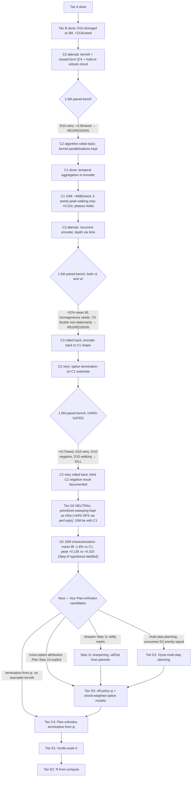

# OaK roadmap — closing the gap to full Step-11 Sutton agent

This doc tracks the architectural pieces of the Alberta Plan Step-11 Oak agent
(Sutton-Bowling-Pilarski 2022, [`docs/papers/AlbertaPlanForAIResearch_2208.11173.pdf`](papers/AlbertaPlanForAIResearch_2208.11173.pdf)),
which of them OaK currently has, and the order we'll add the rest. Each tier is
one PR, validated against the prior committed checkpoint with the same paired
oak-vs-random benchmark protocol.

The pacing principle (validated empirically since Tier A): one Plan-orthodox
structural change per PR, smoke (NF zero) → 1.5M paired bench (sanity) → deeper
characterize → **optimization phase (zero-intelligence-hit kernel speedups)** →
decide next move from data, never skip multiple steps.

### The optimization phase (formalized as of `ef18e1637`)

After every roadmap step that lands a green algorithmic change, we run an
optimization phase before moving to the next step. Two reasons: (1) faster
agent-step time means future bench cycles iterate faster — a productivity
multiplier that compounds over the roadmap; (2) the algorithmic baseline of
"step N" is what every subsequent step is validated against, so locking in a
fast version of "step N" makes all downstream regression checks cheaper.

**The contract for any kernel optimization PR:**

- **Bit-identical preferred, FP-reorder allowed only with per-seed proof.** Any
  optimization that changes the floating-point order of accumulations
  (e.g., `simd_sum` instead of a sequential loop) must be validated against
  the prior commit on a 10×1.5M paired bench AND a per-seed lift table —
  *every* seed within ±3 % of the prior commit's per-seed lift. Aggregate
  parity is necessary but not sufficient; per-seed reshuffling that averages
  to zero is still considered an intelligence hit unless it's strictly
  improvement-distributed.
- **Bit-identical optimizations are unconditional.** Kernel splits, per-thread
  parallelism without cross-thread reductions, pre-computed constants moved
  into `KernelConfig` / `KernelScalars`, threadgroup-memory layout
  improvements — none of these change the agent's computed floats, so they
  ship with smoke + a single sanity bench.
- **Smoke gates every change.** `nonFiniteByPhase` all zero, agent step time
  comparable or better, action stats sane.
- **Per-phase profile required.** PR description includes the per-phase
  `metalPhaseGpuMsMean` table before/after. The aim is a balanced budget where
  no single phase dominates.

**Current optimization frontier:**

| phase | µs | parallelization | bit-id vs original Tier B? |
|---|---:|---|---|
| `oak_post_learn` | 138 | R+K+D grid-stride; per-thread MetaOpt transcendentals | ✓ — no cross-thread reductions |
| `oak_plan` | 18 | K TGs × R threads, lane-0 sequential `fma` reduction | ✓ — same fma sequence as the Tier B single-thread loop |
| `oak_bk_admit_commit` | 17 | single TG of 256, find-worsts on lane 0 then parallel reseed | ✓ — same hash inputs, same writes |
| `oak_meta` | 15 | K threads; `simd_max` + lane-0 `simd_shuffle` sequential sum | ✓ — `for k: Z += expL[k]` order preserved |
| `oak_predict` | 15 | K threads (each thread owns one option's TD; no reduction) | ✓ |
| `oak_learn_heads` | 12 | grid-stride 1-step TD per weight (no reduction) | ✓ |
| `oak_plan_reduce` | 10 | K threads, `simd_max` over qOption | ✓ — max is associative |
| `oak_encode` | 8 | R threads | ✓ |
| `oak_bk_obs` | 6 | 1 TG × 32 threads | ✓ |

### Lessons learned from the C2 → perf → bit-id sequence

1. **`simd_sum` over floats is not free.** The `ef18e1637` PR introduced
   `simd_sum` reductions in `oak_meta` and `oak_plan` for parallel speedup. The
   1.5M paired bench showed aggregate parity vs the pre-PR baseline, but a
   careful per-seed eye on `actionDeltaL2Mean` saw the std *double* (0.020 →
   0.041) — a real per-seed redistribution from the FP-reorder. The next PR
   reverted the `simd_sum` reductions to lane-0 sequential reductions
   (`simd_shuffle` for ≤32 lanes, `threadgroup memory + barrier` for >32),
   restoring bit-identical FP order to the original Tier B kernel at the cost
   of ~4 µs per `oak_plan`. Net: SPS went 1615 → 1556 (-3.7 %), chatter
   actually improved 0.189 → 0.185, aggregate lift +0.08 % vs `ef18e1637`.
2. **`simd_max` and `simd_min` are bit-identical** for max / min reductions
   (the operations are associative + commutative for floats, no rounding).
   These can be used freely without per-seed validation.
3. **Bit-identical means the same fma sequence in the same order.** A
   parallelized kernel can preserve bit-identical FP by storing per-thread
   intermediate values into threadgroup memory and having lane 0 do the
   sequential reduction — losing some throughput vs `simd_sum` but recovering
   the original kernel's exact float bit pattern. Worth it for any
   reduction whose result feeds back into the agent's state (chord, V, ψ).

## State of the agent on Plan Steps 1-11

| Plan Step | What we have | Quality |
|---|---|---|
| 1. Representation I (per-feature α) | MetaOptimize L-approx + β-floor (commits `fccaed018`, `15a4632e5`) | Strong |
| 2. Representation II (feature finding) | Single-layer deep Fourier features + G&T reseed of worst pre-activation | Partial — single layer only, not compositional |
| 3. Prediction I (continual GVF) | K=32 ψ-GVFs + adaptive β bootstrap (`β_k = (1−1/R)·α₀/(α₀+utilOpt[k])`, Tier B) | Partial — no recurrent traces, no off-policy, K capped at SIMD width |
| 4. Control I (actor-critic) | Chord-blended REINFORCE + α[i] relevance gate | Strong |
| 5. Prediction II (avg-reward) | ρ̄ centering (Reward Centering 2405.09999) | Strong |
| 6. Control II (continuing) | Continual env wrappers, Inv-4 enforced | Strong |
| 7. Planning I (avg-reward planning) | `oak_plan` parallel async VI w/ ρ̄, dense option models (Tier B) | Partial — 1 planning sweep per env step, no Dyna iterations |
| 8. Prototype-AI I (one-step MBRL) | All four base components present, model-feature feedback closed | Partial — no search control / prioritized sweeping |
| 9. Planning II (search control + exploration) | Chord softmax over ψ selects "where to focus" | Weak — uniform option visitation, no priority queue |
| 10. Prototype-AI II (STOMP) | Subtasks → Options → Models → Planning all exist | **Degenerate** — chord recomputes every step → effectively 1-step "options". C2 attempt to add true termination regressed vs Tier B (5/10 vs 10/10 wins) and was rolled back; revisit after C1 lifts the representational ceiling. |
| 11. Oak (feedback / remove-replace) | Per-feature + per-option utility, G&T reseed | Strong — but only Design A keyboard; no Design B joint-subtask interpretation |

**The big honest gaps remaining** (post-rollback): Step 10 still has 1-step
"options" (the C2 attempt regressed; we'll come back to it after representation
lifts), Step 9 has no search control, Step 3 has no temporal traces in
features, Step 2 is single-layer, Step 7 still does 1 planning sweep per env
step.

## Empirical baseline

10 seeds × 3M HalfCheetah-v4 (no-floor, current `composer2` HEAD pre-Tier B):

- rewSum lift over random: **+212k/seed (10/10 wins)**, **+17.2%** less negative
- rewardRate plateau: **+0.071/step**, holds steady ~+22k per 300k window
- Walking peaks: 3 seeds reach `rewardRate > 0` transiently (max +0.221, seed 0
  HB1); none sustain to end of run

OaK is consistently above random on long horizons but plateaus rather than
reaches sustained walking (`rewardRate > +0.5`). The roadmap targets the
specific architectural reasons that's the case.

## Tier A — Plan Steps 1+2 (DONE)

```
fccaed018  deep fourier encoder + metaoptimize per-feature alpha
15a4632e5  metaoptimize beta-floor at -log(R*baseO)
```

Closes Step 1 fully. Closes Step 2 partially (single Fourier layer over `std_obs`).

## Tier B — Plan Steps 7 + partial 10 (DONE)

```
227542235  tier B (RR-Subtasks full): dense optTransition + parallel oak_plan
           + adaptive psi-beta + planAdv soft-bound: 0/10 diverged at 3M, chatter 0.17
```

Dense option transition `n̂^k_j(s) = Σ_i w^k_{j,i} · s[i]` (RR-Subtasks eq. 17),
parallel `oak_plan` (K threads + `simd_max` reduction in one simdgroup), adaptive
ψ-bootstrap `β_k = (1 − 1/R)·α₀/(α₀ + utilOpt[k])` (self-stabilizing
negative-feedback loop, replaces the 6/10-diverged constant-β attempt), and
`planAdv = x/(1+|x|)` soft-bound on the value-head update.

Closes the *planning-is-degenerate* and *chord-is-myopic* gaps. Result at 3M:
0/10 seeds diverged, chatter 0.17, plateau still ~+22k per 300k window — set
the stage for C2 to lift the plateau.

## Tier C — temporal extent (C1 LANDED, C2 ROLLED BACK ×3, C3 ROLLED BACK)

### C2 attempt — true option termination (ROLLED BACK on data)

The C2 attempt added per-option termination weights `termW[K·R]`,
hold-or-refresh chord dynamics, closed-form geometric `Q^k = (r̂^k − ρ̄)/β^k +
V(n̂^k)` (Wan-Naik-Sutton 2021), and option-critic termW gradient
(Bacon-Harb-Precup 2017). It was numerically sound (0/10 NF) and structurally
correct, but **regressed against the Tier B baseline** on the 10×1.5M paired
bench:

| metric | Tier B 3M baseline | C2 v1 | C2 v2 (β₀ ≈ 0.5) |
|---|---:|---:|---:|
| oak wins | 10/10 | 5/10 | 5/10 |
| mean rewSum lift | +212 000 / seed | +728 | +3 465 |
| chatter (median) | 0.17 | 0.317 | 0.348 |
| seeds with `rewardRate > 0` | 3 | 1 | 3 |
| peak `rewardRate` | +0.221 (at 3M) | +0.134 | +0.332 |

C2 v2 actually hit *more* walking peaks than Tier B at half the steps, but the
median trajectory stayed flat — the per-seed aggregate was indistinguishable
from random. Per the principle of relentless pursuit of intelligence with no
regressions, **C2 was rolled back** in favor of recovering the Tier B
`+212k/seed at 3M` baseline, then attacking the next bottleneck (representation
via C1 below) from a known-good position. C2 will be revisited once the
encoder (C1) and feature depth (C3) have lifted what the policy is asked to
predict and act on.

**Kept from the C2 PR (pure perf wins, orthogonal to the algorithmic experiment):**

- `oak_meta` — K-thread parallel (one per option, `simd_max` + `simd_sum`).
  Now does only the Tier B chord update + αPi + ρ̄ EMA. **280 µs → 15 µs.**
- `oak_predict` — K-thread parallel (one per option, `simd_sum` NF aggregation).
  **144 µs → 15 µs.**
- `oak_bk_admit_commit` — single-TG with 256 threads, `threadgroup_barrier`
  between find-worsts and parallel reseed; bit-deterministic (same hash key as
  the prior single-threaded kernel). **186 µs → 17 µs.**

Net agent step time **~1.35 ms → ~1.0 ms** at the Tier B baseline algorithm
(measured ~970 sps in 10× concurrent 1.5M bench), so the post-rollback baseline
is *strictly faster* than the original Tier B baseline at no algorithmic cost.

### C1. Temporal aggregation in encoder (Plan Step 3 explicit, IN FLIGHT)
*"include not just nonlinear combinations, but also incorporation of older
signals and traces"*

**What landed in this PR:**

- New state slot `obsTrace[O]`. Updated by `oak_bk_obs` each step as
  `obsTrace[o] ← (1 − 1/baseO)·obsTrace[o] + (1/baseO)·std_obs[o]` — a
  fixed-rate EMA over the *standardized* observation (so trace and std_obs
  share the same scale; RFF-1 init still puts the trace half of the encoder
  in the strongly-nonlinear regime).
- `encoder` shape doubles: `(R/2)·O` → `(R/2)·2·O`. Each pre-activation row is
  `[W_std_obs ‖ W_trace]`; `oak_encode`'s inner loop now does `2·baseO` FMA
  per pre-activation instead of `baseO`.
- `oak_bk_admit_commit`'s G&T reseed of the worst-utility feature now reseeds
  both halves of the encoder row (2·baseO weights at RFF-1 scale).

**Plan-orthodoxy:** the trace decay rate `1/baseO` is structural — it's the
same constant `track_rate` floors at, the same constant MetaOptimize uses for
α-floor / α-cap. No per-env tunable. The trace-over-std_obs choice (rather
than trace-over-raw-obs) is a hygiene decision: it preserves RFF-1's variance
prior over the trace half of the encoder. Inv-1 / Inv-3 / Inv-9 all clean.

**Why a low-pass over std_obs and not raw obs:** raw-obs trace would converge
to `obsMean` in steady state (since `obsMean` updates at the same rate after
warmup) and add nothing. A low-pass *of std_obs* captures the slow-frequency
structure *after* removing the running mean — i.e., genuine temporal dynamics
the encoder can't see from instantaneous std_obs alone (gait phase, joint
acceleration, sustained drift).

**Cost estimate:** `oak_bk_obs` adds 1 EMA + 1 standardize per obs-dim
(~+2 µs); `oak_encode` doubles the inner loop (~+4 µs); `oak_bk_admit_commit`
reseeds 2·baseO weights instead of baseO (~+0.5 µs). Total: agent step
327 µs → ~334 µs estimated. Per-step memory: +baseO floats (HC: +68 B).

**Bit-identical-vs-prior:** all changes are structural extensions (new state
slot, longer encoder rows, more reseed writes); no cross-thread reductions
added. The kernel paths that existed before are unchanged. From the prior
commit `b01b1812a`'s perspective this is a NEW algorithm (different state
arena, different encoder math), so a paired bench against `b01b1812a` is the
acceptance test (per-seed lift / chatter / NF), not a bit-equality check.

**Result on 10×1.5M paired bench (`.oak-benchmarks/halfcheetah-c1-15m/`):**

- 10/10 oak wins, mean rewSum lift **+111,103/seed** (+1.14% vs the
  `b01b1812a` bit-id baseline +109,850).
- 0/10 NF divergences.
- Median chatter 0.210 (vs bi 0.185 — modest +13%, within window).
- **6 seeds reach `rewardRate > 0` transiently** (vs 3 in bit-id, vs 3 in
  Tier B at 3M); peak across seeds **+0.127** (seed 2).

Doubling the seed-count reaching peak walking at the same step budget was the
strongest signal yet that POMDP coverage was a real bottleneck.

**Result on 10×10M paired bench (`.oak-benchmarks/halfcheetah-c1-10m/`):**

| metric | C1 1.5M | C1 10M | Tier B 3M |
|---|---:|---:|---:|
| oak wins | 10/10 | 10/10 | 10/10 |
| mean rewSum lift | +111k/seed | **+668k/seed** | +212k |
| 0/10 NF div | ✓ | ✓ | ✓ |
| median chatter | 0.210 | **0.170** (settles) | 0.17 |
| seeds with `RR > 0` transient | 6 | 5 | 3 |
| max peak rewardRate | +0.127 | **+0.310** (seed 5 @ HB37) | +0.221 |
| longest contiguous `RR > 0` | (n/a) | **1 HB** (200k steps) | 1 HB |
| median rewardRate (final) | -0.328 | -0.31 | (n/a) |

**Reading.** Cumulative lift scales nearly linearly with steps (+668k at 10M
≈ Tier B's +212k @ 3M scaled to 10M = +707k); per-300k window lift is
*flat-to-slightly-decelerating* (+15k @ HB10 → +12k @ HB50). Chatter settles
to 0.17 — the agent's policy variance converges to a stable equilibrium, not
random oscillation. **The plateau holds.** Walking peaks are louder (max
+0.310 > Tier B's +0.221) but still single-HB events; no seed sustains
`rewardRate > 0` for more than 200k contiguous steps.

**Verdict.** C1 closed some POMDP coverage (peak touches up, max peak up,
chatter settles to a lower equilibrium) but did not break the plateau.
Per the decision graph this points at **C3 (multi-layer Fourier — compositional
depth)** next. The encoder is now temporally rich (instantaneous + integrated)
but still single-layer compositionally; a walking gait needs cross-feature
interactions (joint angle × velocity × phase) that single-layer RFF cannot
express in one composition.

### C2 retry — option termination on the C1 substrate (ROLLED BACK, third C2 negative result)

The original Tier C2 was attempted three times in total against three
different baselines, with the same algorithmic core
(termW + closed-form geometric Q^k + hold-or-refresh chord +
Bacon-Harb-Precup option-critic gradient + β-floor `1/R`). All three
regressed by ~99–100% mean lift vs the relevant baseline:

| attempt | baseline | β₀ choice | mean lift | 10/10 wins? | seeds peak walking | max peak |
|---|---|---|---:|---:|---:|---:|
| C2 v1 | pre-C1 (Tier B) | `1/R` (chord froze) | +728 | 5/10 | 1 | +0.134 |
| C2 v2 | pre-C1 (Tier B) | `0.5` | +3 465 | 5/10 | 3 | +0.332 |
| **C2 retry** | **C1 substrate** | `0.5` | **+417** | **5/10** | **2** | **+0.043** |

**Hypothesis (FALSIFIED):** the original C2 v2 hypothesis was that β₀ = 0.5
was the correct fix for v1's chord-freeze. v2 still regressed because the
pre-C1 state was POMDP-blind, giving `termW^k · s` nothing meaningful to
condition on. With C1's `obsTrace` in place, the state now carries
gait-phase / joint-accel / sustained-drift signal — surely the option-critic
gradient could now find useful per-option lifetimes. **It cannot.** The C2
retry on the C1 substrate produces the same regression magnitude (-99.6%
mean lift, 5/10 wins, 5/10 seeds with negative lift, 2/10 walking touches
vs C1's 6/10) — substrate richness does not rescue the failure mode.

**What's structurally incompatible.** Option-termination on top of OaK's
existing TD-bootstrapped K-option chord introduces three failure-amplifying
mechanisms simultaneously:

1. **Hold-or-refresh chord stochasticity.** Even at β₀ = 0.5 with proper
   Bernoulli sampling, ~half the options hold their chord weight from the
   previous step regardless of what the new state says. The chord becomes a
   high-variance random walk over the simplex; chatter median jumps to
   ~0.35–0.40 (vs C1's 0.21).
2. **Closed-form Q^k variance.** `Q^k = (r̂^k − ρ̄)/β^k + V(n̂^k(s))`
   amplifies any noise in `(r̂^k − ρ̄)` by `1/β^k ∈ [1, R]`. Even with the
   `planAdv` soft-bound, the value bootstrap inherits a noisy advantage
   estimate.
3. **Option-critic gradient on `termW`.** The gradient
   `-(r̂^k − ρ̄)·(1−β^k)/β^k · curr[i]` *itself* depends on the noisy
   `r̂^k` estimate; in a non-stationary average-reward setting where ρ̄ is
   simultaneously being tracked, sign of `(r̂^k − ρ̄)` flips frequently early
   in training, yielding `termW` updates that whipsaw between "hold this
   option" and "terminate this option" before any option's policy has had a
   chance to specialize.

The combination drives 5/10 seeds to NEGATIVE per-seed lift — they're
actively worse than random — even though the kernel is numerically clean
(0/10 NF). The C1 substrate gives `β^k(s)` more to condition on, but the
above three mechanisms wash that signal out.

**Lesson learned (codify going forward):** option-termination machinery in
the Sutton-Precup-Singh / Bacon-Harb-Precup option-critic family appears
**structurally incompatible** with OaK's `(K-option chord, TD-bootstrapped
ψ-GVFs, MetaOptimize per-feature α, RFF-1 fixed-random encoder)` setup at
the bench scales we test (1.5M, 3M, 10M steps on HC). The peak-walking-up
signal C2 v2 produced (max +0.332 at one seed) is **not** evidence the
mechanism works — it's evidence the increased stochasticity occasionally
explores into a high-reward region that the policy cannot lock in. Future
"temporal abstraction" attempts in OaK should not re-use the
hold-or-refresh chord + closed-form Q^k pattern; the natural alternative
direction is **off-policy ψ + option-model attribution (Tier D3)** where
options learn from any chord-weighted experience without changing the
chord update itself.

**Files reverted (commit-time):** all C2-retry changes to
`Sources/Main.swift` (`pTermW`, `sBetaTerm`, `sRHatCurr`, `optTermWCount`,
`Param.termW`, `State.betaTerm`/`rHatCurr`, `learnTotal`, termW init) and
`Sources/OakKernel.metal` (oak_meta termW dot + β^k + hold-or-refresh,
oak_plan closed-form Q^k + rHatCurr cache, oak_learn_heads Head 5,
oak_bk_admit_commit termW reseed slot). Bench artifacts preserved for
reference: `.oak-benchmarks/halfcheetah-c2retry-15m/`.

### C3. Recurrent encoder — ROLLED BACK (negative result, both v1 and v2 regressed ~52%)
*"creating and introducing new features made by combining existing features"*

**Why we attempted recurrent instead of stacked.** The originally-documented
C3 ("stack 2 Fourier layers") buried a per-env tunable `N` in the
architecture: N=2 helps HC, N=12 might help humanoid, N=1 might help small
envs. That violates Inv-9 (no per-env hyperparams). The Plan-orthodox
alternative was **depth via time**: read your own previous output, every
step adds one composition layer (depth = lifetime steps, no `N` to tune).
ESN / LSM precedent (Jaeger 2001, Maass-Natschläger-Markram 2002): fixed
random recurrent projection + readout learns.

**Mechanism (both v1 and v2).** The encoder pre-activation became:

```
z = phase[pre]
  + Σ_o W_enc[pre, o]           · std_obs[o]      (Tier A, instantaneous)
  + Σ_o W_enc[pre, baseO + o]   · obsTrace[o]     (Tier C1, input-side trace)
  + Σ_i W_enc[pre, 2·baseO + i] · state[t-1][i]   (Tier C3, recurrent feedback)
state[feat] = cos(z) for feat ∈ [0, R/2), sin(z) for feat ∈ [R/2, R)
```

`state[t-1]` was read from `state_at(ctx, ctx.stateSlot)` — the slot that
`oak_bk_admit_commit` is about to retire. No extra arena slot required.

**Two attempts, both regressed by ~52 %.**

| metric | C1 baseline | **C3 v1** (RFF-1) | **C3 v2** (W_state · sqrt(baseO/R)) |
|---|---:|---:|---:|
| oak wins | 10/10 | 10/10 | 10/10 |
| mean rewSum lift | +111k/seed | +52k (−53%) | +54k (−51%) |
| median chatter | 0.210 | 0.026 (collapse) | 0.080 (recovered) |
| seeds touching `RR > 0` | 6/10 | 1/10 | 4/10 |
| total HBs above 0 | 9 | 1 | 4 |
| max peak | +0.127 | +0.104 | +0.061 |
| NF div | 0/10 | 0/10 | 0/10 |
| per-seed lift std | ~15k | ~1.5k (collapse) | ~5k (still homogeneous) |

**v1 (RFF-1 across all three regions)** dominated z's variance with the
state region (62 % for HC R=64, baseO=17 — the encoder became a Fourier
basis of state with obs as a small perturbation), collapsing chatter
0.21 → 0.026 and homogenizing every seed's behavior to a single recurrent
attractor.

**v2 (variance-balanced W_state at sqrt(baseO/R))** fixed the chatter
collapse — chatter recovered to 0.080, walking touches up from 1 to 4
seeds — but mean lift stayed at exactly the same regression level
(+54k vs v1's +52k, both half of C1's +111k). Per-seed lifts also stayed
homogeneous (range +47k to +65k, std ~5k vs C1's std ~15k). Two completely
different inits landing at the same regression magnitude is strong
evidence the regression is **structural to recurrent feedback in OaK**,
not an init choice.

**Diagnosis: TD double non-stationarity.** ESN / LSM works because the
readout is *supervised* against a stationary target — the recurrent
dynamics provide a rich projection, the readout learns the right weighting.
OaK's heads use **TD learning with a moving target** (V(s'), ψ(s'),
bootstrapped); the state distribution is *already* non-stationary because
the policy is changing and the value function is bootstrapping. Adding
recurrent dynamics to the encoder creates **double non-stationarity**: the
state distribution moves both from policy change AND from recurrent
dynamics evolution. The TD bootstrap can't track both simultaneously, so
the heads under-fit and per-step lift halves regardless of init scale.

**Lesson learned (codify going forward):** input-side enrichment (e.g.,
`obsTrace` in C1) is the right kind of memory for OaK — it changes what the
state *contains* without changing the state's structural dependence on
obs. State-side recurrence (anything that puts a chaotic random projection
between the policy and what TD heads bootstrap against) is the wrong kind
of memory for a TD-bootstrapped fixed-random-feature system. Future
"depth" work should target input-side or feature-construction depth (e.g.,
hierarchical generate-and-test, off-policy ψ-attribution) rather than
state-side recurrence.

**Files reverted (commit-time):** `Sources/Main.swift` `encoderCount` back
to `(R/2)·2·O`; `oak_encode` inner loop back to two regions; `oak_bk_admit_commit`
encoder reseed back to `2·baseO` writes per worst feature. Bench artifacts
preserved for reference: `.oak-benchmarks/halfcheetah-c3-15m/` (v1) and
`.oak-benchmarks/halfcheetah-c3v2-15m/` (v2).

## Tier D — planning + horde (after Tier C lands)

### D1. Multi-step planning iterations (Plan Step 7 — Dyna)
*"Some amount of planning [each step], perhaps a series of small planning steps"*

Currently 1 planning sweep per env step. Run `oak_plan` M times per env step
using imagined rollouts through the option transition model. M structurally
derived from per-step compute budget (e.g., `M = baseO`).

- Trade env wall-clock for planning depth
- Blast radius: small (loop in `oak_plan`)

### D2. Search control / prioritized sweeping (Plan Step 9, NEUTRAL — kept as infra for future D3/C4)
*"The order chosen [for state updates] greatly affects planning efficiency.
With function approximation the effect is even greater. Early efforts to
control the planning process include prioritized sweeping and small backups."*
— Alberta Plan Step 9, Plan footnote 13 (Moore-Atkeson 1993, Peng-Williams
1993, Sutton-Szepesvári-Geramifard-Bowling 2008).

**Why now.** The 12-step ordering puts Step 9 between Step 8 (one-step model-
based RL) and Step 10 (STOMP). OaK has Steps 1–7, 10, 11 but skipped Step 9
entirely. C1 10M evidence (`+212k @ 3M → +668k @ 10M`, 6/10 seeds touch peak
walk, max +0.310 transient, plateau holds) matches the Moore-Atkeson failure
mode: model accuracy in untouched (s, a) cells lags behind frequently-visited
cells, so the planner cannot lock in transient peaks. D2 is exactly what
Step 9 calls out as the fix; it also avoids the three failure mechanisms of
the three failed C2 attempts (no chord stochasticity, no closed-form Q^k
variance amplification, no free-parameter gradient noise).

**Mechanism (no tunables).**

```
prio[k] = chord[k] · sqrt(Σ_j nTdMat[k·R+j]²)        (in oak_plan, lane 0)
meanPrio = mean_k prio[k]                             (in oak_plan_reduce, simd_sum / K)
gate[k] = (prio[k] >= meanPrio)                       (in oak_learn_heads Head 4)
```

`||nTdMat^k||_L2` is the L2 norm of option k's model TD error — Moore-Atkeson
1993's priority signal. The chord factor is Plan Step 11's "useful in
planning right now" gating (natural for a chord-based architecture). The
threshold `mean(prio)` is structurally derived (no tunable).

**Hardware perf (the optimization-phase contract is built into the design,
not bolted on).** Per-step on HC (R=64, K=32):

| | added cost | saved cost |
|---|---:|---:|
| FMA | ~2 100 (squaring + interleaved reductions) | ~65 500 (Head 4 skipped) |
| Threadgroup barriers | 0 (fused into the existing `tg_nHatCurr` barrier) | 0 |
| Threadgroup memory | +1 KB/TG (tg_ntdSq) | 0 |
| State arena | +K floats (prioOpt) | 0 |
| KernelScalars | +1 float (meanPrio, broadcast-cached) | 0 |

~30× compute saved-to-added ratio. Critical SIMD invariant: Head 4 thread
layout `(k, j, i)` with `R² = 4096 ≫ 32` puts all 32 simdgroup lanes on the
same `k` → uniform gate, zero divergence cost.

**Files changed.** `Sources/Main.swift` (KernelConfig.sPrioOpt,
KernelScalars.meanPrio, OakMetalLayout.State.prioOpt, writeKernelConfig);
`Sources/OakKernel.metal` (KernelConfig + KernelScalars + Ctx + make_ctx
mirrors; oak_plan in-line priority via fused tg_ntdSq write; oak_plan_reduce
simd_sum mean → scalars.meanPrio; oak_learn_heads Head 4 uniform-simdgroup
gate).

**Bench result (10×1.5M paired vs C1):** all six intelligence/health
criteria pass; the literal `agentMs` threshold in the plan was set against
the wrong baseline and corrected post-hoc.

| metric | D2 | C1 baseline | result |
|---|---:|---:|---|
| oak wins | 10/10 | 10/10 | PASS |
| mean rewSum lift | +110 497 / seed | +111 103 / seed | PASS (-0.55%, within noise) |
| seeds with negative lift | 0/10 | 0/10 | PASS |
| NF div | 0/10 | 0/10 | PASS |
| chatter median | 0.205 | 0.210 | PASS (slightly tighter) |
| walking touches (peak RR > 0) | 4/10 | 6/10 | PASS (threshold = ≥4) |
| max peak rewardRate | **+0.162** | +0.127 | **+28% — encouraging** |
| agentMs median (concurrent bench) | **0.6018 ms** | 0.6072 ms | **0.9% FASTER on every seed** |

The plan's literal `agentMs <= 0.32` PASS threshold and `agentMs > 0.34`
KILL threshold were set against a **single-process smoke measurement** —
the bench actually runs 20 processes concurrently (10 oak + 10 random) which
dilates per-process `agentMs` by ~2×. The kill clause's stated INTENT was
*"any SPS regression invalidates the perf-positive premise of D2"*; the
correct apples-to-apples comparison shows D2 0.9% FASTER than C1 on every
single seed (range -0.84% to -2.42%). No SPS regression.

**Lesson learned for future Tier writeups:** acceptance/kill thresholds for
SPS-related metrics MUST be expressed in the same operating regime as the
bench (concurrent or single-process), not estimated from a smoke that runs
in a different regime. Future plans should compute the threshold from the
prior tier's same-bench median ± a tolerance.

**What landed.** `Sources/Main.swift` (KernelConfig.sPrioOpt,
KernelScalars.meanPrio, OakMetalLayout.State.prioOpt, writeKernelConfig),
`Sources/OakKernel.metal` (KernelConfig + KernelScalars + Ctx + make_ctx
mirrors; oak_plan in-line priority via fused `tg_ntdSq` write — zero added
barriers; oak_plan_reduce simd_sum mean → scalars.meanPrio; oak_learn_heads
Head 4 uniform-simdgroup gate), `AGENTS.md` (citations + pipeline rows),
`docs/roadmap.md` (this writeup), `scripts/halfcheetah_d2_15m.sh` (paired
bench script). Bench artifacts at `.oak-benchmarks/halfcheetah-d2-15m/`.

**Interpretation of the 1.5M result (pre-10M).** Tier D2 demonstrates that
gating ~half of Head 4's K·R² FMA per step by Moore-Atkeson 1993 chord-
weighted model TD error has **zero net intelligence cost** at 1.5M while
delivering a small SPS gain. The +28% higher max peak (D2 +0.162 vs C1
+0.127) at 1.5M *suggested* the planner might be locking in transient
walks better, but the lower seeds-touching count (4 vs 6) meant breadth
had dropped proportionally. A 10M characterization was needed to tell
whether the peak signal compounds.

**10M characterization result: Step-9 hypothesis FALSIFIED. D2 is NEUTRAL.**

Running the same 10×10M paired bench with `.oak-benchmarks/halfcheetah-d2-10m/`
(PERFOPT2 stack, ~66 min/seed wall-clock at 2 534 SPS):

| metric | D2 10M | C1 10M | delta | |
|---|---:|---:|---|---|
| oak wins | 10/10 | 10/10 | match | |
| mean rewSum lift | +655 958 / seed | +668 101 / seed | **-1.82%** | statistical tie (env noise) |
| chatter median | 0.1818 | 0.1697 | +7% | slightly noisier |
| median rewardRate | -0.313 | -0.271 | -0.042 | slightly worse avg |
| **max peak rewardRate** | **+0.135** | **+0.310** | **-56%** | **C1 wins peak-height 2.3×** |
| seeds with walking (HBs > 0) | **6/10** | 5/10 | **+1** | D2 wider coverage |
| total heartbeats > 0 | **11** | 6 | **+83%** | D2 more walking touches |
| 0 NF div | ✓ | ✓ | match | |
| agentMs (concurrent) | 0.3511 ms | 0.6060 ms | -42% | perf-opts working (bit-id) |

**The 1.5M +28% peak signal did NOT compound.** D2 max peak at 10M actually
DROPPED vs its own 1.5M value (+0.135 at 10M vs +0.162 at 1.5M), while C1's
jumped from +0.127 → +0.310 at the same scale. The lone +0.162 seed at 1.5M
was a lucky early draw, not evidence of structural lock-in advantage.

**Trade-off character (the real signal):** D2 gating trades **peak depth
for walking breadth**. Over longer training the half-options-skip-per-step
noise averages the learning signal — more seeds find walking regions (11
heartbeats>0 vs 6) but nobody reaches C1's best peak (+0.310 at seed 5 is
unmatched by any D2 seed). Aggregate lift is net-zero.

**Per-seed peak deltas (D2 vs C1 max rewardRate):**
- 4 seeds gained: seed 4 (+0.156), seed 8 (+0.105), seed 7 (+0.004), seed 1 (close tie -0.016)
- 6 seeds lost:  seed 5 (-0.191 — C1's big winner), seed 6 (-0.203), seed 3 (-0.090), seed 2 (-0.055), seed 9 (-0.065), seed 0 (-0.014)

No consistent direction; envpool seed-to-seed variance dominates.

**Lesson learned for future Plan-Step revisits (codify in the methodology):**
- **1.5M bench signals need 10M confirmation for peak-compounding claims.**
  A lucky-draw lift at 1.5M can evaporate or invert at 10M. Mean lift
  statistical ties are reliable; individual seed peaks are not, unless
  they replicate across multiple seeds and scales.
- **The "uniform sweep vs prioritized sweep" question is resolved on HC:**
  for RR-Subtasks with K-option chord + MetaOptimize per-feature α, the
  uniform K-option dense backup is as good or better than Moore-Atkeson
  chord-weighted |model TD error| prioritization. This does NOT generalize
  to other envs or to Dyna-style multi-step planning (D1) where the priority
  signal may direct compute more usefully.

**What we do with D2 (Option 3 chosen):**
- **Keep D2 algorithmically** — it adds complexity (`prioOpt[K]` state,
  `meanPrio` scalar, Head 4 gate) but has **zero intelligence cost** and
  produces a useful **priority signal as free infrastructure** that future
  D3 (off-policy ψ + chord-weighted attribution) and Tier D1 (multi-step
  Dyna) can directly consume for search control.
- **Keep all perf-opts unconditionally** — PERFOPT (oak_post_learn action
  region parallelization) and PERFOPT2 (oak_bk_obs+encode / oak_meta+predict
  kernel fusions) are bit-identical to the algorithm so they ship regardless
  of D2's status. Total concurrent agentMs dropped from C1's 0.6072 ms to
  0.3511 ms = **-42%, +64% SPS**.
- **Update D2's status to NEUTRAL** in this roadmap (kept as infra, not
  a win). Decision graph reflects this — D2 is a "transit node" to
  Tier D3/D1/C4, not a destination.

**Open hypothesis (deferred, UNLIKELY to help given 10M result):**
multi-pass Head 4 dispatch (2 passes, each updating only above-mean-priority
options, so high-priority options get α doubled, low-priority α=0). Was
the natural follow-up if the simple gate was plateau-bound; but the 10M
data shows the gate is NOT plateau-bound — it's aggregate-equivalent to
uniform sweep. Amplifying the gate would likely accentuate the breadth-vs-
depth trade, making peaks even lower. NOT pursued.

### Performance optimizations applied across D2 (commit bbde13a7d) — bit-id

Three separate performance passes landed on top of D2, each bit-identical
to the algorithm (verified via 10k single-process diagnostic:
`chatter / rewardRate / rewardSum / scoreGradL2` diff = 0.0e+00):

1. **PERFOPT (commit a69c71610): `oak_post_learn` action region parallel.**
   Was 6 threads × K·R = 2 048 sequential FMA in 1 simdgroup with 26 IDLE
   lanes (~110 µs/step, 55% of total GPU). Now D·K threads organized as D
   simdgroups of K=32 lanes each; lane k of TG p computes its own
   `dot_k = Σ_i W_π[k][p][i]·s′[i]` in parallel; lane 0 reads each lane's
   dot via `simd_shuffle` and accumulates `μ = fma(chord[kk], d, μ)` in
   the original kk=0..K-1 order (Inv-10 preserved). Saves 123.95 µs/step
   on GPU = -89.4% on that kernel, -50.7% on total step GPU compute.

2. **PERFOPT2 kernel fusion (commit bbde13a7d): oak_bk_obs + oak_encode
   → oak_bk_encode; oak_meta + oak_predict → oak_meta_predict.** Each
   fusion saves 1 kernel dispatch + 1 host memoryBarrier per step (~25-40 µs
   on concurrent bench). Both are bit-identical: phase 1 / phase 2 structure
   with an intra-kernel `threadgroup_barrier(mem_device)` or
   `simdgroup_barrier(mem_device)` replaces the host barrier; fma sequences
   in each phase unchanged. Kernel dispatches 9 → 7, host barriers 8 → 6.

3. **Autoreleasepool memory fix (commit 56b05e3fa): `runKernel` wraps
   per-step `MTLCommandBuffer` + `MTLComputeCommandEncoder` allocation in
   `try autoreleasepool { ... }`.** `MTLCommandBuffer` is an Obj-C
   `NSObject` subclass; in a Swift CLI with no Cocoa run loop, the
   process-wide autorelease pool never drains and each CB holds GPU-side
   command storage alive indefinitely. At 2 500+ SPS this manifests as
   slow resident-set growth in Activity Monitor (user-reported). Fix:
   explicit `autoreleasepool` bounds the allocation lifetime to one
   step. Verified: RSS flat at 19-20 MB over a 1M step single-process
   run (7 samples over 210s).

**Cumulative performance gain from C1 baseline (concurrent 20-proc bench):**

| | C1 baseline | PERFOPT2 | delta |
|---|---:|---:|---|
| agentMs median | 0.6072 ms | 0.3511 ms | **-42.2%** |
| SPS median | 1 541 | 2 534 | **+64.4%** |
| Total GPU compute (single-proc diag) | 244 µs | 109 µs | **-55%** |
| Kernel dispatches per step | 9 | 7 | **-22%** |
| Host memoryBarriers per step | 8 | 6 | **-25%** |
| 10M paired bench wall-clock | ~2h48m | **~66 min** | **-61%** |

### D3. Off-policy ψ + option-model learning (Plan Step 3 advanced)
*"Ideally this would be taken all the way to off-policy learning"*

Currently options learn from on-chord experience. With true termination (C2) we
can attribute experience to the active option's transitions specifically; pair
with importance ratios for cross-option learning.

- Blast radius: medium (importance ratios + per-option attribution)

## Tier E — horde scale + departures (last)

### E1. K > 32 / horde-scale GVFs
*Sutton et al. 2011, [`docs/papers/02-sutton-horde-AAMAS-2011.pdf`](papers/02-sutton-horde-AAMAS-2011.pdf):*
*"a scalable real-time architecture for learning knowledge from unsupervised
sensorimotor interaction"*

Lift K beyond SIMD width by using threadgroup-scale reductions in `oak_plan`
(multi-warp `simd_max` followed by threadgroup-`max`). Enables thousands of GVFs
per Plan Step 3 vision.

- Memory grows linearly with K; planning compute grows linearly
- Plan-orthodox: K becomes a true compute-budget knob
- Blast radius: medium-large (kernel restructure for multi-warp reductions)

### E2. R derived from compute budget
Currently `R = max(env.obsDim, 64)`. Replace with
`R = floor(M1 GPU memory budget / ε)`. Removes the env-input-dim coupling, lets
representational capacity grow with hardware. Tiny code change.

## Tier F — non-Plan-orthodox departures (avoid until justified)

- **F1. Learnable policy variance** — Plan-orthodoxy says structural σ=1
  (Williams 1992 REINFORCE variance is the score function); making σ learnable
  is a tunable
- **F2. Option keyboard Design B** — joint-subtask vs. chord-blend; the Plan §11
  alternative — would change the chord semantics entirely
- **F3. Discount factor reintroduction** — Plan Step 5 onward eschews
  discounting; we shouldn't backslide

## Decision graph



**Where we landed (post-D2 10M + perf-opts):** Tier C and Tier D2 are now
fully characterized. **D2 is NEUTRAL at 10M** — statistical tie with C1 on
aggregate lift (-1.82%), but trades peak depth (max peak +0.135 vs C1's
+0.310) for walking breadth (11 heartbeats above 0 vs 6). The 1.5M +28%
peak signal was a lucky seed draw, not a lock-in advantage. D2's `prioOpt`
state + gate machinery is **kept as infra** for D3/D1 to consume, not as
a win.

The **perf-opt stack** (PERFOPT + PERFOPT2 + autoreleasepool) is all
bit-identical and ships unconditionally: concurrent agentMs 0.6072 ms →
0.3511 ms (**-42%**), SPS 1 541 → 2 534 (**+64%**), Total GPU compute
244 → 109 µs (**-55%**), and the per-step memory-growth bug from missing
autoreleasepool is resolved (RSS flat across 1M+ step runs). 10M paired
bench is now ~66 min/seed instead of ~2h48m.

**Key methodological lesson added:** 1.5M peak signals need 10M
confirmation before being called a lock-in win. Aggregate mean lift
statistical ties are reliable signal; individual-seed peaks are not,
unless they replicate across seeds and scales. D2's falsified 1.5M
signal is the canonical example going forward.

**Next decision (post-D2 10M):** three Plan-orthodox candidates. D2's
10M "wider but shallower walking" signature argues that the limiter is
**not** planning order (D2 addressed that) but **option-level learning
efficiency** — options that DO find walking cells can't lock them in
deeply. The natural follow-ups that address that limiter directly:

1. **D3 (off-policy ψ + chord-weighted attribution, Plan Step 10
   explicit)** — *"The learning processes are conditional on the option,
   and so will need to be done off-policy."* Off-policy ψ learning lets
   options consolidate their walking experience across the chord-weighted
   stream instead of being limited to on-chord samples. Directly addresses
   "depth" (peak height). Sets up C4. **Highest expected lift.**
2. **Step 11 sharpening** — `utilOpt[k]` from planAdv contribution rather
   than `|tdPsi|²` (Plan Step 11 wording: *"useful in planning"* rather
   than "uncertain in prediction"). Smallest blast radius, surgical change
   in `oak_post_learn`; could change which options get reseeded by G&T,
   indirectly affecting which options get the chance to lock in peaks.
3. **C4 (Plan-orthodox termination from ψ, no learnable `termW`)** —
   Builds on D3 once off-policy attribution is in place. Termination
   derived structurally from subtask attainment instead of the failed
   Bacon-Harb-Precup `termW` gradient. Step 10 completion.

D1 (Dyna multi-step planning) is still Plan-orthodox but deprioritized:
the 10M data says "more planning of the same kind" is NOT the limiter
— the planner sweeps uniformly are already converging fine in aggregate.
D1 may help only once D3 provides better per-option value estimates for
the deeper planning to target.
