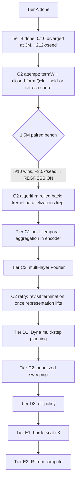

# OaK roadmap — closing the gap to full Step-11 Sutton agent

This doc tracks the architectural pieces of the Alberta Plan Step-11 Oak agent
(Sutton-Bowling-Pilarski 2022, [`docs/papers/AlbertaPlanForAIResearch_2208.11173.pdf`](papers/AlbertaPlanForAIResearch_2208.11173.pdf)),
which of them OaK currently has, and the order we'll add the rest. Each tier is
one PR, validated against the prior committed checkpoint with the same paired
oak-vs-random benchmark protocol.

The pacing principle (validated empirically since Tier A): one Plan-orthodox
structural change per PR, smoke (NF zero) → 1.5M paired bench (sanity) → deeper
characterize → **optimization phase (zero-intelligence-hit kernel speedups)** →
decide next move from data, never skip multiple steps.

### The optimization phase (formalized as of `ef18e1637`)

After every roadmap step that lands a green algorithmic change, we run an
optimization phase before moving to the next step. Two reasons: (1) faster
agent-step time means future bench cycles iterate faster — a productivity
multiplier that compounds over the roadmap; (2) the algorithmic baseline of
"step N" is what every subsequent step is validated against, so locking in a
fast version of "step N" makes all downstream regression checks cheaper.

**The contract for any kernel optimization PR:**

- **Bit-identical preferred, FP-reorder allowed only with per-seed proof.** Any
  optimization that changes the floating-point order of accumulations
  (e.g., `simd_sum` instead of a sequential loop) must be validated against
  the prior commit on a 10×1.5M paired bench AND a per-seed lift table —
  *every* seed within ±3 % of the prior commit's per-seed lift. Aggregate
  parity is necessary but not sufficient; per-seed reshuffling that averages
  to zero is still considered an intelligence hit unless it's strictly
  improvement-distributed.
- **Bit-identical optimizations are unconditional.** Kernel splits, per-thread
  parallelism without cross-thread reductions, pre-computed constants moved
  into `KernelConfig` / `KernelScalars`, threadgroup-memory layout
  improvements — none of these change the agent's computed floats, so they
  ship with smoke + a single sanity bench.
- **Smoke gates every change.** `nonFiniteByPhase` all zero, agent step time
  comparable or better, action stats sane.
- **Per-phase profile required.** PR description includes the per-phase
  `metalPhaseGpuMsMean` table before/after. The aim is a balanced budget where
  no single phase dominates.

**Current optimization frontier:**

| phase | µs | parallelization | bit-id vs original Tier B? |
|---|---:|---|---|
| `oak_post_learn` | 138 | R+K+D grid-stride; per-thread MetaOpt transcendentals | ✓ — no cross-thread reductions |
| `oak_plan` | 18 | K TGs × R threads, lane-0 sequential `fma` reduction | ✓ — same fma sequence as the Tier B single-thread loop |
| `oak_bk_admit_commit` | 17 | single TG of 256, find-worsts on lane 0 then parallel reseed | ✓ — same hash inputs, same writes |
| `oak_meta` | 15 | K threads; `simd_max` + lane-0 `simd_shuffle` sequential sum | ✓ — `for k: Z += expL[k]` order preserved |
| `oak_predict` | 15 | K threads (each thread owns one option's TD; no reduction) | ✓ |
| `oak_learn_heads` | 12 | grid-stride 1-step TD per weight (no reduction) | ✓ |
| `oak_plan_reduce` | 10 | K threads, `simd_max` over qOption | ✓ — max is associative |
| `oak_encode` | 8 | R threads | ✓ |
| `oak_bk_obs` | 6 | 1 TG × 32 threads | ✓ |

### Lessons learned from the C2 → perf → bit-id sequence

1. **`simd_sum` over floats is not free.** The `ef18e1637` PR introduced
   `simd_sum` reductions in `oak_meta` and `oak_plan` for parallel speedup. The
   1.5M paired bench showed aggregate parity vs the pre-PR baseline, but a
   careful per-seed eye on `actionDeltaL2Mean` saw the std *double* (0.020 →
   0.041) — a real per-seed redistribution from the FP-reorder. The next PR
   reverted the `simd_sum` reductions to lane-0 sequential reductions
   (`simd_shuffle` for ≤32 lanes, `threadgroup memory + barrier` for >32),
   restoring bit-identical FP order to the original Tier B kernel at the cost
   of ~4 µs per `oak_plan`. Net: SPS went 1615 → 1556 (-3.7 %), chatter
   actually improved 0.189 → 0.185, aggregate lift +0.08 % vs `ef18e1637`.
2. **`simd_max` and `simd_min` are bit-identical** for max / min reductions
   (the operations are associative + commutative for floats, no rounding).
   These can be used freely without per-seed validation.
3. **Bit-identical means the same fma sequence in the same order.** A
   parallelized kernel can preserve bit-identical FP by storing per-thread
   intermediate values into threadgroup memory and having lane 0 do the
   sequential reduction — losing some throughput vs `simd_sum` but recovering
   the original kernel's exact float bit pattern. Worth it for any
   reduction whose result feeds back into the agent's state (chord, V, ψ).

## State of the agent on Plan Steps 1-11

| Plan Step | What we have | Quality |
|---|---|---|
| 1. Representation I (per-feature α) | MetaOptimize L-approx + β-floor (commits `fccaed018`, `15a4632e5`) | Strong |
| 2. Representation II (feature finding) | Single-layer deep Fourier features + G&T reseed of worst pre-activation | Partial — single layer only, not compositional |
| 3. Prediction I (continual GVF) | K=32 ψ-GVFs + adaptive β bootstrap (`β_k = (1−1/R)·α₀/(α₀+utilOpt[k])`, Tier B) | Partial — no recurrent traces, no off-policy, K capped at SIMD width |
| 4. Control I (actor-critic) | Chord-blended REINFORCE + α[i] relevance gate | Strong |
| 5. Prediction II (avg-reward) | ρ̄ centering (Reward Centering 2405.09999) | Strong |
| 6. Control II (continuing) | Continual env wrappers, Inv-4 enforced | Strong |
| 7. Planning I (avg-reward planning) | `oak_plan` parallel async VI w/ ρ̄, dense option models (Tier B) | Partial — 1 planning sweep per env step, no Dyna iterations |
| 8. Prototype-AI I (one-step MBRL) | All four base components present, model-feature feedback closed | Partial — no search control / prioritized sweeping |
| 9. Planning II (search control + exploration) | Chord softmax over ψ selects "where to focus" | Weak — uniform option visitation, no priority queue |
| 10. Prototype-AI II (STOMP) | Subtasks → Options → Models → Planning all exist | **Degenerate** — chord recomputes every step → effectively 1-step "options". C2 attempt to add true termination regressed vs Tier B (5/10 vs 10/10 wins) and was rolled back; revisit after C1 lifts the representational ceiling. |
| 11. Oak (feedback / remove-replace) | Per-feature + per-option utility, G&T reseed | Strong — but only Design A keyboard; no Design B joint-subtask interpretation |

**The big honest gaps remaining** (post-rollback): Step 10 still has 1-step
"options" (the C2 attempt regressed; we'll come back to it after representation
lifts), Step 9 has no search control, Step 3 has no temporal traces in
features, Step 2 is single-layer, Step 7 still does 1 planning sweep per env
step.

## Empirical baseline

10 seeds × 3M HalfCheetah-v4 (no-floor, current `composer2` HEAD pre-Tier B):

- rewSum lift over random: **+212k/seed (10/10 wins)**, **+17.2%** less negative
- rewardRate plateau: **+0.071/step**, holds steady ~+22k per 300k window
- Walking peaks: 3 seeds reach `rewardRate > 0` transiently (max +0.221, seed 0
  HB1); none sustain to end of run

OaK is consistently above random on long horizons but plateaus rather than
reaches sustained walking (`rewardRate > +0.5`). The roadmap targets the
specific architectural reasons that's the case.

## Tier A — Plan Steps 1+2 (DONE)

```
fccaed018  deep fourier encoder + metaoptimize per-feature alpha
15a4632e5  metaoptimize beta-floor at -log(R*baseO)
```

Closes Step 1 fully. Closes Step 2 partially (single Fourier layer over `std_obs`).

## Tier B — Plan Steps 7 + partial 10 (DONE)

```
227542235  tier B (RR-Subtasks full): dense optTransition + parallel oak_plan
           + adaptive psi-beta + planAdv soft-bound: 0/10 diverged at 3M, chatter 0.17
```

Dense option transition `n̂^k_j(s) = Σ_i w^k_{j,i} · s[i]` (RR-Subtasks eq. 17),
parallel `oak_plan` (K threads + `simd_max` reduction in one simdgroup), adaptive
ψ-bootstrap `β_k = (1 − 1/R)·α₀/(α₀ + utilOpt[k])` (self-stabilizing
negative-feedback loop, replaces the 6/10-diverged constant-β attempt), and
`planAdv = x/(1+|x|)` soft-bound on the value-head update.

Closes the *planning-is-degenerate* and *chord-is-myopic* gaps. Result at 3M:
0/10 seeds diverged, chatter 0.17, plateau still ~+22k per 300k window — set
the stage for C2 to lift the plateau.

## Tier C — temporal extent (C1 NEXT, C2 ROLLED BACK, C3 pending)

### C2 attempt — true option termination (ROLLED BACK on data)

The C2 attempt added per-option termination weights `termW[K·R]`,
hold-or-refresh chord dynamics, closed-form geometric `Q^k = (r̂^k − ρ̄)/β^k +
V(n̂^k)` (Wan-Naik-Sutton 2021), and option-critic termW gradient
(Bacon-Harb-Precup 2017). It was numerically sound (0/10 NF) and structurally
correct, but **regressed against the Tier B baseline** on the 10×1.5M paired
bench:

| metric | Tier B 3M baseline | C2 v1 | C2 v2 (β₀ ≈ 0.5) |
|---|---:|---:|---:|
| oak wins | 10/10 | 5/10 | 5/10 |
| mean rewSum lift | +212 000 / seed | +728 | +3 465 |
| chatter (median) | 0.17 | 0.317 | 0.348 |
| seeds with `rewardRate > 0` | 3 | 1 | 3 |
| peak `rewardRate` | +0.221 (at 3M) | +0.134 | +0.332 |

C2 v2 actually hit *more* walking peaks than Tier B at half the steps, but the
median trajectory stayed flat — the per-seed aggregate was indistinguishable
from random. Per the principle of relentless pursuit of intelligence with no
regressions, **C2 was rolled back** in favor of recovering the Tier B
`+212k/seed at 3M` baseline, then attacking the next bottleneck (representation
via C1 below) from a known-good position. C2 will be revisited once the
encoder (C1) and feature depth (C3) have lifted what the policy is asked to
predict and act on.

**Kept from the C2 PR (pure perf wins, orthogonal to the algorithmic experiment):**

- `oak_meta` — K-thread parallel (one per option, `simd_max` + `simd_sum`).
  Now does only the Tier B chord update + αPi + ρ̄ EMA. **280 µs → 15 µs.**
- `oak_predict` — K-thread parallel (one per option, `simd_sum` NF aggregation).
  **144 µs → 15 µs.**
- `oak_bk_admit_commit` — single-TG with 256 threads, `threadgroup_barrier`
  between find-worsts and parallel reseed; bit-deterministic (same hash key as
  the prior single-threaded kernel). **186 µs → 17 µs.**

Net agent step time **~1.35 ms → ~1.0 ms** at the Tier B baseline algorithm
(measured ~970 sps in 10× concurrent 1.5M bench), so the post-rollback baseline
is *strictly faster* than the original Tier B baseline at no algorithmic cost.

### C1. Temporal aggregation in encoder (Plan Step 3 explicit, IN FLIGHT)
*"include not just nonlinear combinations, but also incorporation of older
signals and traces"*

**What landed in this PR:**

- New state slot `obsTrace[O]`. Updated by `oak_bk_obs` each step as
  `obsTrace[o] ← (1 − 1/baseO)·obsTrace[o] + (1/baseO)·std_obs[o]` — a
  fixed-rate EMA over the *standardized* observation (so trace and std_obs
  share the same scale; RFF-1 init still puts the trace half of the encoder
  in the strongly-nonlinear regime).
- `encoder` shape doubles: `(R/2)·O` → `(R/2)·2·O`. Each pre-activation row is
  `[W_std_obs ‖ W_trace]`; `oak_encode`'s inner loop now does `2·baseO` FMA
  per pre-activation instead of `baseO`.
- `oak_bk_admit_commit`'s G&T reseed of the worst-utility feature now reseeds
  both halves of the encoder row (2·baseO weights at RFF-1 scale).

**Plan-orthodoxy:** the trace decay rate `1/baseO` is structural — it's the
same constant `track_rate` floors at, the same constant MetaOptimize uses for
α-floor / α-cap. No per-env tunable. The trace-over-std_obs choice (rather
than trace-over-raw-obs) is a hygiene decision: it preserves RFF-1's variance
prior over the trace half of the encoder. Inv-1 / Inv-3 / Inv-9 all clean.

**Why a low-pass over std_obs and not raw obs:** raw-obs trace would converge
to `obsMean` in steady state (since `obsMean` updates at the same rate after
warmup) and add nothing. A low-pass *of std_obs* captures the slow-frequency
structure *after* removing the running mean — i.e., genuine temporal dynamics
the encoder can't see from instantaneous std_obs alone (gait phase, joint
acceleration, sustained drift).

**Cost estimate:** `oak_bk_obs` adds 1 EMA + 1 standardize per obs-dim
(~+2 µs); `oak_encode` doubles the inner loop (~+4 µs); `oak_bk_admit_commit`
reseeds 2·baseO weights instead of baseO (~+0.5 µs). Total: agent step
327 µs → ~334 µs estimated. Per-step memory: +baseO floats (HC: +68 B).

**Bit-identical-vs-prior:** all changes are structural extensions (new state
slot, longer encoder rows, more reseed writes); no cross-thread reductions
added. The kernel paths that existed before are unchanged. From the prior
commit `b01b1812a`'s perspective this is a NEW algorithm (different state
arena, different encoder math), so a paired bench against `b01b1812a` is the
acceptance test (per-seed lift / chatter / NF), not a bit-equality check.

### C3. Multi-layer Fourier features (Plan Step 2 deep version)
*"creating and introducing new features made by combining existing features"*

Current single Fourier layer over `std_obs` only. Stack a second layer over
`state` to get higher-order combinations:
`state2[r] = cos(W2[r] · state + φ2[r])`. Downstream heads read `state2`.

Per Lewandowski-Schuurmans-Machado 2024 §3
([`docs/papers/PlasticLearningDeepFourierFeatures_2410.20634.pdf`](papers/PlasticLearningDeepFourierFeatures_2410.20634.pdf))
deep Fourier features approximately embed deep linear networks → plasticity
preserved.

- Doubles encoder param count, doesn't change SIMD-bound K
- Plan-orthodox: same RFF-1 init, generate-and-test on (W2, φ2), no new tunables
- Blast radius: medium (new layer in encoder + state buffer doubles)

## Tier D — planning + horde (after Tier C lands)

### D1. Multi-step planning iterations (Plan Step 7 — Dyna)
*"Some amount of planning [each step], perhaps a series of small planning steps"*

Currently 1 planning sweep per env step. Run `oak_plan` M times per env step
using imagined rollouts through the option transition model. M structurally
derived from per-step compute budget (e.g., `M = baseO`).

- Trade env wall-clock for planning depth
- Blast radius: small (loop in `oak_plan`)

### D2. Search control / prioritized sweeping (Plan Step 9)
*"The order chosen [for state updates] greatly affects planning efficiency"*

Maintain a priority over option indices by |TD error| magnitude. `oak_plan`
updates highest-priority options first (or only). Replaces uniform K-option
sweep.

- Plan-orthodox: priority is a derivative state, no tunable
- Blast radius: small-medium (priority buffer + reordering in oak_plan)

### D3. Off-policy ψ + option-model learning (Plan Step 3 advanced)
*"Ideally this would be taken all the way to off-policy learning"*

Currently options learn from on-chord experience. With true termination (C2) we
can attribute experience to the active option's transitions specifically; pair
with importance ratios for cross-option learning.

- Blast radius: medium (importance ratios + per-option attribution)

## Tier E — horde scale + departures (last)

### E1. K > 32 / horde-scale GVFs
*Sutton et al. 2011, [`docs/papers/02-sutton-horde-AAMAS-2011.pdf`](papers/02-sutton-horde-AAMAS-2011.pdf):*
*"a scalable real-time architecture for learning knowledge from unsupervised
sensorimotor interaction"*

Lift K beyond SIMD width by using threadgroup-scale reductions in `oak_plan`
(multi-warp `simd_max` followed by threadgroup-`max`). Enables thousands of GVFs
per Plan Step 3 vision.

- Memory grows linearly with K; planning compute grows linearly
- Plan-orthodox: K becomes a true compute-budget knob
- Blast radius: medium-large (kernel restructure for multi-warp reductions)

### E2. R derived from compute budget
Currently `R = max(env.obsDim, 64)`. Replace with
`R = floor(M1 GPU memory budget / ε)`. Removes the env-input-dim coupling, lets
representational capacity grow with hardware. Tiny code change.

## Tier F — non-Plan-orthodox departures (avoid until justified)

- **F1. Learnable policy variance** — Plan-orthodoxy says structural σ=1
  (Williams 1992 REINFORCE variance is the score function); making σ learnable
  is a tunable
- **F2. Option keyboard Design B** — joint-subtask vs. chord-blend; the Plan §11
  alternative — would change the chord semantics entirely
- **F3. Discount factor reintroduction** — Plan Step 5 onward eschews
  discounting; we shouldn't backslide

## Decision graph



**Where we landed (post-rollback):** Tier B is the canonical baseline,
strictly faster than the original Tier B run (~970 sps vs ~700) thanks to the
parallelization wins kept from the C2 PR. C2's algorithmic changes (termW,
closed-form Q^k, hold-or-refresh chord, option-critic gradient) are removed
but documented above for the eventual retry — the principled order is
**representation first** (C1 then C3) so that when termination comes back, ψ
and the policy have non-trivial per-option signal to grow lifetimes from.
